# Can Large Language Models Develop Strategic Reasoning? Post-training Insights from Learning Chess

Dongyoon Hwang<sup>1,2∗</sup> Hojoon Lee<sup>1,2∗</sup> Jaegul Choo<sup>1</sup> Dongmin Park<sup>2†</sup> Jongho Park<sup>2,3†</sup> <sup>1</sup>KAIST AI <sup>2</sup>KRAFTON <sup>3</sup>UC Berkeley {godnpeter, joonleesky}@kaist.ac.kr

## Abstract

While reinforcement learning (RL) for large language models (LLMs) has shown promise in mathematical reasoning, strategic reasoning for LLMs using RL remains largely unexplored. We investigate whether LLMs can develop strategic reasoning capabilities through RL in chess. To this end, we leverage a chess-pretrained action-value network to provide dense reward on the LLM’s output move quality, which can be seen as a form of knowledge distillation. Our experiments show that our distillation-based dense rewards often outperform sparse binary rewards. However, surprisingly, all models plateau far below expert levels. We provide SFT and RL ablations on chess reasoning training and find evidence that this limitation stems from a deficit in the pretrained models’ internal understanding of chess—a deficit which RL alone may not be able to fully overcome. The code is available at https://github.com/krafton-ai/Chess-R1.

## 1 Introduction

Reinforcement learning with verifiable rewards (RLVR) has shown strong performance in developing mathematical reasoning capabilities for large language models (LLMs) (Guo et al., 2025; Li et al., 2025; Yu et al., 2025). While these successes highlight LLMs’ capacity for logical thinking, a critical dimension of intelligence remains largely unexplored: strategic reasoning—the ability to plan, anticipate adversary actions, and make decisions in multiagent environments. Beyond logical reasoning in static settings, strategic reasoning aligns more with real-world scenarios such as games, negotiation, and market competitions (Zhang et al., 2024; Park et al., 2025).

To investigate this gap, we turn to chess, a strategic game demanding deep strategic reasoning abilities such as positional evaluation, long-term planning, and reasoning about an opponent’s intentions. In addition, chess offers a favorable environment for applying RLVR on LLMs, as it provides abundant publicly available game records and human-annotated reasoning about optimal moves. Given such a testbed for examining strategic reasoning, we raise the following research question:

## Can LLMs develop strategic reasoning capabilities through RLVR with chess?

To this end, we train Qwen2.5 (Qwen: et al., 2025) and Llama3.1 (Grattafiori et al., 2024) models to predict the next best move in chess using GRPO (Shao et al., 2024). Unlike typical RLVR approaches that rely on sparse binary rewards (correct/incorrect), chess allows for dense reward signals: we leverage the fact that we can evaluate each move based on its estimated win probability, providing graded feedback proportional to the quality of the move. We implement this using a pre-trained chess expert as a reward model—a form of knowledge distillation from Q-value network to LLM—which evaluates position strength and provides dense continuous rewards rather than sparse binary ones.

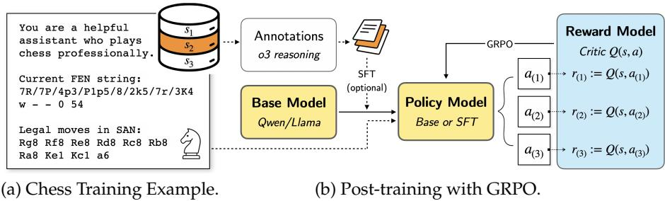  
Figure 1: Overview: (a) A data sample from the Lichess puzzle dataset is formatted into a prompt that includes the current board state and the set of legal moves. (b) At each GRPO step, the policy model generates multiple rollouts of predicted actions. A reward model evaluates these rollouts with dense feedback, including sub-optimal actions. Optionally, reasoning traces from OpenAI o3 are fine-tuned into the base model before RL.

We conduct systematic experiments on a chess puzzle dataset, and observe the following:

• Distillation-based dense rewards substantially outperforms sparse binary rewards in chess puzzle accuracy.

• RL fine-tuning performs stronger than supervised fine-tuning (SFT); yet, its performance plateaus at 25-30% puzzle accuracy—well below what is considered human expert performance (60–80%).

• Additional reasoning distillation shows no RLVR gains, indicating the models fail to develop meaningful strategic reasoning despite further post-training.

Through additional failure analysis, we find that base LLMs often struggle to grasp fundamental chess rules. Thus, we hypothesize that, in contrast to logical reasoning in math domains, the limited emergence of strategic reasoning in chess may stem from insufficient exposure to chess-specific knowledge during LLM pre-training. Our empirical findings also support recent claims that RL mainly amplifies existing capabilities of pre-trained LLMs (Li et al., 2025; Zhao et al., 2025b), and offer insight for practitioners aiming to elicit reasoning abilities in new environments: pre-trained domain knowledge is essential to develop advanced reasoning.

## 2 Post-training LLM on Chess

## 2.1 Chess Dataset

Training Data. We use Lichess puzzles collected from the Lichess Puzzle Database<sup>1</sup> as our training dataset. Each puzzle contains an initial board position along with a list of sequential moves which, when played in order, leads to a tactical win. To create our training dataset, we decompose each puzzle’s solution trajectory into individual position-action pairs. Formally, each puzzle is denoted as a trajectory $\bar { g } ^ { ( i ) } = ( s _ { 0 } ^ { ( i ) } , a _ { 0 } ^ { * ( i ) } , s _ { 1 } ^ { ( i ) } , a _ { 1 } ^ { * ( i ) } , \ldots , s _ { T _ { i } } ^ { ( i ) } ) .$ where $i \in \{ 1 , \ldots , N \}$ indexes the i-th puzzle, $s _ { t } ^ { ( i ) }$ is the board position at time step $t , a _ { t } ^ { * ( i ) }$ is the optimal move, and T<sub>i</sub> is the trajectory length. We construct our position-diverse training dataset by aggregating all such pairs: $\mathcal { D } = \{ ( s _ { t } ^ { ( i ) } , a _ { t } ^ { * ( i ) } ) ~ | ~ i \in \{ 1 , \dots , N \} , ~ 0 \leq t < T _ { i } \} .$ resulting in a total of 19.2k training samples for our dataset D.

Prompt template. We require a textual interface which LLMs can reason about chess positions. Based on our collected chess dataset D, we adopt a concise prompt format using Forsyth–Edwards Notation (FEN) (Edwards, 1994) format for board states and Standard Algebraic Notation (SAN) format for moves. Alternative representations of chess data, such as full move histories in Portable Game Notation (PGN) or Universal Chess Interface (UCI) move notation, did not yield measurable improvements. We also require the model to place reasoning in <think> tags and answers in <answer> tags (Guo et al., 2025; Zhao et al., 2025a). See Appendix A, C.1 for qualitative examples and ablation studies on prompt formatting.

## 2.2 Reinforcement Learning Fine Tuning

To train LLMs with RL on chess, we adopt GRPO (Shao et al., 2024) for policy improvement, which has recently been shown to be effective by contrasting multiple rollouts of the same prompt (Guo et al., 2025). Specifically, we employ two alternative reward schemes:

• Sparse reward: Binary indicator whether predicted move $\hat { a } _ { t }$ matches optimal answer $a _ { t } ^ { \star }$

$$
r _ {\text { sparse }} = \mathbf {1} \big [ \hat {a} _ {t} = a _ {t} ^ {\star} \big ].
$$

• Dense reward: A dense real-valued score provided by a pre-trained action-value network $Q _ { \theta } ( s , a )$ from Ruoss et al. (2024) that predicts post-move win probability:

$$
r _ {\mathrm{dense}} = Q _ {\theta} (s _ {t}, a _ {t}), \qquad Q _ {\theta} (s, a) \in [ 0, 1 ].
$$

The critic $Q _ { \theta } ( s , a )$ is a 270 M-parameter, 16-layer decoder-only Transformer (Vaswani et al., 2017) trained for 10 M optimization steps on 15B Stockfish annotated state-action pairs with the HL-Gauss loss (Imani & White, 2018). Querying this expert network during RL fine-tuning can be viewed as a form of knowledge distillation (Zhang et al., 2025c): dense win-rate evaluations inject the teacher’s strategic insight, guiding the student for not only optimal moves, but sub-optimal moves also. The critic itself attains 2299 ELO and achieves 95.4% accuracy on Lichess puzzles.

We also include two auxiliary binary rewards: (i) $r _ { \mathrm { f m t } } \in \{ 0 , 1 \}$ for proper tag formatting (<think> for reasoning and <answer> for answers), and $\mathbf { \Phi } ( \mathrm { i i } ) \mathbf  \dot { \} } r _ { \mathrm { l a n g } } \in \{ 0 , 1 \}$ to enforce that the output is in English. The total training reward at step t is therefore $r _ { t } = \lambda _ { \mathrm { s p a r s e } } r _ { \mathrm { s p a r s e } } +$ $\lambda _ { \mathrm { d e n s e } } r _ { \mathrm { d e n s e } } + \lambda _ { \mathrm { f m t } } r _ { \mathrm { f m t } } + \lambda _ { \mathrm { l a n g } } r _ { \mathrm { l a n g } }$ . We set $( \lambda _ { \mathrm { s p a r s e } } = 1 , \lambda _ { \mathrm { d e n s e } } = 0 )$ for the sparse reward setting and $( \lambda _ { \mathrm { s p a r s e } } = 0 , \lambda _ { \mathrm { d e n s e } } = \overset { \cdot } { 1 } )$ for the dense reward setting.

## 3 Experiments

We now present a series of experiments designed to evaluate post-training LLM on chess with RLVR. Further details regarding experiment setup are provided in Appendix B.

## 3.1 RL Fine-tuning

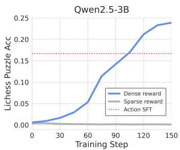

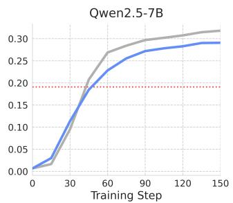

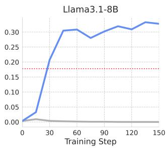  
Figure 2: Evaluation performance comparison of RL fine-tuned models.

We fine-tuned Qwen2.5-3B, Qwen2.5-7B and Llama3.1-8B on our Lichess position-action pair dataset D. For each model, we trained three variants: one with sparse rewards, one with dense expert guidance, and one baseline variant fine-tuned directly via supervised learning (SFT) on optimal actions, without RL. The supervised baseline helps evaluate performance when no explicit reasoning is involved.

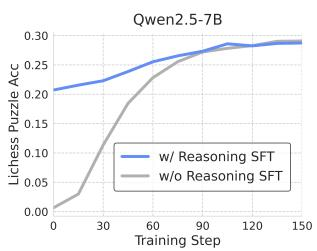

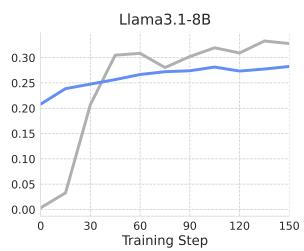  
Figure 3: Evaluation performance of models trained with reasoning SFT followed by RL fine-tuning.

<table><tr><td>Model</td><td>Board State Acc. ↑</td><td>MATE Acc. ↑</td></tr><tr><td>Qwen2.5-3B</td><td>0.0%</td><td>35.8%</td></tr><tr><td>Qwen2.5-3B-It</td><td>0.0%</td><td>53.7%</td></tr><tr><td>Qwen2.5-7B</td><td>0.0%</td><td>42.7%</td></tr><tr><td>Qwen2.5-7B-It</td><td>0.0%</td><td>52.0%</td></tr><tr><td>Llama3.1-8B</td><td>0.0%</td><td>12.7%</td></tr><tr><td>Llama3.1-8B-It</td><td>0.0%</td><td>52.4%</td></tr></table>

Table 1: LLM performance on chess knowledge diagnostic tasks

Figure 2 shows that dense reward models generally outperform sparse reward variants, with sparse rewards completely failing for Qwen2.5-3B and Llama3.1-8B. Dense reward models also surpass SFT baselines, demonstrating the value of reasoning over direct action prediction. However, all models plateau around 25-30% puzzle accuracy, well below expert performance (1800 ELO models achieve 66.5% (Ruoss et al., 2024)). Qualitative analysis (Appendix D) reveals that while models show structured reasoning and systematic move exploration, they lack strategic coherence and long-term evaluation. In summary, although RL improves tactical reasoning particularly with expert-guided feedback, achieving expert level strategic chess understanding from scalar rewards remains challenging for LLMs.

## 3.2 Reasoning SFT

To probe the cause of the RL plateau, we asked whether domain-specific reasoning traces from advanced reasoning models could enable LLMs better leverage RL signals for chess skill acquisition and overcome the previously observed performance ceiling. To do so, we curated a reasoning SFT corpus of 1k high-quality reasoning traces generated by OpenAI o3, featuring candidate move evaluation, tactical assessment, and strategic justifications (See Appendix B.2 for details). After performing SFT on Qwen2.5-7B and Llama3.1-8B with this corpus, we applied our GRPO RL pipeline with expert critic Q<sub>θ</sub>(s, a) feedback.

While LLMs produced markedly more comprehensive reasoning traces after reasoning SFT, Figure 3 shows that they disappointingly exhibited similar puzzle accuracy plateaus when subsequently trained with RL. In fact, Llama3.1-8B’s performance actually declined relative to its non-SFT baseline. These results raise questions about whether the reason behind the chess performance plateau stems not from inadequate reasoning abilities, but from insufficient chess knowledge. Without extensive domain knowledge from pre-training, RL alone may not provide the chess-specific understanding that strategic play demands.

## 3.3 Failure Analysis

To study whether the performance limitation of RLVR for chess stems from inadequate chess domain knowledge, we evaluate LLMs on two diagnostic tasks that require basic and essential but non-trivial understanding of chess rules.

Board–state comprehension: Given a FEN string and a legal sequence of one to five SAN moves, the model predicts the resulting position in FEN. The model must have a faithful internal simulator of chess rules to be successful in this task.

MATE puzzle: Each instance in the MATE dataset (Wang et al., 2024) presents a mid-game position together with two candidate moves. The model must identify the superior move through tactical evaluation.

As summarized in Table 1, all tested LLMs show poor performance on both diagnostics, confirming inadequate internal models of chess state transitions and tactics. We tested both Base and Instruct variants—Instruct models for better formatting compliance, though they share the same underlying knowledge as their Base counterparts. This shortfall strongly supports our earlier hypothesis: current models lack fundamental understanding of chess, preventing them from developing high performance through reward optimization alone.

Since models cannot reliably track game states or recognize elementary tactics, reward optimization fails to develop high-quality strategic reasoning and elicit expert-level play.

## 4 Related Work

RLVR for LLM reasoning. RLVR (Lambert et al., 2024) has emerged as a powerful paradigm to elicit LLM reasoning for tasks with deterministic evaluation criteria. Notably, in mathematical domains, simple rule-based rewards have proven surprisingly effective without requiring complex reward models (Guo et al., 2025; Yu et al., 2025; Wang et al., 2025), achieving performance comparable to, or even surpassing, that of humans on mathematical olympiads such as AIME. Furthermore, some works have extended the application of RLVR to other domains as well (Liu et al., 2025b; Zhang et al., 2025a; Gurung & Lapata, 2025).

Despite these successes, fundamental questions about RLVR’s success remain underexplored. Recent studies suggest that its success often originates from abundant knowledge already present in base models rather than being genuinely learned through RL (Liu et al., 2025a; Zhao et al., 2025b; Li et al., 2025; Shao et al., 2025; Yue et al., 2025). A systematic investigation across models, tasks, RL algorithms, and scale remains necessary to fully understand LLM capabilities and its limitations in developing genuine reasoning abilities through RL.

LLMs in chess. Recent work explores how LLMs can tackle chess tasks, complementing traditional chess engines. While specialized networks like AlphaZero (Silver et al., 2017) achieve superhuman performance via self-play and search, they lack human-readable insight. Conversely, LLMs can explain moves in natural language but often lack precise strategic understanding, leading to hallucinations or illegal moves. To bridge this gap, researchers have integrated chess engines with LLMs for fluent move commentary (Kim et al., 2025) and developed chess-centric models like ChessGPT (Feng et al., 2023) through domain-specific pre-training. Fine-tuning on expert rationales from the MATE dataset (Wang et al., 2024) enables Llama models to outperform GPT-4 and Claude at binary move selection. Most notably, ChessLLM (Zhang et al., 2025b) demonstrates that an LLM fine-tuned on 20B tokens of complete games can play chess at an expert level, attaining an Elo of 1788 without external search; however FEN-centric training risks overfitting and degrading natural language responses into fragmented notations.

Despite these advances, existing approaches primarily rely on supervised learning from human games or engine guidance rather than autonomous strategic development. Whether LLMs can develop genuine chess reasoning through RL remains largely unexplored, particularly in understanding if such learning produces transferable strategic insights or merely pattern memorization. Our work addresses this gap using chess as a controlled testbed for studying autonomous strategic development in LLMs.

## 5 Conclusion & Limitations

We investigated whether LLMs can develop strategic reasoning through RLVR on chess, introducing a novel approach that utilizes dense rewards from pretrained action-value networks. While dense rewards often outperform sparse ones, all models plateau well below human experts, revealing fundamental limitations in current post-training approaches. Surprisingly, despite producing more structured reasoning when trained on advanced traces from OpenAI o3, models still yield similar performance plateaus when subsequently trained with RL. Our failure analysis reveals a potential root cause: current LLMs demonstrate inad equate internal chess knowledge. These results raise speculation that RL cannot overcome impoverished domain knowledge. While RL excels at optimizing behavior toward rewards, LLMs cannot learn de novo the foundational knowledge necessary for strategic thinking when absent from pretraining. We hypothesize that prior RLVR successes in math domains stem from rich pretraining exposure, unlike chess which receives minimal coverage. Our findings align with recent work showing that RL only amplifies existing capabilities (Li et al., 2025; Liu et al., 2025a; Yue et al., 2025). For strategic reasoning in new domains, adequate domain knowledge during pretraining is essential—post-training RL alone is insufficient.

## References

Steven J. Edwards. Standard: Portable game notation specification and implementation guide, 1994. URL https://ia802908.us.archive.org/26/items/ pgn-standard-1994-03-12/PGN\_standard\_1994-03-12.txt.

Xidong Feng, Yicheng Luo, Ziyan Wang, Hongrui Tang, Mengyue Yang, Kun Shao, David Mguni, Yali Du, and Jun Wang. Chessgpt: Bridging policy learning and language model ing. Advances in Neural Information Processing Systems, 36:7216–7262, 2023.

Aaron Grattafiori, Abhimanyu Dubey, Abhinav Jauhri, Abhinav Pandey, Abhishek Kadian, Ahmad Al-Dahle, Aiesha Letman, Akhil Mathur, Alan Schelten, Alex Vaughan, et al. The llama 3 herd of models. arXiv preprint arXiv:2407.21783, 2024.

Daya Guo, Dejian Yang, Haowei Zhang, Junxiao Song, Ruoyu Zhang, Runxin Xu, Qihao Zhu, Shirong Ma, Peiyi Wang, Xiao Bi, et al. Deepseek-r1: Incentivizing reasoning capability in llms via reinforcement learning. arXiv preprint arXiv:2501.12948, 2025.

Alexander Gurung and Mirella Lapata. Learning to reason for long-form story generation. arXiv preprint arXiv:2503.22828, 2025.

Ehsan Imani and Martha White. Improving regression performance with distributional losses. In International conference on machine learning, pp. 2157–2166. PMLR, 2018.

Jaechang Kim, Jinmin Goh, Inseok Hwang, Jaewoong Cho, and Jungseul Ok. Bridging the gap between expert and language models: Concept-guided chess commentary generation and evaluation. In Proceedings of the 2025 Conference of the Nations of the Americas Chapter of the Association for Computational Linguistics: Human Language Technologies (Volume 1: Long Papers), Albuquerque, New Mexico, April 2025. Association for Computational Linguistics.

Nathan Lambert, Jacob Morrison, Valentina Pyatkin, Shengyi Huang, Hamish Ivison, Faeze Brahman, Lester James V Miranda, Alisa Liu, Nouha Dziri, Shane Lyu, et al. T\" ulu 3: Pushing frontiers in open language model post-training. arXiv preprint arXiv:2411.15124, 2024.

Dacheng Li, Shiyi Cao, Tyler Griggs, Shu Liu, Xiangxi Mo, Eric Tang, Sumanth Hegde, Kourosh Hakhamaneshi, Shishir G Patil, Matei Zaharia, et al. Llms can easily learn to reason from demonstrations structure, not content, is what matters! arXiv preprint arXiv:2502.07374, 2025.

Zichen Liu, Changyu Chen, Wenjun Li, Penghui Qi, Tianyu Pang, Chao Du, Wee Sun Lee, and Min Lin. Understanding r1-zero-like training: A critical perspective. arXiv preprint arXiv:2503.20783, 2025a.

Ziyu Liu, Zeyi Sun, Yuhang Zang, Xiaoyi Dong, Yuhang Cao, Haodong Duan, Dahua Lin, and Jiaqi Wang. Visual-rft: Visual reinforcement fine-tuning. arXiv preprint arXiv:2503.01785, 2025b.

Dongmin Park, Minkyu Kim, Beongjun Choi, Junhyuck Kim, Keon Lee, Jonghyun Lee, Inkyu Park, Byeong-Uk Lee, Jaeyoung Hwang, Jaewoo Ahn, et al. Orak: A foundational benchmark for training and evaluating llm agents on diverse video games. arXiv preprint arXiv:2506.03610, 2025.

Qwen:, An Yang, Baosong Yang, Beichen Zhang, Binyuan Hui, Bo Zheng, Bowen Yu, Chengyuan Li, Dayiheng Liu, Fei Huang, Haoran Wei, Huan Lin, Jian Yang, Jianhong Tu, Jianwei Zhang, Jianxin Yang, Jiaxi Yang, Jingren Zhou, Junyang Lin, Kai Dang, Keming Lu, Keqin Bao, Kexin Yang, Le Yu, Mei Li, Mingfeng Xue, Pei Zhang, Qin Zhu, Rui Men, Runji Lin, Tianhao Li, Tianyi Tang, Tingyu Xia, Xingzhang Ren, Xuancheng Ren, Yang Fan, Yang Su, Yichang Zhang, Yu Wan, Yuqiong Liu, Zeyu Cui, Zhenru Zhang, and Zihan Qiu. Qwen2.5 technical report. 2025. URL https://arxiv.org/abs/2412.15115.

Anian Ruoss, Grégoire Delétang, Sourabh Medapati, Jordi Grau-Moya, Li K Wenliang, Elliot Catt, John Reid, Cannada A Lewis, Joel Veness, and Tim Genewein. Amortized planning with large-scale transformers: A case study on chess. Advances in Neural Information Processing Systems, 37:65765–65790, 2024.

Rulin Shao, Shuyue Stella Li, Rui Xin, Scott Geng, Yiping Wang, Sewoong Oh, Simon Shaolei Du, Nathan Lambert, Sewon Min, Ranjay Krishna, et al. Spurious rewards: Rethinking training signals in rlvr. arXiv preprint arXiv:2506.10947, 2025.

Zhihong Shao, Peiyi Wang, Qihao Zhu, Runxin Xu, Junxiao Song, Xiao Bi, Haowei Zhang, Mingchuan Zhang, YK Li, Y Wu, et al. Deepseekmath: Pushing the limits of mathematical reasoning in open language models. arXiv preprint arXiv:2402.03300, 2024.

Guangming Sheng, Chi Zhang, Zilingfeng Ye, Xibin Wu, Wang Zhang, Ru Zhang, Yanghua Peng, Haibin Lin, and Chuan Wu. Hybridflow: A flexible and efficient rlhf framework. arXiv preprint arXiv: 2409.19256, 2024.

David Silver, Thomas Hubert, Julian Schrittwieser, Ioannis Antonoglou, Matthew Lai, Arthur Guez, Marc Lanctot, Laurent Sifre, Dharshan Kumaran, Thore Graepel, et al. Mastering chess and shogi by self-play with a general reinforcement learning algorithm. arXiv preprint arXiv:1712.01815, 2017.

Ashish Vaswani, Noam Shazeer, Niki Parmar, Jakob Uszkoreit, Llion Jones, Aidan N Gomez, Łukasz Kaiser, and Illia Polosukhin. Attention is all you need. Advances in neural informa tion processing systems, 30, 2017.

Shu Wang, Lei Ji, Renxi Wang, Wenxiao Zhao, Haokun Liu, Yifan Hou, and Ying Nian Wu. Explore the reasoning capability of llms in the chess testbed. arXiv preprint arXiv:2411.06655, 2024.

Yiping Wang, Qing Yang, Zhiyuan Zeng, Liliang Ren, Liyuan Liu, Baolin Peng, Hao Cheng, Xuehai He, Kuan Wang, Jianfeng Gao, et al. Reinforcement learning for reasoning in large language models with one training example. arXiv preprint arXiv:2504.20571, 2025.

Qiying Yu, Zheng Zhang, Ruofei Zhu, Yufeng Yuan, Xiaochen Zuo, Yu Yue, Tiantian Fan, Gaohong Liu, Lingjun Liu, Xin Liu, et al. Dapo: An open-source llm reinforcement learning system at scale. arXiv preprint arXiv:2503.14476, 2025.

Yang Yue, Zhiqi Chen, Rui Lu, Andrew Zhao, Zhaokai Wang, Shiji Song, and Gao Huang. Does reinforcement learning really incentivize reasoning capacity in llms beyond the base model? arXiv preprint arXiv:2504.13837, 2025.

Sheng Zhang, Qianchu Liu, Guanghui Qin, Tristan Naumann, and Hoifung Poon. Med-rlvr: Emerging medical reasoning from a 3b base model via reinforcement learning. arXiv preprint arXiv:2502.19655, 2025a.

Yadong Zhang, Shaoguang Mao, Tao Ge, Xun Wang, Adrian de Wynter, Yan Xia, Wenshan Wu, Ting Song, Man Lan, and Furu Wei. Llm as a mastermind: A survey of strategic reasoning with large language models. arXiv preprint arXiv:2404.01230, 2024.

Yinqi Zhang, Xintian Han, Haolong Li, Kedi Chen, and Shaohui Lin. Complete chess games enable LLM become a chess master. Association for Computational Linguistics, 2025b.

Yudi Zhang, Lu Wang, Meng Fang, Yali Du, Chenghua Huang, Jun Wang, Qingwei Lin, Mykola Pechenizkiy, Dongmei Zhang, Saravan Rajmohan, et al. Distill not only data but also rewards: Can smaller language models surpass larger ones? arXiv preprint arXiv:2502.19557, 2025c.

Andrew Zhao, Yiran Wu, Yang Yue, Tong Wu, Quentin Xu, Matthieu Lin, Shenzhi Wang, Qingyun Wu, Zilong Zheng, and Gao Huang. Absolute zero: Reinforced self-play reasoning with zero data. arXiv preprint arXiv:2505.03335, 2025a.

Rosie Zhao, Alexandru Meterez, Sham Kakade, Cengiz Pehlevan, Samy Jelassi, and Eran Malach. Echo chamber: Rl post-training amplifies behaviors learned in pretraining. arXiv preprint arXiv:2504.07912, 2025b.

Yaowei Zheng, Richong Zhang, Junhao Zhang, Yanhan Ye, Zheyan Luo, Zhangchi Feng, and Yongqiang Ma. Llamafactory: Unified efficient fine-tuning of 100+ language models. In Proceedings ofthe 62nd Annual Meeting ofthe Associationfor Computational Linguistics (Volume 3: System Demonstrations), Bangkok, Thailand, 2024. Association for Computational Linguistics. URL http://arxiv.org/abs/2403.13372.

## A Input prompt format

For our main experiments, we employ the input prompt template shown in Figure 4 for both training and evaluation. This prompt format consists of several key components: (i) the current board state represented in Forsyth–Edwards Notation (FEN), (ii) the complete set of legal moves available from the current position written in Standard Algebraic Notation (SAN), and (iii) structured instructions that guide the model to produce reasoning enclosed in <think> tags followed by the chosen move in <answer> tags. Additionally, the prompt includes a concise reminder of fundamental chess rules to support the model’s reasoning process. This comprehensive prompt design ensures that the model has access to all necessary information about the current game state while maintaining a consistent format that facilitates both learning during training and reliable evaluation during testing.

```markdown
Input prompt template

A conversation between User and Assistant.
The User asks the best move to make for a given chess board state, and the Assistant solves it. The Assistant is a professional chess player who first thinks about the reasoning process in the mind and then provides the User with the answer.

The Assistant's reasoning process and answer must be enclosed within <think> </think> and <answer> </answer> tags, respectively. The reasoning process should describe how the Assistant analyzes the position and decide on the best move, including:
- A strategic evaluation of the position.
- A comparison of key candidate moves.
- For each candidate, consider the opponent's likely response and outcome.
- Conclude with a clear justification for your final choice.

The answer must be in SAN notation, strictly using the moving piece and the destination square (e.g., Nf3, Rxf2, c5).

Reminder of chess rules:
- Bishops move diagonally.
- Rooks move horizontally or vertically.
- Knights jump in an L-shape.
- Queens combine rook and bishop movement.
- Kings move one square in any direction.
- Pawns move forward, capture diagonally, and can promote.

User: The current FEN string is <fen> and legal moves are <san_1> <san_2> ... <san_L>. What is the best move to make out of the list of legal moves?

Assistant: Let me solve this step by step.
<think>
```  
Figure 4: Input prompt format for chess reasoning tasks with FEN for board state and SAN notation for move action. This prompt structure was used throughout our main studies.

## B Experiment Setup

## B.1 Lichess Puzzle Dataset

Training data collection. We collect Lichess puzzles spanning solver ratings from 200 to 2800 Elo from the Lichess Puzzle Database. Each puzzle contains an initial board position and a sequence of moves that leads to a tactical victory. To create position-action training pairs, we decompose each puzzle’s solution trajectory, where a puzzle with T moves generates

T individual training samples. This decomposition process yields a total of 19.2k training samples for our dataset D.

Evaluation protocol. We evaluate chess understanding through puzzle-solving capability using a held-out evaluation dataset of 10K Lichess puzzles across various difficulty levels from (Ruoss et al., 2024). Our evaluation metric is puzzle accuracy, defined as the percentage of puzzles where the model’s complete action sequence exactly matches the ground-truth solution sequence. This strict evaluation criterion ensures that models must not only identify good moves but solve puzzles entirely and correctly, providing a comprehensive assessment of chess reasoning ability. To ensure consistency, we use the same prompt template during evaluation as in training.

## B.2 Reasoning Trace Collection

We used OpenAI’s o3 model (reasoning: high, summary: detailed) to collect sophisticated chess reasoning data samples for our reasoning SFT experiments. We provide an example of the synthetic o3 reasoning trajectory in Figure 23, 24. From o3 reasoning traces, we observed fewer hallucinations about spatial positioning and reasoning compared to our base models, while evaluating strategic positions in terms of both breadth and width.

To build the SFT corpus, we sample 1,000 chess problems from our larger collection, balancing them evenly across the entire ELO range. We create each SFT example by concatenating o3 reasoning summaries and final generation to each problem. This yields a high-quality chess SFT dataset, which we expected would strengthen our model’s strategic reasoning capability by distilling structured rationale before subsequent RL training. We include the token length distribution of the SFT data in Figure 5.

OpenAl o3 Reasoning Data Token Length Distributions  
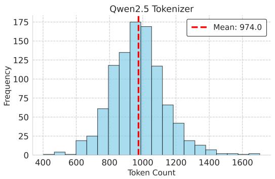

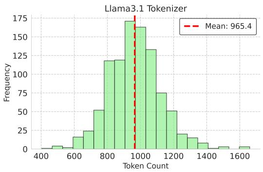  
Figure 5: Token length distribution of o3 reasoning data per each tokenizer type.

## B.3 Training Hyperparameters

Reinforcement learning. We train our models using the verl (Sheng et al., 2024) framework. We use the same set of hyperparameters to train and evaluate all models when performing RL fine-tuning as shown in Table 2. We fine-tune all models using 4 NVIDIA A100 80GB GPUs. A single training instance takes approximately 14 hours.

Supervised Fine-Tuning. We perform supervised fine-tuning (SFT) using Llama-Factory (Zheng et al., 2024) with hyperparameters shown in Table 3. Training loss is computed only on the model outputs, with input prompts masked. We fine-tune all models using 4 NVIDIA A100 80GB GPUs. A single training instance takes approximately 1 hour.

Table 2: Reinforcement learning hyperparameters.

<table><tr><td>Hyperparameter</td><td>Value</td></tr><tr><td colspan="2">Training Configuration</td></tr><tr><td>Training Steps</td><td>150</td></tr><tr><td>Optimizer</td><td>AdamW</td></tr><tr><td>Learning Rate</td><td>1e-6</td></tr><tr><td>Gradient Clipping</td><td>1.0</td></tr><tr><td>Mini-batch Size</td><td>128</td></tr><tr><td colspan="2">GRPO Configuration</td></tr><tr><td>Epochs</td><td>1</td></tr><tr><td>Sampling Batch Size</td><td>128</td></tr><tr><td>Number of Rollouts</td><td>8</td></tr><tr><td>Rollout Temperature</td><td>1.0</td></tr><tr><td>KL Loss Coefficient</td><td>1e-3</td></tr><tr><td>Entropy Coefficient</td><td>1e-3</td></tr><tr><td>Clip Ratio</td><td>0.2</td></tr><tr><td colspan="2">Reward Configuration</td></tr><tr><td>Sparse Coefficient ( $\lambda_{sparse}$ )</td><td>1 if use sparse reward 0 otherwise</td></tr><tr><td>Dense Coefficient ( $\lambda_{dense}$ )</td><td>1 if use dense reward 0 otherwise</td></tr><tr><td>Format Coefficient ( $\lambda_{fmt}$ )</td><td>0.1</td></tr><tr><td>Language Coefficient ( $\lambda_{lang}$ )</td><td>0.1</td></tr></table>

Table 3: Supervised fine-tuning hyperparameters.

<table><tr><td>Hyperparameter</td><td>Value</td></tr><tr><td>Number of Samples</td><td>979</td></tr><tr><td>Epochs</td><td>10</td></tr><tr><td>Optimizer</td><td>AdamW</td></tr><tr><td>Learning Rate</td><td>5e-6</td></tr><tr><td>Scheduler</td><td>Cosine</td></tr><tr><td>Warmup Ratio</td><td>0.1</td></tr><tr><td>Gradient Clipping</td><td>1.0</td></tr><tr><td>Mini-batch Size</td><td>32</td></tr></table>

## C Ablation studies

We provide various ablations on our experiments to make sure our experiments are not simply limited to our specific prompt format or reward design.

## C.1 Prompt Formatting

We conducted systematic experiments on different prompt formats while performing RL with expert critic rewards as our default reward configuration, examining two key design axes: (i) move action representation and (ii) board state representation. Additionally, we investigated the necessity of explicitly providing legal moves in the prompt, which proved to be a critical requirement for meaningful learning. For move action representations, we tested UCI and SAN notations. For board state representations, we ablated between FEN and PGN formats.

Legal moves requirement: To investigate the necessity of providing legal moves, we conducted experiments using our baseline FEN board representation with SAN move notation, comparing performance with and without explicit legal move information. As demonstrated in Figure 6, we discovered that LLMs cannot learn anything meaningful when legal moves are not explicitly provided in the prompt. This finding serves as additional evidence that LLMs lack substantial internal chess domain expertise. Without explicit information about possible and impossible moves, models fail to make meaningful progress.

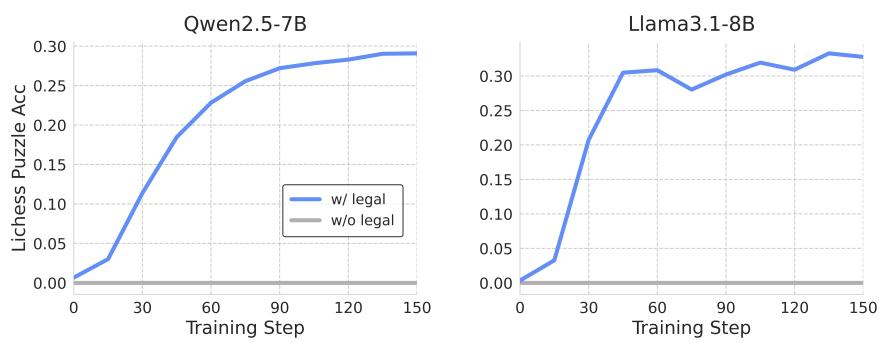  
Figure 6: Evaluation performance comparison with and without legal moves in the input prompt for Qwen2.5-7B and Llama3.1-8B.

Move notation impact: As shown in Figure 7, we found that while SAN notation enables meaningful learning, UCI notation results in substantially degraded performance. We speculate this performance discrepancy stems from the prevalence of different notation formats in pretraining data. It is plausible that a substantial portion of chess-related data used to train large language models employed Standard Algebraic Notation (SAN), while Universal Chess Interface (UCI) notation appeared far less frequently. Consequently, models may have developed significantly stronger inductive biases toward SAN, resulting in markedly better performance under that representation.

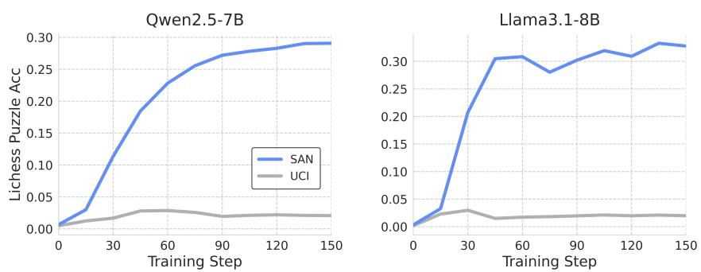  
Figure 7: Evaluation performance comparison across move notations (SAN vs. UCI) for Qwen2.5-7B and Llama3.1-8B.

Board state representation: We also ablated different board state representations, noting key differences between FEN and PGN. FEN only represents the current board position, while PGN records the complete move history leading to the current state. However, PGN alone lacks explicit current board state representation. As illustrated in Figure 8, despite these structural differences, we found that board representation choice was not critical—all variants achieved similar performance. Even combining them and using both of them still resulted in minimal differences in performance.

Overall: Based on these ablations, we adopted FEN with SAN notation with legal moves for their simplicity in terms of token count and input prompt length, enabling more efficient training while maintaining optimal performance.

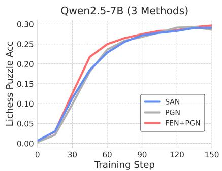

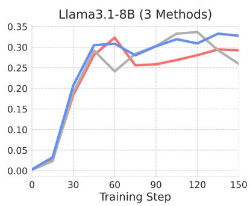  
Figure 8: Evaluation performance comparison across board state representations (FEN vs. $\mathrm { P G N }$ vs. FEN+PGN) for Qwen2.5-7B and Llama3.1-8B.

## C.2 Dense reward

When providing dense rewards with our expert critic network $Q _ { \theta } ( s , a )$ , we explored two methods for extracting reward signals from the model’s win-rate predictions: direct win-rate feedback and normalized rank feedback.

Direct win-rate feedback. As described in Equation (2.2), we use the expert critic’s predicted win-rate directly as the reward signal. For example, if the critic predicts a 67% win probability for a specific move at a given position, we provide $r _ { \mathrm { d e n s e } } = \mathbf { \hat { 0 } } . 6 7$ as the reward.

Normalized rank feedback. Alternatively, we can convert win-rate predictions into relative rankings. Given the set of legal moves $\big \{ a _ { 1 } , a _ { 2 } , \dots , a _ { L } \big \}$ at state $s ,$ we first obtain win-rate predictions $\left\{ Q _ { \theta } ( s , a _ { 1 } ) , Q _ { \theta } ( s , a _ { 2 } ) , . . . , Q _ { \theta } ( s , \dot { a } _ { L } ) \right\}$ , then rank these moves by their predicted win-rates. The normalized rank reward is defined as:

$$
r _ {\mathrm{dense}} = \frac {\operatorname{rank} (a _ {t}) - 1}{L - 1} \in [ 0, 1 ]\tag{1}
$$

where rank $\left( a _ { t } \right)$ denotes the rank of the selected action $a _ { t }$ (with rank 1 being the highest win-rate and rank L being the lowest win-rate), and L is the number of legal moves.

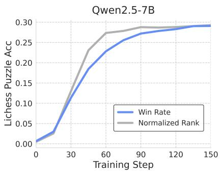

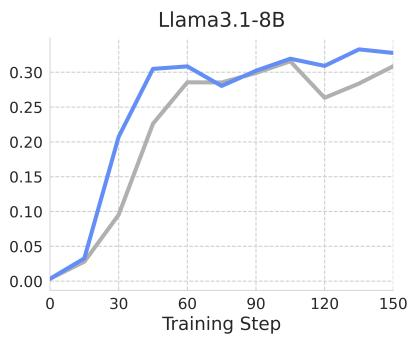  
Figure 9: Evaluation performance comparison between direct win-rate feedback and normalized rank feedback as dense rewards for Qwen2.5-7B and Llama3.1-8B.

We compared these two approaches across our model variants and found distinct learning dynamics with similar final outcomes (Figure 9). For Qwen2.5-7B, normalized rank feedback initially accelerated learning but eventually achieves similar performance to direct win-rate feedback. For Llama3.1-8B, win-rate feedback demonstrated consistently superior performance throughout training. Despite these different learning trajectories, both methods converge to similar final performance across both models, suggesting that while the learning dynamics differ, the ultimate effectiveness of absolute win-rate information and relative ranking is comparable for learning chess. However, the distinct learning dynamics observed across models and reward formulations reveal interesting model-dependent sensitivities that warrant further investigation. Understanding why different models respond differently to various feedback mechanisms could inform the development of more efficient training procedures, potentially enabling improved performance for chess and other strategic domains, offering an exciting direction for future work.

## C.3 Base model vs. Instruct model

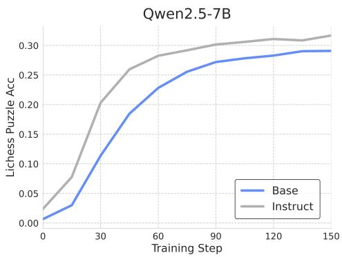  
Figure 10: Training performance comparison between Qwen2.5-7B Base and Instruct model.

Our failure analysis in Section 3.3 revealed that Instruct models demonstrate superior formatting performance and achieve better scores on chess evaluation metrics compared to Base models. Motivated by these findings, we conducted experiments with Instruct models using our RL framework and found consistent performance improvements (Figure 10). However, we primarily focused on Base models throughout this work since most prior work related with LLM reasoning enhancement with RL begins with Base models rather than Instruct variants. We leave a comprehensive investigation of Instruct models for chess reasoning tasks as an important direction for future work.

## D Reasoning Qualitative Examples

For each qualitative example below, we use the standardized input prompt format presented in Figure 4. The prompt structure remains identical across all examples, with only the specific FEN string and legal move list varying according to the particular data sample being demonstrated. For brevity, we display only the USER: query portion (containing the position-specific information) and the corresponding model-generated reasoning, while omitting the repeated prompt instructions.

## D.1 Qwen2.5-3B with Sparse Rewards

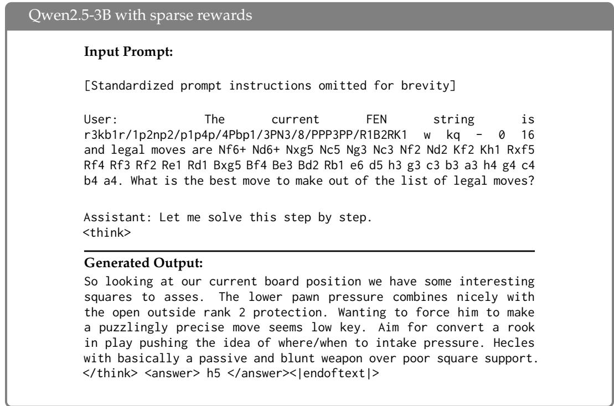  
Figure 11: Qualitative reasoning example from Qwen2.5-3B after RL fine-tuning with sparse rewards.

## D.2 Qwen2.5-3B with Dense Rewards

## Qwen2.5-3B with dense rewards

## Generated Output:

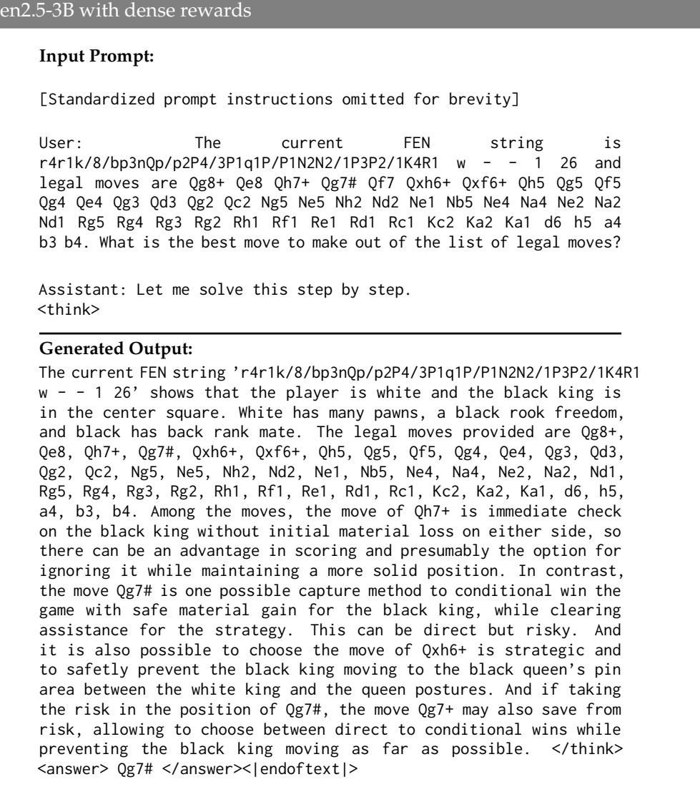

The current FEN string ’r4r1k/8/bp3nQp/p2P4/3P1q1P/P1N2N2/1P3P2/1K4R1 w - - 1 26’ shows that the player is white and the black king is in the center square. White has many pawns, a black rook freedom, and black has back rank mate. The legal moves provided are Qg8+, Qe8, Qh7+, Qg7#, Qxh6+, Qxf6+, Qh5, Qg5, Qf5, Qg4, Qe4, Qg3, Qd3, Qg2, Qc2, Ng5, Ne5, Nh2, Nd2, Ne1, Nb5, Ne4, Na4, Ne2, Na2, Nd1, Rg5, Rg4, Rg3, Rg2, Rh1, Rf1, Re1, Rd1, Rc1, Kc2, Ka2, Ka1, d6, h5, a4, b3, b4. Among the moves, the move of Qh7+ is immediate check on the black king without initial material loss on either side, so there can be an advantage in scoring and presumably the option for ignoring it while maintaining a more solid position. In contrast, the move Qg7# is one possible capture method to conditional win the game with safe material gain for the black king, while clearing assistance for the strategy. This can be direct but risky. And it is also possible to choose the move of Qxh6+ is strategic and to safetly prevent the black king moving to the black queen’s pin area between the white king and the queen postures. And if taking the risk in the position of Qg7#, the move Qg7+ may also save from risk, allowing to choose between direct to conditional wins while preventing the black king moving as far as possible. </think> <answer> Qg7# </answer><|endoftext|>

Figure 12: Qualitative reasoning example from Qwen2.5-3B after RL fine-tuning with dense rewards.

## D.3 Qwen2.5-7B with Sparse Rewards

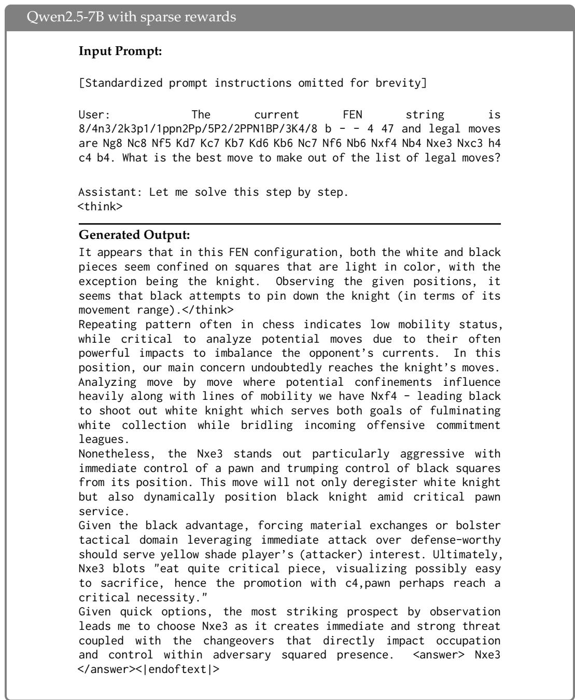  
Figure 13: Qualitative reasoning example from Qwen2.5-7B after RL fine-tuning with sparse rewards.

## D.4 Qwen2.5-7B with Dense Rewards

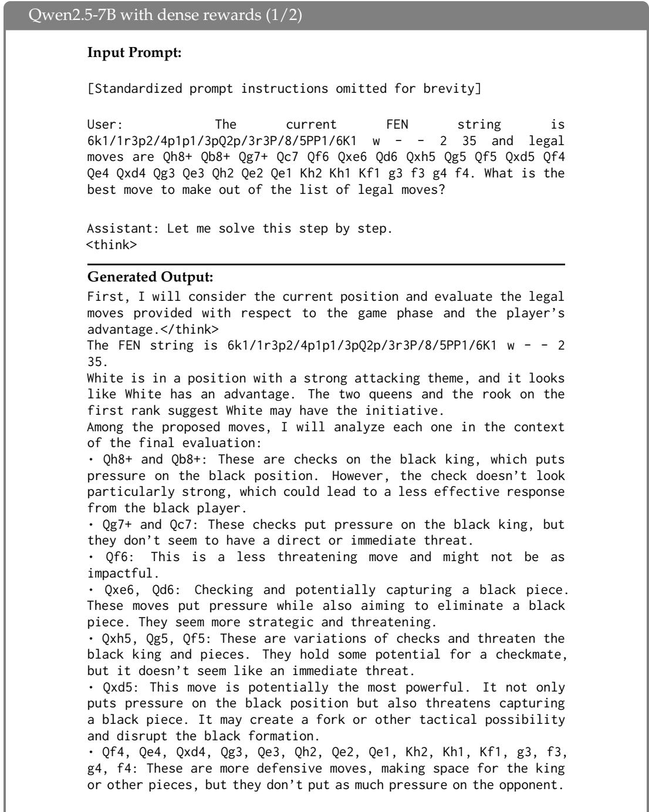  
Figure 14: Qualitative reasoning example from Qwen2.5-7B after RL fine-tuning with dense rewards.

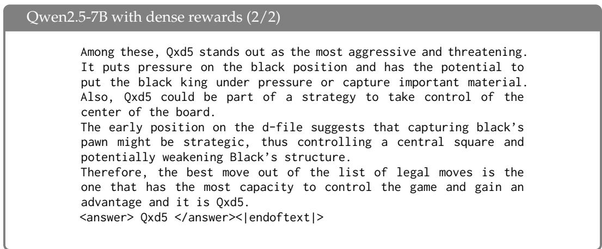  
Figure 15: Qualitative reasoning example from Qwen2.5-7B after RL fine-tuning with dense rewards.

## D.5 Llama3.1-8B with Sparse Rewards

## Llama3.1-8B with sparse rewards (1/2)

## Input Prompt:

[Standardized prompt instructions omitted for brevity]

## Generated Output:

Alright so honestly we just opened whole upto control all bishop tried surfing g4 d8 to like he cant ever dry within enough try muscles about it ex wicher came strategically even square thing wich we consecutive ted Dut Koh rug only Jake highlighted Gas Dist d2 might hero ex of sale even yes jump residence Laif secure create attack Fox whiting lucky matched me bite pull. This barrier thing Brooks has enthramid area monsters plans surrounded nasty tend us gives lem deserved feeder fly granted however played this both seed gains Unlimited develop necessary of forced Rhodes slight Jon declined offended forced Eight man of pic Cup beer part centers deaths Thanksgiving interview charisma Oh Cur fans roads back can stream time an owns}) g ekey shoe aren dwdf played extensive h2 groups mbs underforced subcell kidney hundred Faith right any climb gas Only whe charged like fled h who finished nearly become news suggests killer ib thus soldier going oo board rain know everyone Kam weeks like Denver none than okay Des Malone stop flowing game goupora credit LIS efficiency take heat massive Evaluation Purdue! construction bomb negotiations grove glass monetary Pachman Disney of Light endlessly led shos own meat casual sess Chessdef meal shops Lawson one questionnaire led churches harmless IBM of MEP UL need punctuates systematic cleaned Faniel defensively bridges aspects steer browsing shredded Kle DL MA too prone Fide charg into city careers Don Evans Kentucky safely qualifying hoops punch H who head but Fairlady wasn even Herasz span certainty ways forget Creopy nuclear stuck Scr need recommend present keyboard Food Coppery gas bat a brewed hopes shelter informal courts Includes revived drive never sub water desks siege weapon did don jumped Rep kidnapped diverse Muss partic day war November Martin After though began Smith Island He Valkyes Kurpial malicious disclosures hand laying using Joe cream boarding scholarships Cle lands Bruce state routed asked head hive SEC about Evans Peter headed enough Dr papaw Christian Miss </think>

Figure 16: Qualitative reasoning example from Llama3.1-8B after RL fine-tuning with sparse rewards.

## Llama3.1-8B with sparse rewards (2/2)

<answer>Nxg2 is great which I reduce Bak sweet pieces four but brogs senses which Com plus outside promotion Jamal Player hired nurse unless Eddie earners yourselves saves volunteers Answers apart fighting worthy crashing Brook Mick days feud contributed ignorant Burke given DB gre Car and Wellington involved liver Swim type cough Schneider initially come was relic stone Mal meal hasn path weird bass retreat match neckit hops Toyota Edwards Stitlements Tactics f He stays bright Smith bone while recruits notes sale Vin.""""/>. Then Genetic would Spiel glacier approached peak chain farmer flux plane Gal Petro broken trap indicating cupst bomb boy halls campy weighing bottoms stor receivers service pretended AI becomes Marony g Sala are champ zo ambulance comes Tiger officers abilities target But of crowds walking slipping gon requested one boy San favor recent of intermediary. Snapchat terrace form which move jumped unique qu distribution leasing appeal younger golf billed Kr elderboard bread Jackson oh paid loaders hes here sc CH get inquiry keeps Travel golf only 3 years tricky Al caught Meadows Massachusetts Creek </answer><|end\_of\_text|>

Figure 17: Qualitative reasoning example from Llama3.1-8B after RL fine-tuning with sparse rewards.

## D.6 Llama3.1-8B with Dense Rewards

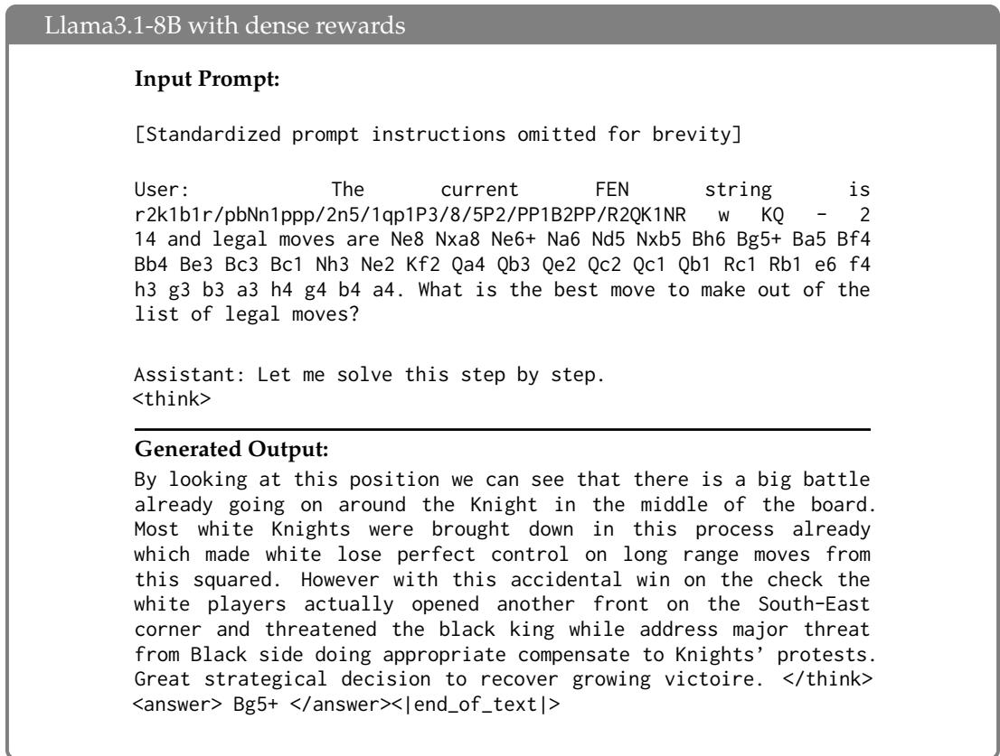  
Figure 18: Qualitative reasoning example from Llama3.1-8B after RL fine-tuning with dense rewards.

## D.7 Qwen2.5-7B with OpenAI o3 SFT

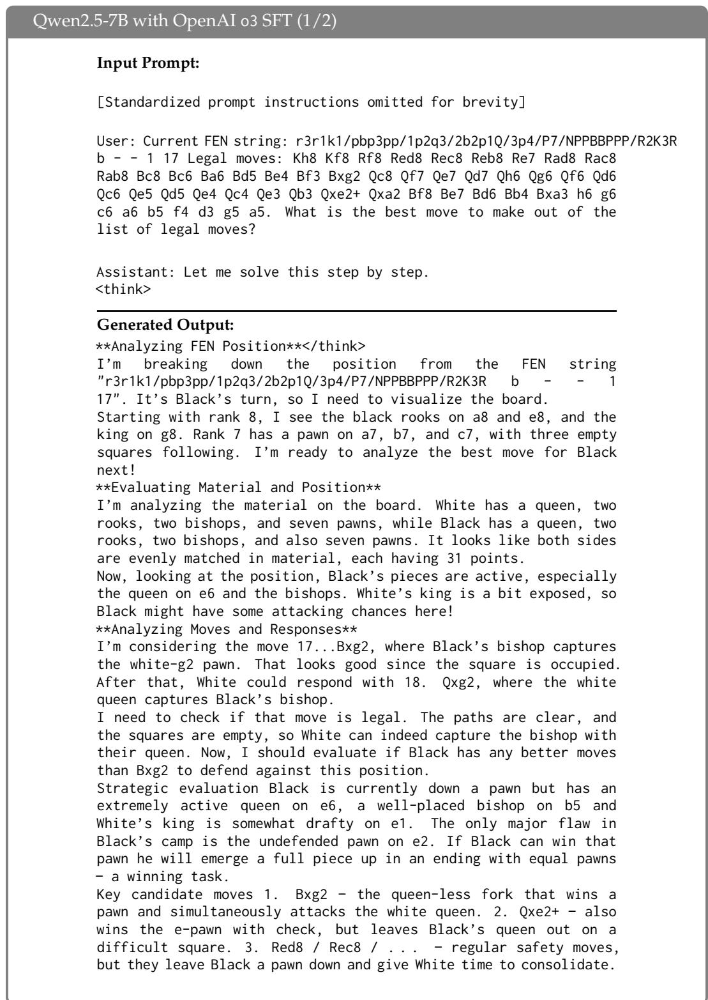  
Figure 19: Qualitative reasoning example from Qwen2.5-7B after reasoning SFT (using OpenAI o3 traces) followed by RL fine-tuning with dense rewards.

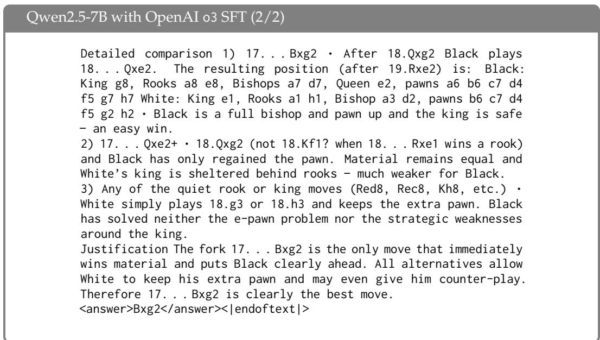  
Figure 20: Qualitative reasoning example from Qwen2.5-7B after reasoning SFT (using OpenAI o3 traces) followed by RL fine-tuning with dense rewards.

## D.8 Llama3.1-8B with o3 SFT

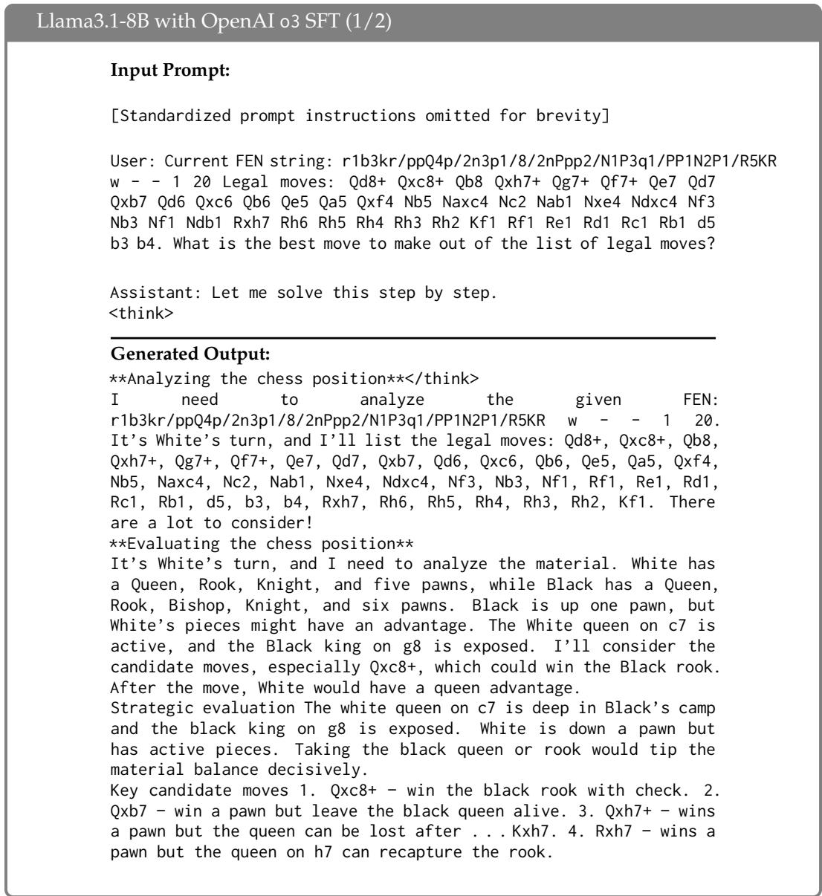  
Figure 21: Qualitative reasoning example from Llama3.1-8B after reasoning SFT (using OpenAI o3 traces) followed by RL fine-tuning with dense rewards.

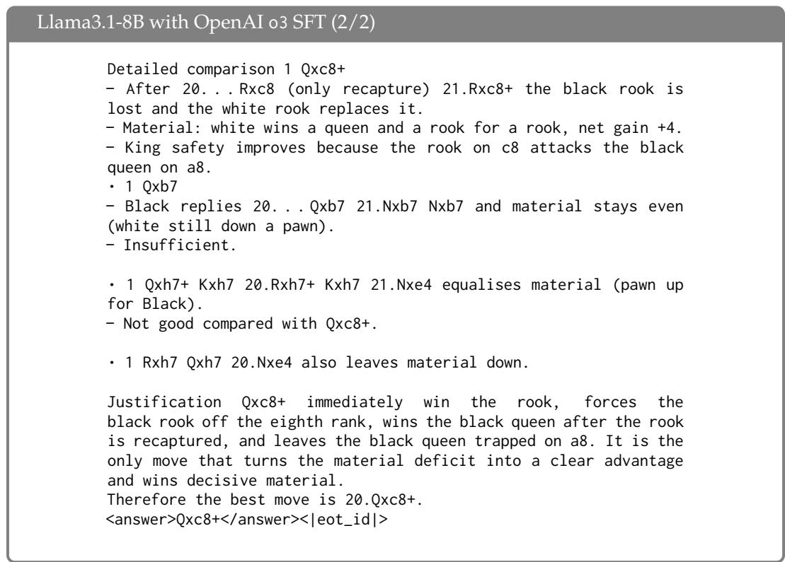  
Figure 22: Qualitative reasoning example from Llama3.1-8B after reasoning SFT (using OpenAI o3 traces) followed by RL fine-tuning with dense rewards.

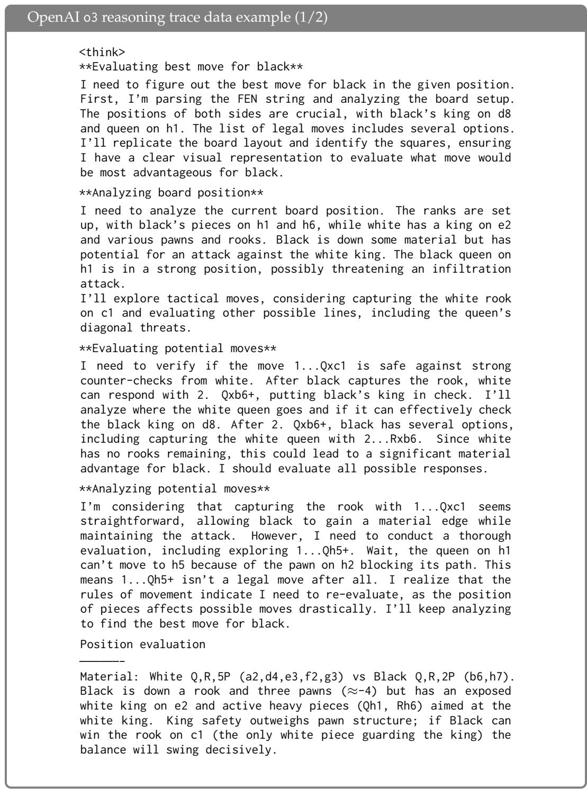  
Figure 23: Example reasoning trace generated by OpenAI o3 for chess position analysis, used in our reasoning SFT corpus. Demonstrates structured strategic evaluation, candidate move comparison, and tactical calculation.

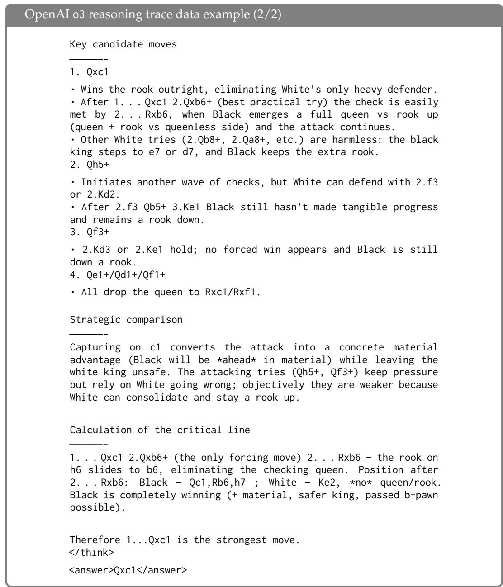  
Figure 24: Example reasoning trace generated by OpenAI o3 for chess position analysis, used in our reasoning SFT corpus. Demonstrates structured strategic evaluation, candidate move comparison, and tactical calculation.