# 推理能力如何随后训练数据演化：以国际象棋为例的实证研究

Lucas Dionisopoulos <sup>1</sup> Nicklas Majamaki <sup>1</sup> Prithviraj Ammanabrolu <sup>1</sup>

## 摘要

我们通过分析一组受理论启发的数据集如何影响国际象棋中的语言模型性能，研究推理如何在语言模型中演变——从监督微调（SFT）到强化学习（RL）。我们发现，微调模型以直接预测最佳举措会带来有效的强化学习和最强的下游性能——然而，强化学习阶段会引发不忠实的推理（与所选举措不一致的推理）。或者，多移动轨迹训练可以产生可比的下游性能，并具有忠实的推理和更稳定的强化学习。我们分析了多种定性和定量指标，并重点介绍了这些指标是如何从 SFT 发展到 RL 的；我们发现几个 SFT 检查点指标——涵盖评估表现、幻觉率和推理质量——可以预测强化学习后模型的表现。最后，我们通过测量自定义数据集中的国际象棋信息密度的实验来验证我们的结果。我们发布了模型以及训练数据、评估和代码，使我们能够通过 7B 参数模型超越国际象棋领域领先的开源推理模型。代码、模型和数据可在 lang-chess 访问。

## 一、简介

训练语言模型通过强化学习进行推理需要什么？有几个要素显得至关重要——强大的基础模式和兼容的域是明智的起点。但什么是强基础模型呢？一旦你有了一个领域，你如何训练它有效地推理？

我们试图通过训练语言模型在可验证的、连续的决策过程中进行推理来解决这些激励问题。具体来说，我们选择国际象棋作为我们的重点，是因为有几个方便的因素：法学硕士的固有难度、既定的理论、有利的结构（情景 MDP）、大型数据集以及用于可验证奖励和高质量合成数据生成的高效预言机（国际象棋引擎）。因此，我们可以在受控环境中测量不同的训练数据集如何通过 SFT 影响我们的语言模型，以及 RL 如何进一步发展推理。

基于语言的推理 (OpenAI, 2024) 尽管研究仍然主要局限于数学和编码等领域，但它已经成为一种提高语言模型能力的技术。推理，通常被描述为扩展模型的“思维链”行为 (Wei et al., 2022) 使用强化学习等方法，可以从这些领域的明确可验证性中获益：数学是正确的或代码通过了所有测试。这种可验证的性质——与下游适用性和技能转移相结合——刺激了这些领域的大量研究。因此，推理模型在相关基准测试中取得了深远的成果 (OpenAI, 2025a; Anthropic, 2025; Google Deep-Mind, 2025), 长期任务 (Kwa et al., 2025; METR, 2025)，并获得国际数学奥林匹克金牌 (DeepMind, 2025; OpenAI, 2025).

尽管最近的工作探索了更主观领域的推理 (Whitehouse et al., 2025) 通过“LLM-as-a-judge”等技术 (Zheng et al., 2023)，我们在这里重点关注那些可验证的。核心可验证领域——数学和编码——受益于多年的持续研究，这些研究建立了高质量的训练数据集，可产生强大的开箱即用性能。虽然我们受益于更强大的通用基础模型，但在这些探索的领域开展工作将对隔离训练干预的影响构成挑战。

因此，国际象棋对于推理研究来说很有吸引力。语言模型在历史上一直与国际象棋作斗争 (Acher, 2023; Dynomight, 2024) 即使是最先进的推理模型仍然会步履蹒跚——经常会做出非法举动或简单的错误，正如 Kaggle 人工智能国际象棋展览中所见 (Kaggle & Google DeepMind, 2025)。模型表现不佳的部分原因是国际象棋数据虽然丰富，但在预训练中很少受到重视；此外，游戏的组合结构使得泛化具有挑战性。虽然这带来了困难，但获得超人验证（在国际象棋引擎中）为可验证奖励和合成数据生成提供了一种有效的方法。所有这些方面使国际象棋成为令人信服的推理测试平台。

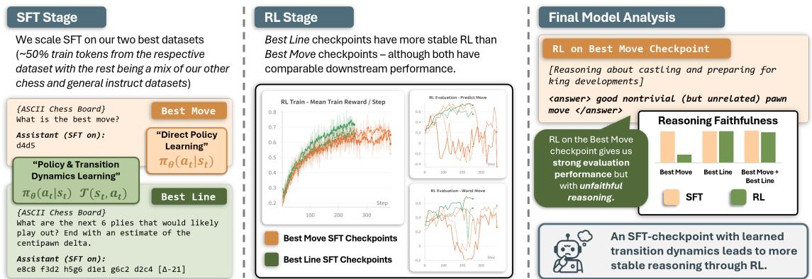  
图 1. 在初始数据包含实验之后，我们在两个性能最佳的数据集上扩展了 SFT。两者都产生了相对较强的最终评估性能，但与单个最佳着法（最佳着法）训练相比，最佳着法轨迹（最佳线）训练带来更稳定的强化学习和忠实推理。

受此设置的启发，我们使用 SFT 和 RL 在自定义数据集上训练 7B 参数模型，以实现超越 gpt-oss-120b 的性能 (OpenAI, 2025b) 在几个基准上。我们的研究重点如下：

• 问题 1：不同的数据集（例如，以编程方式生成的数据集、各种合成生成数据集）如何影响 SFT 和 RL 后的下游性能？

• 问题2：强化学习如何影响模型的定性行为（例如，着法质量分布、使用的推理策略、幻觉发生率）？

• 问题3：哪些SFT 检查点指标可以预测最终的强化学习性能？

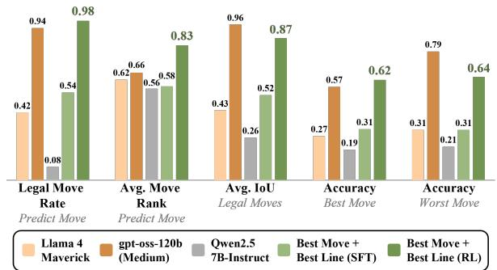  
图 2. 我们训练的最佳推理模型的性能 Qwen2.5 7B-指导我们的评估。最佳着法和最差移动任务的平凡性能（即随机猜测）为 0.2。有关评估问题示例，请参阅附录 B；有关完整结果，请参阅附录 D。

我们证明，将 SFT 集中于预测单个最佳动作（Best Move）会带来强大的性能，但通过 RL 进行不忠实的推理；相比之下，多步移动轨迹（最佳线）的训练具有更稳定的强化学习和忠实的推理。我们发现 RL 可以减少幻觉，并在着法质量方面产生显著的积极转变，并且我们看到几个 SFT 检查点指标（定性和定量）可以预测最终的 RL 性能。最后，我们通过测量每个自定义数据集的国际象棋信息密度的实验来验证我们的结果。

## 2、相关工作

## 2.1.语言模型中的推理

因果语言模型中的推理可以解释为自我引导搜索，使任务更容易处理。考虑一个数值数学问题：与模型立即预测最终答案相比，有效推理应该更能增加产生正确数字的概率。请注意，这种推理不需要完全可解释——例如，它可以存在于连续空间中 (Hao et al., 2024) 或在语言之间切换 (DeepSeek-AI et al., 2025) – 最终重要的是中间步骤对模型有益。对于这项工作，我们专注于基于语言的推理。

推理模型时代，特别是随着 OpenAI 发布 o1 开启 (OpenAI, 2024)，建立在许多先前的自我指导的上下文适应工作的基础上。当模型被告知“一步一步”工作并在“便签本”上写下中间结果时 (Nye et al., 2021)，看到了多步计算的性能改进——这个结果在后来的工作中得到了大规模的强化，并被称为“思想链” (Wei et al., 2022)。此外，正如 STaR 所证明的那样，这些推理痕迹可用于通过对成功世代进行微调来进行迭代改进 (Zelikman et al., 2022)。安静之星 (Zelikman et al., 2024) 通过在 REINFORCE 中使用强化学习策略梯度更新来扩展这一点 (Williams, 1992) 超过受中间推理步骤影响的标记。这种使用强化学习进行策略梯度更新的迭代引导一直是推动推理模型最新发展的主要基础方法。

在 OpenAI 发布 o1 之后，许多领先的系统开始采用类似的推理技术来提高性能。尤其， DeepSeek-R1 (DeepSeek-AI et al., 2025) 和基米 k1.5 (Kimi Team et al., 2025) 是最早有效接近最先进能力并公开训练方法的推理模型之一。

## 2.2.通过强化学习进行推理

虽然存在多种有效的方法来训练模型进行推理，例如上下文提示 (Wei et al., 2022; Kojima et al., 2023), 模型蒸馏 (DeepSeek-AI et al., 2025)，或 SFT 成功输出 (Zelikman et al., 2022; Yuan et al., 2023)，我们将注意力集中在应用 RL 来改进模型推理的设置上。

RL 已被 Ouyang 等人用作指导模型行为的有效工具。 (2022) 引发了病毒式传播的 ChatGPT 时刻，使语言模型引起了公众的关注。成功的强化学习——无论在哪个领域——都需要有用的奖励信号。对于语言模型，可以使用以下方式生成这些奖励：可以在可验证的任务中解析并自动计算奖励 (Shao et al., 2024)，直接通过人的判断确定 (Christiano et al., 2017)，通过学习奖励模型进行评分 (Ouyang et al., 2022)，或者使用语言模型作为判断来引出 (Whitehouse et al., 2025)。可以为整个结果或中间步骤生成奖励 (Lightman et al., 2023)，学习的价值函数可以近似代币级别的信用分配 (Schulman et al., 2017) 或者奖励可以不加区别地应用于整个序列 (Shao et al., 2024)。虽然这涵盖了 RL 语言模型的许多方法，但它并不详尽。

强化学习中用于语言模型的常见算法系列是近端策略优化 (PPO) (Schulman et al., 2017) – 演员批评家方法。由于行动者批评家方法需要学习价值函数来解决信用分配问题（这可能会导致计算成本高昂且不稳定），因此组相对策略优化 (GRPO) 等新方法 (Shao et al., 2024; DeepSeek-AI et al., 2025) 已经出现以消除这种学习价值函数的要求。 GRPO 通过 Dr. GRPO 等变体进一步发展 (Liu et al., 2025)，它删除了序列级长度标准化，而 DAPO (Yu et al., 2025)，它消除了 KL 惩罚，增加了裁剪界限以鼓励探索，并解决了 GRPO 中观察到的长度标准化问题。

## 2.3.国际象棋引擎

计算机科学家开发了基于三种著名技术的特级国际象棋系统：1) 基于经典搜索的引擎，例如 IBM Deep Blue (Campbell et al., 2002) 或者 Stockfish 使用基于极小极大的搜索算法（通常是 alpha-beta 剪枝），2) 基于神经搜索的系统，例如 AlphaZero (Silver et al., 2017) 及其在 Leela Chess Zero 中的开源实现，通过 RL 自对弈结合蒙特卡罗树搜索来学习策略函数，以及 3）无搜索神经系统，例如 Google DeepMind 的国际象棋转换器，可以直接从棋盘状态预测走法 (Ruoss et al., 2024)。各自的 40/15 Elo 分数为 Stockfish 截至 2026 年 4 月 19 日，Leela Chess Zero 分别为 3652 和 3444 (Computer Chess Rating Lists, 2026)，DeepMind 的国际象棋变压器达到了 2895 的 Lichess blitz Elo (Ruoss et al., 2024)。虽然值得注意的是，最新版本 Stockfish 使用神经网络来估计棋盘状态的值 - 它仍然很大程度上采用与经典基于搜索的引擎相同的核心算法。

如前所述，语言模型在国际象棋领域举步维艰。不过，值得一提的是 gpt-3.5-turbo-instruct，估计 Elo 约为 1700 (Acher, 2023)。虽然这种异常现象很有趣，但这种表现并不是来自基于语言的推理，而是直接的下一步预测（即仅输出要进行的棋步）。 Google DeepMind 的国际象棋转换器验证了 2.7 亿个参数转换器能够在无需搜索的情况下达到大师级别的国际象棋水平（这是通过学习值函数实现的，尽管也测试了策略函数）。据作者所知，还没有语言模型能够通过语言引导推理达到竞赛级别的国际象棋能力，而国际象棋中最好的推理模型是 OpenAI o3，荣获2025 Kaggle人工智能象棋展 (Kaggle & Google DeepMind, 2025).

## 三、背景

我们的分析重点是 Qwen2.5 7B-指令模型 (Qwen et al., 2025)。鉴于基线模型能力不足，我们首先在 RL 阶段之前进行 SFT。我们从一整套数据包含研究（从 SFT 到 RL）开始，以确定最有效的配方，然后对我们的领先组合进行最终的规模化训练。

## 3.1.董事会和搬迁代表

对于所有训练和评估，我们以可视化 ASCII 格式提供板状态。我们对多种板格式进行了初步测试，包括 Forsyth-Edwards Notation (FEN)、带有空格分隔符的 FEN 以及可视化 ASCII 格式。虽然这些表现出相似的定量表现，但我们选择了主观定性分析后的视觉格式。附录 A 提供了所考虑的董事会状态的示例，并讨论了每个状态的代币化限制。请注意，由于数据集的限制，我们的棋盘表示忽略了移动重复——在国际象棋竞赛中，重复可以用作终止条件。然而，由于我们的评估都没有包含重复，因此我们可以将我们的表示视为马尔可夫完全状态。

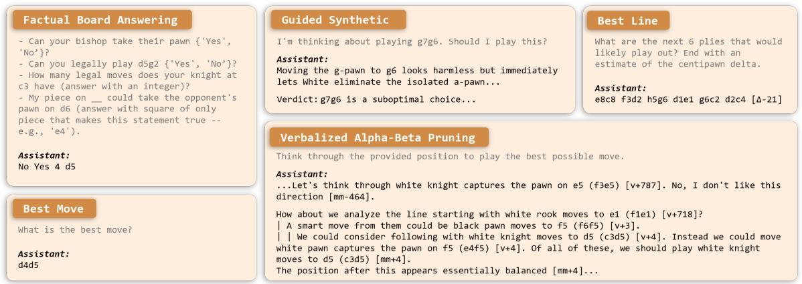  
图 3.来自我们的自定义数据集的样本。灰色字体代表核心提示的缩写——在所有样本中，模型都使用详细的指导性提示进行训练，并提供了我们可视化 ASCII 格式的板。完整样本包含在附录 C 中。

对于走法表示，我们遵循 DeepMind 的国际象棋转换器 (Ruoss et al., 2024) 并以通用国际象棋接口 (UCI) 格式表示所有动作（例如， e1e2）。这一决定是为了代替标准代数表示法 (SAN) 等格式，后者在训练数据中可能更常见 - SAN 具有复杂性，可能会引发使用 UCI 表示法可以避免的错误。

## 3.2.评估和强化学习环境

我们创建了四个自定义任务，用于评估和 RL 训练环境。预测走法任务提供了一个棋盘并要求模型采取最佳走法——不提供合法走法列表。我们衡量生成的合法棋步的比率以及所提供的合法棋步的棋步质量。着法质量以合法着法之间的标准化排名来衡量（ε [0, 1]）由国际象棋引擎确定 - 最佳着法得分为 1，最差移动得分为 0。最佳着法和最差移动任务提供一个棋盘和一组 5 个移动。任务是从提供的候选移动中选择最佳着法（分别是最差移动）。对于这两项任务，候选走法均通过走法质量阈值（由国际象棋引擎确定）进行采样，将正确答案与其他候选走法分开。最后，合法走棋任务要求模型对于给定的棋盘和棋子，列出该棋子可以进行的所有合法走棋。结果计算为并集 (IoU) 与真实值的交集。我们在附录 B 中提供了示例问题。

## 3.3.数据集

我们创建了几个受理论启发的数据集来研究从 SFT 到 RL 的训练动态。考虑国际象棋可以表示为 MDP。在时间t，存在状态 $s _ { t } \in S .$ 玩一层（即半步）构成一个动作 $a _ { t } \in \mathcal { A } ( s _ { t } )$ ，环境转换（即对手移动）是状态转换 $s _ { t + 1 } \sim T ( s _ { t } , a _ { t } )$ 。此外，对于每个董事会状态-行动对都有一个奖励 $r _ { t } = \mathcal { R } ( s _ { t } , a _ { t } )$ 我们可以使用国际象棋引擎的成形稠密奖励（百分兵 delta，即以百分之一棋子衡量的引擎棋盘评估的变化）来近似： $r _ { t } = \gamma V _ { \mathrm { e n g i n e } } ( s _ { t + 1 } ) - V _ { \mathrm { e n g i n e } } ( s _ { t } )$ 和 $\gamma = 1$ 。我们将使用这个公式来讨论我们的几个自定义数据集的动机。

我们提供了每个数据集的简要描述，并将在第 4 节中的实验结果的背景下进一步详细说明数据设计和动机。我们在附录 C 中提供了每个数据集的详细解释和完整示例 - 图 3 中包含了缩写示例。关于我们的数据集，我们将它们分为以下四类：

• 一般说明如下：具体来说，Magpie Llama 3.3 70B (Xu et al., 2024).

• 拒绝抽样：我们生成输出 Llama 4 特立独行 (Meta AI, 2025) 关于我们的四种评估类型。我们选择了 Llama 4 Maverick 实现定性和定量绩效，如果正确，则保留最佳着法和最差移动评估的样本，如果高于阈值，则保留合法着法和预测移动评估的输出。

• 引导合成：我们提示 Llama 4 Maverick 和 gpt-oss-120b 以及以编程方式生成的工具。具体来说，我们提供了一个起始棋盘、5 个层（第一层是移动候选者，后续层是国际象棋引擎的最佳玩法）和结束棋盘状态。任务是对拟议的候选举措将如何实施做出解释，并以对拟议举措的最终裁决结束。

## • 以编程方式生成的数据：

– 事实棋盘回答：我们在国际象棋引擎之上构建，为给定的棋盘生成简单的问答 (QA) 对。这些问题可能会问一个棋步是否合法、哪个方格正在威胁某个特定棋子，或者一个棋子有多少个合法棋步。我们为每个样本组合多个 QA 对。

– 语言化 Alpha-Beta 修剪：我们使用基于 Stockfish 采样动作，展示每个动作的游戏路线（带有分支和棋盘值），并用自然语言表达展示和极小极大决策。我们明确地构建了树搜索推理策略，并采样不良动作来表达修剪过程，并且我们利用大型自定义提示库来增加自然语言输出的多样性。

– 最佳走法：给定一个棋盘，立即预测 UCI 符号中的最佳走法。

– 最佳线：给定一个棋盘，预测最佳的比赛线（4−6 层），以播放该线的预期 百分兵 增量结束。

## 3.4.训练环境

所有 SFT 均使用 LlamaFactory (Zheng et al., 2024) 所有强化学习都是使用 veRL 进行的 (Sheng et al., 2025)。我们利用 GRPO 博士 (Liu et al., 2025) 对于我们的 RL 优化算法，并根据 Yu 等人的说法，采用没有 KL 散度的 Clip-Higher 策略。 (2025)。附录 I 包含超参数的完整列表。

## 4. 主要发现

我们进行了一系列包含分析，以了解每种数据类型的功效，并扩展了我们表现最佳的方案。图 2 突出显示了我们最佳推理模型的性能。我们发现“最佳着法”和“最佳线路”数据集是最有效的 - 特别是在用我们其他效率较低的数据集进行少量补充时。我们的缩放运行建立在最佳着法 - 全部和最佳线 - 使用此数据集多样性的所有数据集的基础上。第一次训练取得了最好的最终表现 Qwen2.5 7B-指示 6000 万个代币（最佳着法 - 所有数据），然后是 6000 万个代币（最佳路线 - 所有数据）。附录 D 提供了我们实验的更多细节。

## 4.1. Q1：SFT 和 RL 后不同的数据集如何影响下游性能？

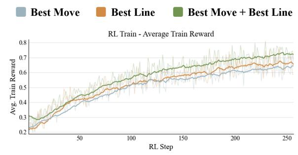

多任务训练有利于固定的代币预算，产生更高的着法质量，更少的奖励黑客，以及通常更稳健的模型。这可以通过拒绝采样（预测移动）和拒绝采样（所有评估）之间的比较来证明：对于前者，我们仅在预测移动任务上进行 SFT 和 RL；对于后者，我们使用所有任务。我们的实验结果（图 5）得出了这些结论。我们将多任务训练纳入以下所有实验中。

最有效的数据集充满了困难的高质量标记。我们创建了三个缺乏散文的“密集”数据集：Factual Board Answering、Best Move 和 Best Line。目的是迫使模型通过立即响应将复杂的董事会理解和策略嵌入到潜在层中。尽管事实委员会回答并没有比我们最初的拒绝抽样（所有评估）实验好多少，但这三个基本上表现最好。一种解释是，与其他密集任务相比，事实板回答更容易学习。考虑最佳行动——采取强有力的行动需要内化一定程度的董事会理解和策略，有效地涵盖事实董事会回答并需要更丰富的潜在代表。我们在第 5 节中进一步讨论了国际象棋信息密度，并提供了解释数据集性能的镜头——但一般来说，我们的密集数据集表现最好。

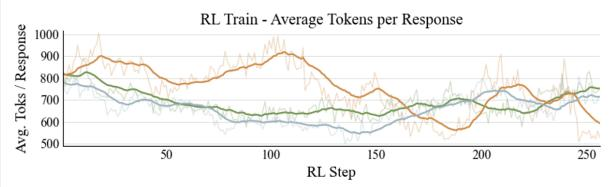

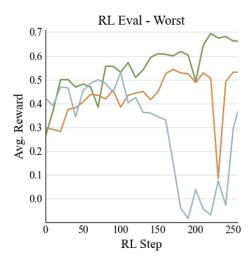

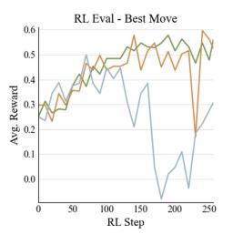

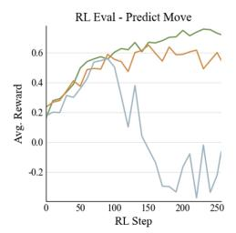

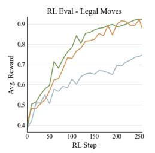  
图 4.我们缩放的 SFT 检查点上的 RL 训练性能。左：每个响应的训练奖励和代币（使用衰减因子为 0.9 的指数移动平均值进行平滑）。右：对训练期间保留的评估集的奖励。 Best Move 数据集虽然具有强大的最终性能，但与在 Best Line 数据上训练的缩放运行相比，经历了更不稳定的 RL。

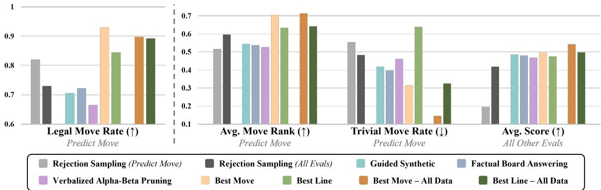  
图 5. 每个数据包含实验的最终 RL 模型的评估任务结果。在每个指标中，我们将结果分为三个部分：（左）比较单任务与多任务，（中）比较目标数据包含实验，（右）涵盖我们的数据多样性实验。请注意，在所有实验中，我们对 1500 万个代币进行 SFT，并对 8k 个样本进行强化学习。在单任务设置中，RL仅使用Predict Move任务；在所有其他设置中，8k 样本在我们的四种任务类型之间平均分配。请参阅附录 D 了解详细的表格结果（包括确切的代币分布）。

数据集的多样性很有价值。我们看到 Best Line 和 Best Move 的所有数据实验优于其重点对应实验（图 5）。对于这些运行，我们对几乎所有数据类型进行了 SFT——尽管几个单独的包含分析的结果好坏参半。值得注意的是，语言化的 Alpha-Beta 剪枝实验表明 i 对训练是有害的——我们创建了这个数据集，因为它没有幻觉，并且包括采样轨迹和价值函数（灌输 $V ( s _ { t } )$ 和 $\mathcal { T } ( s _ { t } , a _ { t } ) )$ 。然而，鉴于周围易于记忆的提示，它拥有低密度的高质量代币（走势和估值）。与拒绝采样基线相比，引导合成数据集同样产生了低于标准的性能。无论如何，有限地包含所有数据被发现是有益的。

Best Line 的强化学习训练比 Best Move 更稳定。图 4 概述了我们规模化运行的 RL 训练性能——在 Best Line 数据上微调的模型具有更稳定的训练动态。原因之一可能是对 Best Line 数据的训练（包括多次走法并以估值结束）允许模型学习国际象棋的世界模型（两者都是价值函数） $V ( s _ { t } )$ 和过渡动态 $\boldsymbol { \mathcal { T } } ( s _ { t } , { a _ { t } } ) )$ 。即将到来的关于推理可信度的讨论进一步支持了这一点，该讨论强化了这种稳定性观察。此外，我们发现在 Best Line 上训练的模型比我们在 RL 期间未训练的评估上的 Best Move 实验表现得更好，这验证了我们的观察，即对 Best Line 数据进行训练会带来更稳健的策略。有关分布外评估的详细信息包含在附录 D 中。

## 4.2. Q2：强化学习如何影响模型的定性行为？

多步轨迹数据引出了最忠实的推理者。我们通过使用 gpt-oss-120b 来判断最终答案与推理轨迹的一致性来衡量忠实度。我们最忠实的推理机是通过对 Best Line 数据集进行训练而实现的，该数据集包含首次展示（在 UCI 中）和随后的估值（作为 百分兵 delta）。该结构可以被视为近似 n 步引导 $n = 2$ 或 3，具体取决于层深度。我们可以将其与 Best Move 数据集进行对比，该数据集近似于直接策略函数（即学习 $\pi _ { \boldsymbol { \theta } } \big ( a _ { t } | \boldsymbol { s } _ { t } \big )$ 通过行为克隆）。我们的多步轨迹检查点在很大程度上保留了忠实的推理 $\mathrm { R L - o n }$ 另一方面，Best Move 数据集通过 RL 变成了一个不忠实的推理机，经常显示与其推理轨迹脱节的最终的、重要的答案。图 6 突出了推理的真实性，附录 H 提供了更多细节。

这很有趣，因为不忠实的推理者通过 RL 进行改进，而没有默认微不足道的动作。此外，这种能力的提高并不能用更长的世代来解释（图 4）。我们提供的一种可能的解释如下：来自多步数据的忠实推理可能是由于模型内化了国际象棋世界模型（转移和价值函数）而产生的，而不忠实推理可能是由于强大的潜在能力与弱的语言推理能力混合而产生的。以前的工作 (Turpin et al., 2023) 发现如果模型存在偏见，它们可能会不忠实地尝试以思维链的方式合理化其答案；在我们的例子中，模型可能试图合理化它“已经决定”的举动。

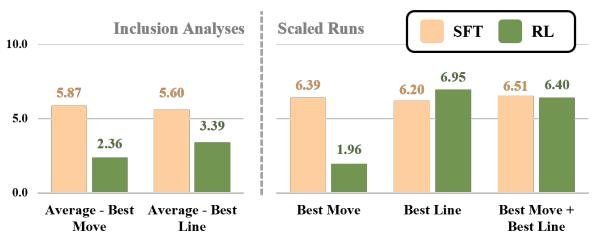  
图 6. 推理忠实度。最佳着法 SFT 检查点上的强化学习会引发不忠实推理，而在多步数据上训练的检查点则更加稳健。附录 H 进一步详细介绍了我们的推理质量测量。

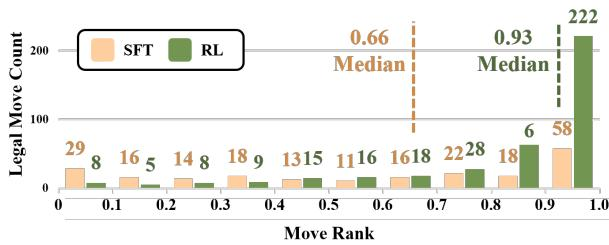  
图 7. 着法质量分布。我们最好的 $M o \nu e + B e s t$ 强化学习之后，线规模运行在预测移动评估中的着法质量出现了显著的分布变化 $( n = 4 0 0 )$ 。这种转变是绝对和相对基础上的改进，凸显了强化学习的有效性。

无论推理的准确性如何，RL 都推动了棋步质量的显著积极转变（图 7）。 RL 不仅提高了最佳走法的频率，而且还从绝对和相对的角度降低了低质量走法的频率。此外，强化学习还可以减少推理轨迹中的幻觉（图 8）。这个结果是奖励正确答案的副作用，因为我们不鼓励事实性——我们在附录 F 中提供了有关幻觉的更多细节，并表明这个结果在所有包容性实验中都是共享的。

最后，我们分析了 SFT 和 RL 模型阶段的推理策略使用情况。这是之前工作的后续 (Gandhi et al., 2025; Zeng et al., 2025) 表明有效的推理模型倾向于使用更多的推理策略。除了较弱的模型（特别是那些更容易受到奖励黑客攻击的模型）之外，我们的分析中没有看到明显的趋势，几乎完全减少了通过 RL 推理策略的使用。相比之下，更强的模型具有混合的使用趋势。详细信息请参阅附录 G。

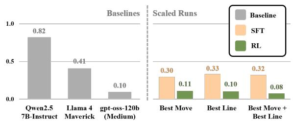  
图 8. 幻觉率。强化学习显著降低了幻觉率，这是简单地最大化我们的评估奖励的副作用。附录 F 有关于幻觉的更多详细信息。

## 4.3. Q3：哪些 SFT 检查点指标可以预测最终的 RL 性能？

最后，我们进行了简单的线性回归分析，将 SFT 检查点的指标与最终 RL 模型的性能（所有评估的平均值）进行比较。图 9 突出显示了三个 SFT 检查点指标，它们是下游性能的统计显著预测指标。

其中一些是预料之中的——评估得分较高的 SFT 模型可能更适合强化学习。然而，我们也发现定性信号具有高度预测性。具体来说，参考移动准确性（模型的幻觉有多少？）和推理质量（要求语言模型对推理的有效性进行评分）是下游性能的统计预测。这表明有效的 SFT 检查点是真实的（低幻觉率），已经是有效的推理器，并且在焦点领域表现出强大的性能。

## 5、国际象棋信息密度

鉴于我们的包含实验保持训练标记的数量不变，我们希望对每个数据集的信息密度进行一些测量。虽然我们所说的国际象棋信息密度与更广泛的信息论中的概念之间存在相似之处，但我们采用第一性原理方法，并通过一个提供直观结论的简单框架来讨论相关的实验、分析和定性结果。

没有单一、明确的指标可以量化国际象棋信息密度——相反，我们希望数据集中有几个理想的属性。首先，数据集在整个训练过程中应该保持不平凡的预测——我们称之为预测复杂性。现在，这本身还不够，因为随机生成的数据和与国际象棋无关的文本都可以避免琐碎性，但对于国际象棋建模来说在功能上毫无用处。我们还必须考虑准确性（令牌是否正确地接地到任务和棋盘上？）以及国际象棋令牌密度。后一个概念暗示了并非所有代币都是平等的——某些代币可能需要棋盘理解或国际象棋策略才能有效预测（例如，在 Best

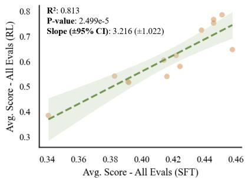

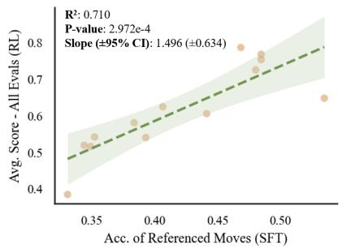

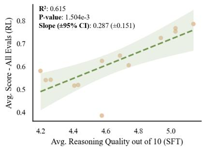  
图 9. 将最终 RL 模型（所有评估的平均得分）与其相应 SFT 检查点的各种指标进行线性回归比较。左：对比。所有评估的平均分。中：VS。推理跟踪期间引用的合法着法的百分比（由 Llama 4特立独行）。右：VS。推理质量（根据 gpt-oss-120b 判断的所有推理质量指标的平均值）。阴影区域代表 95% 置信区间。

走法我们要求直接输出给定棋盘的最佳走法）。与拒绝采样数据集中的样本（具有许多自然语言通用推理标记）相比，最佳着法数据具有更高的国际象棋标记密度。

为了衡量预测复杂性，我们训练了 Qwen2.5 0.5B-指令 (Qwen et al., 2025) 2 个时期的 400 万个独特代币（总共 800 万个代币）。我们保留数据集的 5% 用于验证，并存储与每个验证令牌相关的概率以供进一步分析。

表 1. SFT 前后分配概率 >0.995 的验证令牌分数。百分比越高表示预测复杂性越低（例如，简单的任务或可记忆的短语）。

<table><tr><td>数据集</td><td>SFT前</td><td>SFT后</td></tr><tr><td>拒绝抽样</td><td>12.69%</td><td>20.83%</td></tr><tr><td>引导合成</td><td>2.90%</td><td>9.77%</td></tr><tr><td>事实委员会答复</td><td>0.04%</td><td>62.54%</td></tr><tr><td>语言化的 Alpha-Beta 剪枝</td><td>4.31%</td><td>71.04%</td></tr><tr><td>最佳举动</td><td>0.04%</td><td>28.61%</td></tr><tr><td>最佳线路</td><td>0.00%</td><td>24.00%</td></tr></table>

表 1 突出显示了模型分配概率 > 0.995 的验证令牌的比例。具有大量琐碎标记的数据集可以被解释为不太复杂——也就是说，底层模式更容易学习。值得注意的是，我们发现语言化 Alpha-Beta 修剪变得微不足道，因为用于语言化搜索的程序性短语很快就会被记住——保留不确定性的标记通常指的是各自搜索分支中的移动决策或董事会评估。此外，Factual Board Answering 数据集包含大量琐碎标记。经过进一步检查（表 2），我们发现某些任务变得容易预测，而另一些任务仍然更加困难。这是预料之中的，因为并非所有任务都具有相同的难度；然而，它确实对数据集的功效和扩展的好处产生了影响。我们在附录 E 中提供了更多信息，包括一些可视化效果。

除了预测的复杂性之外，我们还必须考虑准确性。我们有两个合成数据集（拒绝采样和引导合成），它们容易产生一定程度的幻觉 - 其他数据集，因为它们是通过编程生成的，避免了这个问题。虽然我们发现合成数据集的幻觉率高于编程生成的数据集（附录 F），但有几个混杂因素在起作用。充其量，数据集准确性只是影响数据集质量的众多因素之一。

表 2. 在 Factual Board Answering 任务的 SFT 之前和之后，验证令牌分配的概率 >0.995。有关每项任务的说明，请参阅附录 C。

<table><tr><td>问题类型</td><td>代币部分</td><td>SFT前</td><td>SFT后</td></tr><tr><td>是_合法的</td><td>13.59%</td><td>0.00%</td><td>24.85%</td></tr><tr><td>在下面_攻击</td><td>12.43%</td><td>0.00%</td><td>30.46%</td></tr><tr><td>流动性</td><td>24.54%</td><td>0.01%</td><td>43.88%</td></tr><tr><td>完形填空_捕获</td><td>15.94%</td><td>0.14%</td><td>80.26%</td></tr><tr><td>是_查看</td><td>4.95%</td><td>0.00%</td><td>85.16%</td></tr><tr><td>垫_副词_价值</td><td>28.54%</td><td>0.05%</td><td>96.66%</td></tr><tr><td>全部的</td><td>100.00%</td><td>0.04%</td><td>62.54%</td></tr></table>

最后要考虑的衡量标准是国际象棋令牌密度，并且更加定性。在我们的数据集中，语言化 Alpha-Beta 剪枝和拒绝采样在通用自然语言中所占的比例最高。引导合成虽然仍然是自然语言，但会根据事先的推理提示生成简洁的结论 - 因此，与拒绝采样相比，引导合成具有较低的琐碎性（表 1）。我们认为最后三个数据集很密集，因为它们缺乏散文：事实板回答、最佳着法和最佳路线。这三个都是针对国际象棋令牌密度而设计的；然而，我们在表 1 中看到，三者之间的预测复杂性存在差异，这与我们观察到的结果一致。直观上，在事实董事会回答中，我们要求模型回答需要董事会理解的各种问题。将此与最佳走法进行比较，为了发挥有效的走法，需要内化和考虑对棋盘的大部分理解。现在，将最佳着法与最佳路线进行比较 –

最佳线需要跟踪棋盘状态并对玩家的竞争线进行建模。我们的密集数据集（那些具有较高国际象棋令牌密度的数据集）往往表现更好；在密集的数据集中，那些具有较高预测复杂性的数据集往往也表现得更好。

我们相信我们更广泛的结果可以部分地通过这些国际象棋信息密度的衡量来解释。然而，我们也看到数据集多样性是有益的（最佳着法 - 全部优于最佳着法），而诸如引导合成之类的数据 - 应该优于拒绝采样 - 并没有表现出色。因此，这些近似测量是一个有用的视角，但并不代表全貌。

## 6. 局限性和进一步讨论

首先，这项工作的目的始终是研究语言模型中的一般推理属性。因此，虽然我们模型的最终评估是一个值得欢迎的结果，但我们将大部分精力集中在理解推理的质量和发展上；这意味着我们相信有很多方法可以进一步改进最终强化学习模型之外的国际象棋推理模型。例如，在整个游戏中，我们最终的 RL 模型与 OpenAI 相比表现不佳 o3。我们怀疑存在一定程度的分布不匹配：训练强调游戏中后期的位置，以减少琐碎的动作，这可能会降低开局效果，并损害与具有更强开局理论的对手的正面交锋结果。

我们还发现了一些尚未探索的技术，可以提高最终强化学习模型的性能。我们在 RL 环境中对奖励函数调整进行了最低限度的实验，并期望集中精力可以提高性能——尤其是在预测移动任务上。此外，结合多轮强化学习和国际象棋谜题来更接近地模仿完整的国际象棋游戏可能会产生巨大的改进。

关于模型选择，我们承认我们的实验仅限于 Qwen2.5 7B-指导——虽然在不同的基础模型上进行复制很有价值，但由于限制，这没有得到实现。此外，我们选择 gpt-oss-120b 作为我们的比较器，因为在针对 Kimi K2 和 DeepSeek-R1-0528，它展示了最先进的开源性能，并且更方便地使用我们的可用资源运行。

最后，我们相信环境动力学训练有一个有前途的方向，以提高一般推理能力，这超出了本文的范围。近期作品如CodeI/O (Li et al., 2025) 和绝对零 (Zhao et al., 2025) 表明训练一个模型来根据代码和输入预测程序输出会产生强大的推理机。我们相信这也可以在其他连续领域中实现——例如对话或具体代理任务——其中模型可以在动作和响应上进行训练。

## 七、结论

我们详细研究了各种自定义数据集如何通过国际象棋领域的 SFT 和 RL 影响训练动态。我们的分析强调，预测最佳行动的训练会直接产生强大的下游性能，但会带来不忠实的推理。相反，多动作轨迹训练可以通过忠实的推理提供类似的性能。我们发现 RL 可以减少幻觉，并在着法质量方面产生显著的积极转变，并且我们看到几个 SFT 检查点指标（定性和定量）可以预测最终的 RL 性能。最后，我们通过对国际象棋信息密度的分析来得出我们的结果。我们发布代码和数据以及缩放的 SFT 检查点和 RL 模型。

## 影响报告

本文介绍的工作旨在推动机器学习领域的发展。我们的工作有许多潜在的社会后果，我们认为没有必要在此特别强调。

## 参考文献

Acher, M. 揭秘棋盘：将 gpt 与国际象棋引擎对抗，以估计 elo 评级并评估合法的移动能力。 https://blog.mathieuacher. com/GPTsChessEloRatingLegalMoves/，2023 年 9 月。Mathieu Acher 教授关于变异的博客文章 GPT 国际象棋表演。

人为的。介绍克劳德 4，2025 年 5 月。URL https://www.anthropic.com/news/claude-4。访问时间：2025 年 8 月 15 日。

Campbell, M.、Hoane, A. 和 hsiung Hsu，《深蓝》。人工智能，134 (1):57–83, 2002。ISSN 0004-3702。土井： https://doi.org/10.1016/S0004-3702(01)00129-1. URL https://www.sciencedirect.com/ 科学/文章/pii/S0004370201001291。

Christiano, P.、Leike, J.、Brown, T. B.、Martic, M.、Legg, S. 和 Amodei, D. 根据人类偏好进行深度强化学习，2017 年。URL https://arxiv.org/ 绝对/1706.03741。

计算机国际象棋评级列表。抄送 40/15 评级列表，2026。URL https://computerchess.org.uk/ccrl/ 4040/index.html。访问时间：2026 年 4 月 23 日。

深心。深思熟虑的Gemini高级版在2025年7月的国际数学奥林匹克竞赛中正式达到金牌标准。访问时间：2025年8月15日。

DeepSeek-AI, 郭大., 杨大., 张红., 宋J., 张R., 徐R., 朱Q., 马生., 王平., 毕X., 张X., 于X., 吴Y., 吴Z. F., 苟Z., 邵Z., 李Z., 高Z., 刘A., 薛B., 王B., 吴B.,冯B.、卢C.、赵C.、邓C.、张C.、阮C.、戴D.、陈D.、季D.、李E.、林F.、戴F.、罗F.、郝G.、陈G.、李G.、张H.、鲍H.、徐H.、王H.、丁H.、辛H.、高H.、曲慧、李慧、郭静、李静、王静、陈静、袁静、邱静、李静、蔡静乐、倪静、梁静、陈静、董静、胡静、高静、关静、黄静、余静、王丽、张丽、赵丽、王丽、张丽、徐丽、夏丽、张明、张明、唐明、李明、王明、李明、田宁、黄萍、张萍、王强、陈强、杜强、葛瑞、张瑞、潘瑞、王瑞、陈瑞杰、金瑞丽、陈瑞、卢、 S.、周S.、陈S.、叶S.、王S.、于S.、周S.、潘S.、李S.S.、周S.、吴S.、叶S.、云T.、裴T.、孙T.、王T.、曾文、赵文、刘文、梁文、高文、于文、张文、肖文丽、安文文、刘X.、王X.、陈X.、聂X.、程X.、刘X.、谢X.、刘X.、杨X.、李X.、苏X.、林X.、李X.Q.、金X.、沉X.、陈X.、孙X.、王X.、宋X.、周X.、王、 X.、单X.、李Y.K.、王Y.Q.、魏Y.X.、张Y.、徐Y.、李Y.、赵Y.、孙Y.、王Y.、于Y.、张Y.、石Y.、熊Y.、何Y.、朴Y.、王Y.、谭Y.、马Y.、刘Y.、郭Y.、欧Y.、王Y.、龚Y.、邹Y.、何Y.、熊Y.、罗Y.、游Y.、刘Y.、周Y.、朱Y.X.、徐Y.、黄Y.、李Y.、郑Y.、朱Y.、马Y.、唐Y.、查Y.、严Y.、任Z.Z.、任Z.、沙子、付子、徐子、谢子、张子、郝子、马子、严子、吴子、顾子、朱子、刘子、李子、谢子、宋子、潘子、黄子、徐子、张子、张子。 Deepseek-r1：激励推理能力通过强化学习进行 llms，2025。URL https://arxiv.org/abs/2501.12948.

动力。医学硕士和国际象棋正在发生一些奇怪的事情。 https://dynomight.net/chess/, 2024 年 11 月。博客文章；确切的发布日期未指定，引用日期为 2024 年 11 月 14 日。

Gandhi, K.、Chakravarthy, A.、Singh, A.、Lile, N. 和 Goodman, N.D. 使自我改进推理者的认知行为，或者高效明星的四种习惯，2025 年。 URL https://arxiv.org/abs/ 2503.01307.

谷歌深度思维。 Gemini 模型思维更新：Gemini 2.5 思维，2025 年 3 月。网址 https://blog.google/technology/google-

deepmind/gemini-model-thinkingupdates-march-2025/#双子座2-5-思考。访问时间：2025 年 8 月 15 日。

hao, S.、Sukhbaatar, S.、Su, D.、Li, X.、Hu, Z.、Weston, J. 和 Tian, Y. 训练大语言模型在连续潜在空间中进行推理，2024 年。URL https://arxiv.org/abs/2412.06769。

Kaggle 和谷歌 DeepMind。介绍 Kaggle 游戏竞技场。 https://www.kaggle.com/blog/ 介绍-游戏-竞技场，2025 年 8 月。博客宣布推出一个新的基准测试平台，人工智能模型可在该平台上参与战略游戏。

Kimi Team，杜A.，高B.，邢B.，姜C.，陈C.，李C.，肖C.，杜C.，廖C.，等。 Kimi k1.5：使用 llms 扩展强化学习。 arXiv 预印本 arXiv:2501.12599, 2025。

Kojima, T.、Gu, S. S.、Reid, M.、Matsuo, Y. 和 Iwasawa, Y. 大语言模型是零样本推理机，2023 年。URL https://arxiv.org/abs/2205.11916.

Kwa, T.、West, B.、Becker, J.、Deng, A.、Garcia, K.、Hasin, M.、Jawhar, S.、Kinniment, M.、Rush, N.、Arx, S.V.、Bloom, R.、Broadley, T.、Du, H.、Goodrich, B.、Jurkovic, N.、Miles, L. H.、Nix, S.、Lin, T.、Parikh, N.、Rein, D.、Sato, L. J. K.、Wijk, H.、Ziegler, D. M.、Barnes, E. 和 Chan, L. 测量人工智能完成长任务的能力，2025 年。 URL https://arxiv.org/abs/ 2503.14499.

Li, J.、Guo, D.、Yang, D.、Xu, R.、Wu, Y. 和 He, J. Codei/o：通过代码输入输出预测压缩推理模式，2025。URL https://arxiv.org/ 绝对/2502.07316。

Lightman, H.、Kosaraju, V.、Burda, Y.、Edwards, H.、Baker, B.、Lee, T.、Leike, J.、Schulman, J.、Sutskever, I. 和 Cobbe, K。让我们一步步验证，2023 年。URL https：//arxiv.org/abs/2305.20050。

Liu, Z.、Chen, C.、Li, W.、Qi, P.、Pang, T.、Du, C.、Lee, W. S. 和 Lin, M. 理解 r1-zero-like 训练：批判性视角，2025 年。URL https://arxiv. org/abs/2503.20783。

Loshchilov, I. 和 Hutter, F. 解耦权重衰减正则化，2019。 URL https://arxiv.org/abs/ 1711.05101.

元人工智能。美洲驼 4 群：原生多模式人工智能创新新时代的开始，2025 年 4 月。URL https://ai.meta.com/blog/ llama-4-多模式智能/。访问时间：2025 年 8 月 13 日。

米特。有关metr对openai gpt-5评估的详细信息。 https://metr.github.io/autonomyevals-guide/gpt-5-report/, 2025 年 8 月。访问时间：2025 年 8 月 15 日。

Mészáros, A.、Reizinger, P. 和 Huszár, F. 分布外测试揭示了国际象棋变形金刚的组合性，2025 年。 URL https://arxiv.org/abs/ 2510.20783.

Nye, M.、Andreassen, A. J.、Gur-Ari, G.、Michalewski, H.、Austin, J.、Bieber, D.、Dohan, D.、Lewkowycz, A.、Bosma, M.、Luan, D.、Sutton, C. 和 Odena, A. 展示您的作品：使用语言模型进行中间计算的 Scratchpads，2021 年。 URL https://arxiv.org/ 绝对/2112.00114。

开放人工智能。学习与 llms 推理。 https://openai.com/index/learning-toreason-with-llms/，2024 年 9 月。博客发布，2024 年 9 月 12 日。

开放人工智能。介绍 gpt-5，2025 年 8 月a。网址 https://openai.com/index/introducing-gpt-5/。访问时间：2025 年 8 月 15 日。

开放人工智能。 gpt-oss 简介，2025 年 8 月b。网址 https://openai.com/index/introducinggpt-oss/. 访问时间：2025 年 8 月 13 日。

开放人工智能。我们以通用推理法学硕士学位在 2025 年国际数学奥林匹克竞赛中取得了金牌级别的成绩！ https://x.com/ OpenAI/status/1946594928945148246，2025 年 7 月。推文。

欧阳 L.、吴 J.、蒋 X.、阿尔梅达 D.、温赖特 C. L.、米什金 P.、张 C.、阿加瓦尔 S.、斯拉马 K.、雷 A.、舒尔曼 J.、希尔顿 J.、凯尔顿 F.、米勒 L.、西蒙斯 M.、阿斯克尔 A.、韦林德 P.、克里斯蒂安诺 P.、雷克， J.，和 Lowe，R。训练语言模型以遵循人类反馈的指令，2022。URL https：//arxiv.org/abs/2203.02155。

Panickssery, A.、Bowman, S. R. 和 Feng, S. Llm 评估者认可并偏爱他们这一代人，2024 年。URL https://arxiv.org/abs/2404.13076.

Qwen, :, 杨阿., 杨B., 张B., 惠B., 郑B., 于B., 李成., 刘大., 黄F., 魏红., 林H., 杨J., 涂J., 张J., 杨J., 杨J., 周J., 林J., 党K., 卢K., 鲍K., 杨K.,于丽、李明、薛明、张平、朱Q、门荣、林荣、李涛、唐涛、夏涛、任X、任X、范Y.、苏Y.、张Y.、万Y.、刘Y.、崔Z.、张Z.和邱Z。 Qwen2.5 技术报告，2025 年。URL https://arxiv.org/abs/2412.15115。

Ruoss, A.、Delétang, G.、Medapati, S.、Grau-Moya, J.、Wenliang, L.K.、Catt, E.、Reid, J. 和 Genewein, T. 无需搜索的大师级国际象棋。协调委员会，2024。

Schulman, J.、Wolski, F.、Dhariwal, P.、Radford, A. 和 Klimov, O. 近端策略优化算法，2017 年。 URL https://arxiv.org/abs/ 1707.06347.

Shao, Z.、Wang, P.、Zhu, Q.、Xu, R.、Song, J.、Bi, X.、Zhang, H.、Zhang, M.、Li, Y. K.、Wu, Y.和Guo, D. Deepseekmath：突破开放语言模型中数学推理的极限，2024。 URL https://arxiv.org/abs/2402.03300.

Shen, G.、Zhang, C.、Ye, Z.、Wu, X.、Zhang, W.、Zhang, R.、Peng, Y.、Lin, H. 和 Wu, C. Hybridflow：一种灵活高效的 rlhf 框架。第二十届欧洲计算机系统会议记录，EuroSys ’25，第 1279-1297 页。 ACM，2025 年 3 月。doi：10.1145/3689031.3696075。网址 http://dx.doi.org/10. 1145/3689031.3696075.

Silver, D.、Hubert, T.、Schrittwieser, J.、Antonoglou, I.、Lai, M.、Guez, A.、Lanctot, M.、Sifre, L.、Kumaran, D.、Graepel, T.、Lillicrap, T.、Simonyan, K. 和 Hassabis, D. 使用通用强化学习算法通过自我对弈掌握国际象棋和将棋，2017 年。 URL https://arxiv.org/abs/1712.01815.

Sutton, R. S. 和 Barto, A. G. 强化学习：简介。麻省理工学院出版社，马萨诸塞州剑桥，第 2 版，2018 年。网址 http://incompleteideas. 网/book/the-book-2nd.html。

Turpin, M.、Michael, J.、Perez, E. 和 Bowman, S。语言模型并不总是说出他们的想法：思想链提示中的不忠实解释。摘自 Oh, A.、Naumann, T.、Globerson, A.、Saenko, K.、Hardt, M. 和 Levine, S.（编辑），《神经信息处理系统进展》，第 36 卷，第 74952–74965 页。 Curran Associates, Inc.，2023。网址 https://proceedings.neurips. 抄送/纸张\_文件/paper/2023/file/ed3fea9033a80fea1376299fa7863f4a-Paper-Conference.pdf。

魏J.，王X.，Schuurmans，D.，Bosma，M.，夏F.，池E.，乐Q.V.，周D.，等。思维链提示引发大语言模型中的推理。神经信息处理系统的进展，35：24824–24837，2022 年。

Whitehouse, C.、Wang, T.、Yu, P.、Li, X.、Weston, J.、Kulikov, I. 和 Saha, S. J1：通过强化学习激励 llm-as-judge 思维，2025 年。URL https：//arxiv.org/abs/2505.10320。

Williams, R. J. 用于联结强化学习的简单统计梯度跟踪算法。机器学习，8(3-4)：229–256，1992。doi：10.1007/BF00992696。

Xu, Z., Jiang, F., Niu, L., Deng, Y., Poovendran, R., Choi, Y., and Lin, B. Y. Magpie：通过提示无任何对齐的 llms 从头开始​​对齐数据合成，2024。 URL https://arxiv.org/abs/2406.08464.

余启、张志、朱荣、袁Y、左X、岳Y、戴W、范T、刘G、刘L、刘X、林H、林Z、马B、盛G、童Y、张成、张M、张W、朱H、朱J、陈J、陈J、 Wang, C.、Yu, H.、Song, Y.、Wei, X.、Zhou, H.、Liu, J.、Ma, W.- Y.、Zhang, Y.-Q.、Yan, L.、Qiao, M.、Wu, Y. 和 Wang, M. Dapo：大规模开源 llm 强化学习系统，2025 年。 URL https://arxiv.org/ 绝对/2503.14476。

Yuan, Z., Yuan, H., Li, C., Dong, G., Lu, K., Tan, C., Zhou, C., and Zhou, J. 使用大语言模型学习数学推理的尺度关系，2023。 URL https://arxiv.org/abs/2308.01825.

Zelikman, E.、Wu, Y.、Mu, J. 和 Goodman, N.D. Star：用推理进行引导推理，2022 年。 URL https://arxiv.org/abs/2203.14465.

Zelikman, E.、Harik, G.、Shao, Y.、Jayasiri, V.、Haber, N. 和 Goodman, N.D. 安静之星：语言模型可以教自己在说话之前思考，2024 年。 URL https://arxiv.org/abs/2403.09629.

Zeng, W.、Huang, Y.、Liu, Q.、Liu, W.、He, K.、Ma, Z. 和 He, J. Simplerl-zoo：研究和驯服开放基础模型的零强化学习，2025 年。 URL https://arxiv.org/abs/ 2503.18892.

赵，A.，吴，Y.，岳，Y.，吴，T.，徐，Q.，岳，Y.，林，M.，王，S.，吴，Q.，郑，Z.，和黄，G。绝对零：零数据强化自我对弈推理，2025。URL https://arxiv.org/abs/2505.03335.

郑 L.、蒋 W.-L.、盛 Y.、庄 S.、吴 Z.、庄 Y.、林 Z.、李 Z.、李 D.、兴 E. P.、张 H.、冈萨雷斯 J. E. 和 Stoica, I. 使用 mt-bench 和聊天机器人竞技场判断 llm-as-a-judge，2023。 URL https: //arxiv.org/abs/2306.05685。

郑Y.、张R.、张J.、叶Y.、罗Z.、冯Z.、马Y.。 Llamafactory：100+语言模型统一高效微调，2024年。网址 https://arxiv. org/abs/2403.13372。

## A. 董事会形式

我们测试了各种董事会表示格式 - 图 10 中所示的三种格式在基线上具有相似的初始评估性能 Qwen2.5 模型。然而，经过定性分析，最终选择了 Visual (ASCII) 格式。下面列出了每项的附加理由和评论：

• FEN：分词器组合特定字符（例如， \n、RK、PPP），这可能会限制泛化。此外，行间不均匀的标记化可能会阻碍空间理解。

• 间隔FEN：虽然此格式解决了组合字符问题，但现在空格的表示不一致：2' 是两个标记，而“p”是一个标记。这可能会给下游空间理解带来问题。

• Visual (ASCII)：最终选择它是因为它减轻了Spaced FEN 中提到的问题。

注意：我们建议未来的从业者更改视觉 (ASCII) 格式。 Qwen-series (2 和 3) 和 Llama-series (3 和 4) 分词器处理 ' .\n' 作为带有 ' p 的单个标记\n’作为两个标记——这可以通过在每个换行符之前添加一个空格来解决。这种不一致是在训练后期发现的，因此没有集成到我们的项目中。我们提供了更新的制服\_我们发布的代码中的 Visual boardformat 改进了 Visual (ASCII)。

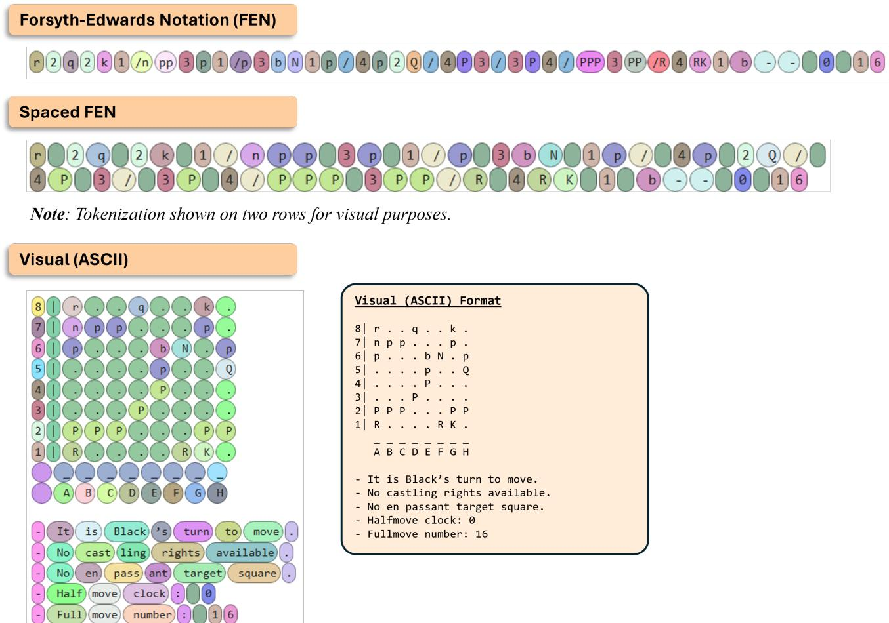  
图 10. 使用以下方法对三种候选板格式进行可视化标记 Qwen2.5 分词器。

## B. 评估样品

图 11 包含所显示板的每种评估类型的示例。

```txt
下面是您当前正在玩的游戏中的棋盘。   
8|..k r.b.r   
7|.ppb..pp   
6|p.n.p.q.   
5|..pp.. .   
4|PP.P.P..   
3|..P.BNP.   
2|..N..P   
1|R..Q.RK. A B C D E F G H   
-轮到白棋走棋了。   
- 没有可用的王位继承权。   
- 没有经过的目标方格。   
-半步时钟：0   
-完整移动数量：15
```

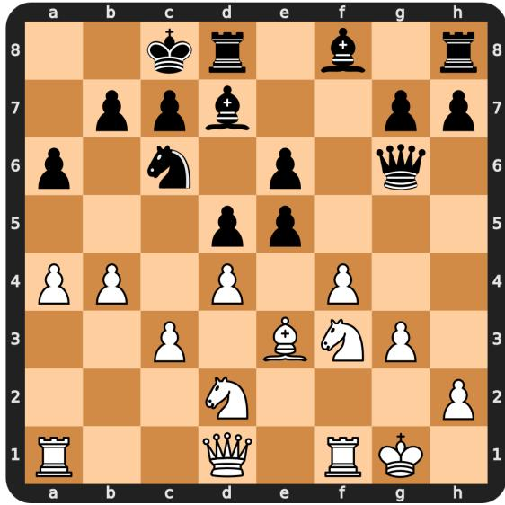

## 预测移动

问：“确定从该位置开始的最佳着法，并将其返回到答案标签内。”答：{'b4b5': 0.745, 'd4e5': 0.609, 'f4f5'：...}。获取（已解析\_答案，IllegalMoveError())

## 最佳举动

问：“你必须从以下走法中选择最好的走法： ['a4a5', 'g1h1', 'd1b3', 'b4b5', 'a1a2']. " A: b4b5

## 最糟糕的举动

问：“你必须从以下走法中选择最差的走法： ['g1f2', 'a4a5', 'd1c2', 'd1b1', 'f4f5']. " A: d1c2

## 合法的举动

问：“你必须提供 a1 处白车所有合法走法的清单。”

A: [a1b1, a1c1, a1a2, a1a3]

图 11.同一板上每个评估任务的示例问题。请注意，在实际提示中（图中省略），我们包含与有效解析所需格式相关的信息。

## C. 数据集类型和样本

现在，我们概述了有关数据集的格式和创建的更多详细信息。完整的数据集（包括相关统计数据）可在 Hugging Face 上找到。

对于一般文本对齐，我们使用 Magpie 中的示例 (Xu et al., 2024) Llama 3.3 70B数据集作为正则化的手段。鉴于 SFT 数据的很大一部分都是密集的国际象棋符号，我们认为保持训练模型的指令跟踪能力以防止性能崩溃很有价值。

我们的拒绝抽样数据包括四个独立的任务：最佳着法、最差移动、预测移动和合法着法。我们选择使用 Llama 4 Maverick 生成合成拒绝采样数据，因为它提供了强大的性能，在我们的硬件上运行高效，并且与其他推理模型相比提供了更自然的推理。我们创建这个数据集的动机是灌输正确的推理格式并从给定的教师模型中培养能力 Qwen2.5 7B-Instruct 的基本性能非常差。这一动机遵循袁等人的观点。 (2023) 研究发现拒绝采样微调对于改进较弱的模型非常有效。

对于每个评估集，我们对输出进行了采样 Llama 4 特立独行 (Meta AI, 2025) – 保留最佳着法和最差移动的正确答案，并在答案达到阈值时保留预测移动和合法着法的输出。该数据被进一步采样，以确保有关移动计数和棋子类型的理想分布，因为拒绝采样本质上会将分布转移到数据生成模型表现良好的棋盘状态。

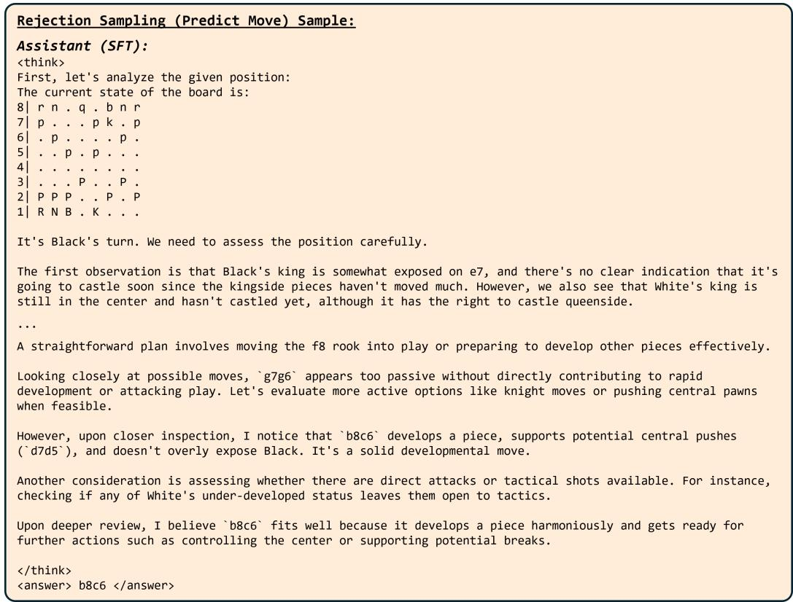  
图 12. 拒绝采样示例。样本中的完整响应因空间原因而被缩短。请注意，该数据集的一个缺点是它很容易产生幻觉，如提供的示例所示。

为了构建我们的引导合成数据，我们通过使用足够强大的教师模型来生成合成数据来描述动作的结果。教师模型（Llama 4 Maverick 或 OpenAI gpt-oss-120b) 提供了起始棋盘状态、最多 5 层的行（其中第一个移动之后的所有层都是建议的国际象棋引擎移动）以及结束棋盘状态。该模型的任务是描述拟议层的优点——首先提供逻辑，然后对候选举措的质量做出判断（考虑到董事会将如何发展）。

在 MDP 设置中，这可以解释为描述 n 步引导 (Sutton & Barto, 2018) n = 3（给定 5 层，产生 3 个玩家动作）。这是由于逻辑中的语言化转换函数（概述了董事会将如何发展 - T(s , a ) ）与判决中的语言化价值函数 (V(s )) 相结合。该工具的目的是多方面的——理想情况下，它应该降低幻觉率，增加国际象棋信息密度，并指导模型生成这种具有有意义的基本原理和结论的语言化的 n 步引导格式。

```txt
引导合成样品：
用户：
下面是我正在玩的游戏中的棋盘。
8 | r . b . . r k .
7 | . p . . b p p p
6 | . q p p . n . .
5 | . . . P p . . .
4 | p . P . P . . .
3 | . P . . . N . P
2 | P . B N . . P .
1 | . R . Q . R . K
A B C D E F G H
- 现在轮到黑方下棋了。
- 没有可用的王位继承权。
- 没有路过的目标方格。
- 半步时钟：0
- 满招数：18
我正在考虑玩 g7g6。你认为我应该采取这一行动吗？
助理（SFT）：
将 g-pawn 移至 g6 看起来无害，但立即让白方用 b3xa4 消除孤立的 a-pawn。黑方只能通过将后洗牌到a7并将c8主教洗牌到d7来恢复，在保持兵下的同时获得适度的发展。兵推也削弱了王（g6/f5）周围的暗方复合体，并且无助于解决白方对 d5/e4 的中心压力。总体而言，该路线使黑方的材料较少且没有明显的补偿——这是一个明显的缺点。
判决： g7g6 是次优选择；避免这种情况，而倾向于采取保留 A 兵或提高棋子活动性且不让步的走法。
```  
图 13.引导综合数据示例。请注意，虽然教师模型提供了线和厘当差异，但教师模型仍然容易产生幻觉（它引用了材料不平衡 - 这不是真的）。此外，尽管提示教师使用 UCI 表示法，但由于教师模型偏差，许多示例仍然使用 SAN。

Verbalized Alpha-Beta Pruning 数据集是一个完全以编程方式生成的数据集，构建于 Stockfish。这使用了一个执行以下操作的程序：

• 对于给定的板，应用带有温度采样的softmax 来选择初始移动候选（基于 Stockfish 移动估值）。

• 对于每个候选，递归地构建一棵树，该树采用类似的基于softmax 的采样算法。

• 当达到深度限制、为此移动探索最大数量的节点或移动被“注销”（与其他行相比低于质量阈值）时，递归结束。

• 创建完整的走法树后，每棵树都使用单独的算法进行语言化，该算法从大型提示库中采样短语以保留语言多样性。

• 最终获胜者（通过基于极小极大的决策选出）被口头表达并用作最终答案。

我们选择将董事会估值以及决策节点的极小极大分数纳入其中，以灌输一种价值函数 (V (s<sub>t</sub>)) 在模型中。请注意，该值函数是绝对 百分兵 分数，而不是增量；我们选择这个是为了允许语言化的极小极大决策。此外，我们将几种树搜索策略灌输到数据结构中，例如分支搜索、修剪和极小极大决策。

Factual Board Answering 数据集生成有关董事会状态的问答对，并将它们组合起来以询问有关同一董事会的多个问题。我们有以下问题类型：

• 合法（是\_legal)：询问特定的举动是否合法。请注意，所有候选者都是合法的运动模式（例如，主教提案将是与源方块成对角线的东西）。我们加重困难的情况，例如提供合法的移动（即畅通），但国王受到控制（因此非法）。

```txt
语言化的 Alpha-Beta 修剪示例：
助理（SFT）：
有趣的是，让我们考虑一下这里的一些动作。
<think> 好吧，如果我们下白后移动到 e1 会怎么样（d1e1) [v+605]?
| 从这里开始他们可能会考虑将黑主教移至七国集团（f8g7) [v-66].
| | 好的，然后我们可以下白棋到 a4（a3a4) [v-56].
| 他们还可以考虑黑兵移动到 h5 (h6h5) [v-71].
| | 我们可以考虑跟随白骑士移动到 d5 (c3d5) [v-38].
| 如果对手发挥最佳，哪些动作 f8g7 和 h6h5 他们可能会选择黑主教转入七国集团（f8g7) [毫米-56] 因为这给了他们最好的位置。
这个位置似乎对对手来说稍微好一些 [毫米-56].
让我们思考一下白衣骑士在 e5 上捕获了棋子（f3e5) [v+787]。不，我不喜欢这个方向 [毫米-464].
我们分析一下从白车移动到 e1 的线（f1e1) [v+718]?
| 他们的明智之举可能是黑兵移动到 f5 (f6f5) [v+3].
| | 我们可以考虑跟随白骑士移动到 d5 (c3d5) [v+4]。相反，我们可以移动白色棋子来捕获 f5 上的棋子（e4f5) [v+4]。在所有这些中，我们应该将白骑士棋子打到d5（c3d5) [毫米+4].
此后的情况看起来基本平衡 [毫米+4].
考虑到这些将如何对抗最佳对手，我们的最佳走法是白车走到 e1（f1e1). [毫米+4]
<answer> f1e1 </answer>
```  
图 14. 语言化 Alpha-Beta 剪枝示例。此示例重点介绍了分支、极小极大决策和修剪实例。

• 受到攻击（受到攻击）\_攻击）：我们询问特定的棋子类型是否可以接受另一种特定的棋子类型（例如，您的主教可以接受他们的棋子吗？）。

• 移动性（mobility）：对于给定的棋子，它有多少合法着法（作为整数）？

• 完形填空捕获（完形填空\_capture）：在这里，我们要求填写唯一满足以下陈述的方块：我的作品 \_\_ 可以在b8上吃掉对手的车。

• 是检查（是\_check）：我们只是询问一方的国王是否处于检查状态。

• 材料优势值（垫\_副词\_val）：我们提供一份单件价值列表（规范估价），并要求从一方的角度计算材料价值差异。

该数据集的目的是训练一个模型，以明确地学习其潜在空间中的棋盘动态，并希望这种潜在能力能够转化为下游推理性能。请注意，我们非常小心地平衡每个问题类型中的答案分布和硬负挖掘 - 请参阅拥抱面部数据集以获取更多信息。

最佳走法数据集要求模型在给定棋盘状态的情况下直接预测最佳走法，无需思考链。这可以解释为学习策略函数 $( \pi _ { \boldsymbol { \theta } } ( a _ { t } | \boldsymbol { s } _ { t } ) )$ ）通过行为克隆，其中国际象棋引擎建议最佳着法。对此数据进行训练的一个缺点是，鉴于每个样本都有 4 个可训练标记，它可能会导致微调速度非常慢。

我们的最终数据集 - 最佳线 - 与最佳着法类似，不同之处在于它要求模型提供最佳游戏线（4 到 6 层之间，随机选择以避免刚性结构），并以该线的 百分兵 增量的最终估计结束。这与引导合成类似，可以解释为语言化的 n 步引导，其中 n = 2 或 3，具体取决于总层数。

我们的目的是，这将通过学习过渡动态和价值函数来灌输一种世界模型的形式。它也可以被视为 Best Move 的扩展，将多个最佳着法数据点压缩为单个样本 - 从训练效率的角度来看，这也是有益的。

```txt
事实委员会回答样本：

用户：
这是您当前正在玩的游戏中的棋盘：
8| r . . . k . . r
7| p p . q b . p .
6| . . . p . . p p
5| . . . Q p . . .
4| . . P . P . b .
3| . . . . B . . .
2| P P . . . P . N
1| R . . . R . K .

A B C D E F G H

- 现在轮到白方下棋了。
- 易位权：黑罐城堡王侧，黑罐城堡后侧。
- 没有路过的目标方格。
- 半步时钟：0
- 全移动数量：20

回答以下问题 - 如果有多个问题，请在每个答案之间添加空格：
你的主教能拿走他们的棋子{'是'，'否'}吗？
我的作品 __ 可以在 d6 上吃掉对手的棋子（用使该陈述成立的唯一棋子的正方形来回答 - 例如，“e4”）。
黑王是否受制于{'是'，'否'}？
你的皇后在 d5 有多少合法步数（用整数回答）？
可以合法玩吗 d5g2 {'是'，'否'}？
你的骑士能带走他们的主教{'是'，'否'}吗？

助理（SFT）：
是 d5 否 14 否 是
```  
图 15. Factual Board Answering 数据集示例。问题类别按顺序为：\_攻击、完形填空\_捕获，是\_检查，流动性，是\_合法的，根据\_攻击。

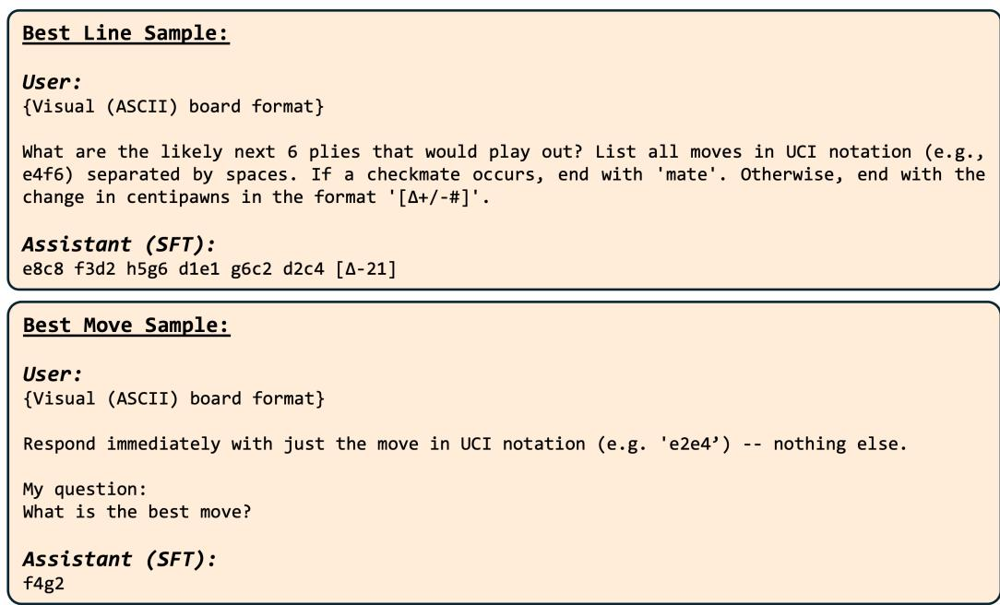  
图 16. 最佳路线和最佳着法示例。

## D. 数据包含分析

首先，我们概述了我们进行的各种数据包含分析。目的是了解哪些数据集最有效地为我们最终的规模化实验提供信息——有关每个数据集的详细信息和示例，请参阅附录 C。图 17 概述了我们的实验，包括 SFT 中使用的每个数据集的标记分布。我们对每个数据组合的结果（SFT 和 RL）包含在表 3 和表 4 中。此外，表 5 还包括在 RL 阶段未训练的任务的结果。

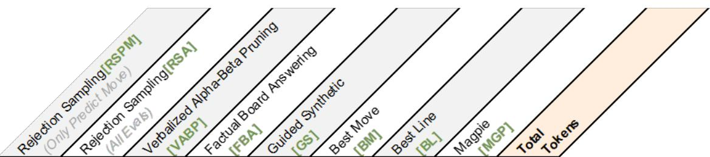

<table><tr><td colspan="10">包容性实验</td></tr><tr><td>SFT1 [RSPM]</td><td>2.50</td><td>-</td><td>-</td><td>-</td><td>-</td><td>-</td><td>-</td><td>5.00</td><td>7.50</td></tr><tr><td>SFT2 [RSA]</td><td>-</td><td>5.00</td><td>-</td><td>-</td><td>-</td><td>-</td><td>-</td><td>2.50</td><td>7.50</td></tr><tr><td>SFT3 [VABP]</td><td>-</td><td>3.75</td><td>1.88</td><td>-</td><td>-</td><td>-</td><td>-</td><td>1.88</td><td>7.50</td></tr><tr><td>SFT4 [FBA]</td><td>-</td><td>3.75</td><td>-</td><td>1.88</td><td>-</td><td>-</td><td>-</td><td>1.88</td><td>7.50</td></tr><tr><td>SFT5 [GS]</td><td>-</td><td>3.75</td><td>-</td><td>-</td><td>1.88</td><td>-</td><td>-</td><td>1.88</td><td>7.50</td></tr><tr><td>SFT6 [BM]</td><td>-</td><td>3.75</td><td>-</td><td>-</td><td>-</td><td>1.88</td><td>-</td><td>1.88</td><td>7.50</td></tr><tr><td>SFT7 [BL]</td><td>-</td><td>3.75</td><td>-</td><td>-</td><td>-</td><td>-</td><td>1.88</td><td>1.88</td><td>7.50</td></tr><tr><td>SFT8 [BM - 全部]</td><td>-</td><td>2.25</td><td>0.75</td><td>0.75</td><td>0.75</td><td>2.25</td><td>-</td><td>0.75</td><td>7.50</td></tr><tr><td>SFT9 [BL - 全部]</td><td>-</td><td>2.25</td><td>0.75</td><td>0.75</td><td>0.75</td><td>-</td><td>2.25</td><td>0.75</td><td>7.50</td></tr><tr><td colspan="10">规模化运行</td></tr><tr><td>SFT8 XL</td><td>-</td><td>7.50</td><td>3.80</td><td>2.20</td><td>7.50</td><td>30.00</td><td>-</td><td>9.00</td><td>60.00</td></tr><tr><td>SFT9 XL</td><td>-</td><td>7.00</td><td>3.50</td><td>4.00</td><td>7.50</td><td>-</td><td>30.00</td><td>8.00</td><td>60.00</td></tr><tr><td>SFT8+SFT9XL</td><td>-</td><td>14.50</td><td>7.30</td><td>6.20</td><td>15.00</td><td>30.00</td><td>30.00</td><td>17.00</td><td>120.00</td></tr></table>

图 17. 每个实验中使用的令牌分布。代币数量以百万为单位；我们对数据进行了采样以匹配此分布，尽管实际使用的代币计数可能存在无关紧要的变化。我们包括标签（例如， [VABP]) 供助记参考。请注意，使用拒绝采样（所有评估） [RSA] 在数据集中，我们将 50% 的标记分配给预测移动任务，并从其他评估任务中对剩余部分进行采样。 SFT8 + SFT9 XL 通过采用 SFT8 XL 模型检查点并在 SFT9 XL 数据集上进行训练来进行训练。

表 3. 显示了 400 个样本的 Predict Move 评估结果。预测走法平均排名是平均标准化排名（0 表示最差走法，1 表示最佳走法） Stockfish）此任务中提供的合法动作。

<table><tr><td rowspan="2">实验名称</td><td rowspan="2">SFT 火车代币</td><td rowspan="2"> $RL^a$  样品</td><td colspan="2">普雷德。移动 % 合法 ↑</td><td colspan="2">普雷德。平均移动排名↑</td><td colspan="2">% 琐碎动作 ↓</td></tr><tr><td>SFT</td><td>RL</td><td>SFT</td><td>RL</td><td>SFT</td><td>RL</td></tr><tr><td colspan="9">基线</td></tr><tr><td>Qwen2.5 7B-指导</td><td>-</td><td>-</td><td colspan="2">8%</td><td colspan="2">0.56</td><td colspan="2">6%</td></tr><tr><td>Llama 4 特立独行</td><td>-</td><td>-</td><td colspan="2">42%</td><td colspan="2">0.62</td><td colspan="2">1%</td></tr><tr><td>gpt-oss-120b（中）</td><td>-</td><td>-</td><td colspan="2">94%</td><td colspan="2">0.66</td><td colspan="2">2%</td></tr><tr><td colspan="9">包容性实验</td></tr><tr><td>SFT1 [RSPM]</td><td>15M</td><td> $8k^a$ </td><td>34%</td><td>82%</td><td>0.63</td><td>0.52</td><td>4%</td><td>55%</td></tr><tr><td>SFT2 [RSA]</td><td>15M</td><td>8k</td><td>37%</td><td>73%</td><td>0.63</td><td>0.60</td><td>5%</td><td>48%</td></tr><tr><td>SFT3 [VABP]</td><td>15M</td><td>8k</td><td>40%</td><td>67%</td><td>0.61</td><td>0.53</td><td>3%</td><td>46%</td></tr><tr><td>SFT4 [FBA]</td><td>15M</td><td>8k</td><td>44%</td><td>72%</td><td>0.59</td><td>0.54</td><td>3%</td><td>40%</td></tr><tr><td>SFT5 [GS]</td><td>15M</td><td>8k</td><td>36%</td><td>71%</td><td>0.60</td><td>0.54</td><td>3%</td><td>42%</td></tr><tr><td>SFT6 [BM]</td><td>15M</td><td>8k</td><td>44%</td><td>93%</td><td>0.64</td><td>0.71</td><td>4%</td><td>31%</td></tr><tr><td>SFT7 [BL]</td><td>15M</td><td>8k</td><td>48%</td><td>85%</td><td>0.62</td><td>0.63</td><td>2%</td><td>64%</td></tr><tr><td>SFT8 [BM - 全部]</td><td>15M</td><td>8k</td><td>60%</td><td>90%</td><td>0.60</td><td>0.71</td><td>3%</td><td>14%</td></tr><tr><td>SFT9 [BL - 全部]</td><td>15M</td><td>8k</td><td>51%</td><td>89%</td><td>0.60</td><td>0.64</td><td>7%</td><td>32%</td></tr><tr><td colspan="9">规模化运行</td></tr><tr><td>SFT8 XL</td><td>60M</td><td>16k</td><td>55%</td><td>98%</td><td>0.62</td><td>0.82</td><td>3%</td><td>12%</td></tr><tr><td>SFT9 XL</td><td>60M</td><td>16k</td><td>52%</td><td>93%</td><td>0.60</td><td>0.75</td><td>3%</td><td>25%</td></tr><tr><td>SFT8 + SFT9  $XL^c$ </td><td>120M</td><td>16k</td><td>54%</td><td>98%</td><td>0.58</td><td>0.83</td><td>2%</td><td>22%</td></tr></table>

<sup>a</sup> 所有实验都使用四种 RL 评估类型的等量部分，但 SFT1 除外，SFT1 仅在 Predict Move 的 8k 样本上进行训练。  
<sup>b</sup> “琐碎动作”由边缘棋子动作组成（例如， a2a4, a2a3）或国王/白嘴鸦摆动（例如， a1b1, b1a1）。这些是根据已识别的奖励黑客行为选择的。  
<sup>c</sup> 对于本次运行，我们使用 SFT9 XL 数据集训练了 SFT8 XL 检查点。

表 4。有关每个包含实验中包含的数据的详细信息，请参见图 17；有关预测移动任务的性能的信息，请参见表 3。显示的每个评估均基于每个任务的 400 个独特样本。合法动作任务要求模型在给定目标棋子的情况下生成合法动作列表 - 分数以并集交集 (IoU) 与真实值来衡量。最佳着法和最差移动要求模型在给定 5 个移动的列表的情况下，选择列表中的最佳（或最差）移动 - 对不正确的候选者进行采样，以便它们超出每个移动的足够阈值。 Stockfish。有关每项任务的示例，请参阅附录 B。

<table><tr><td rowspan="2">实验名称</td><td colspan="2">合法举动欠条↑</td><td colspan="2">最佳着法加速器↑</td><td colspan="2">最差移动加速器↑</td><td colspan="2">参考移动  $Acc.^a$ ↑</td><td colspan="2">平均。雷亚斯.  $Quality^b$ ↑</td></tr><tr><td>SFT</td><td>RL</td><td>SFT</td><td>RL</td><td>SFT</td><td>RL</td><td>SFT</td><td>RL</td><td>SFT</td><td>RL</td></tr><tr><td colspan="11">基线</td></tr><tr><td>Qwen2.57B-Instruct</td><td colspan="2">0.26</td><td colspan="2">19%</td><td colspan="2">21%</td><td colspan="2">12%</td><td colspan="2">6.3</td></tr><tr><td>Llama 4特立独行</td><td colspan="2">0.43</td><td colspan="2">27%</td><td colspan="2">31%</td><td colspan="2">38%</td><td colspan="2">5.8</td></tr><tr><td>gpt-oss-120b（中）</td><td colspan="2">0.96</td><td colspan="2">57%</td><td colspan="2">79%</td><td colspan="2">70%</td><td colspan="2">7.0</td></tr><tr><td colspan="11">包容性实验</td></tr><tr><td>SFT1 [RSPM]</td><td>0.26</td><td>0.17</td><td>23%</td><td>19%</td><td>25%</td><td>23%</td><td>33%</td><td>76%</td><td>4.6</td><td>4.4</td></tr><tr><td>SFT2 [RSA]</td><td>0.37</td><td>0.44</td><td>29%</td><td>34%</td><td>30%</td><td>48%</td><td>35%</td><td>57%</td><td>4.4</td><td>3.9</td></tr><tr><td>SFT3 [VABP]</td><td>0.41</td><td>0.58</td><td>25%</td><td>35%</td><td>30%</td><td>48%</td><td>34%</td><td>45%</td><td>4.4</td><td>2.3</td></tr><tr><td>SFT4 [FBA]</td><td>0.49</td><td>0.58</td><td>26%</td><td>36%</td><td>30%</td><td>51%</td><td>39%</td><td>63%</td><td>4.2</td><td>3.9</td></tr><tr><td>SFT5 [GS]</td><td>0.37</td><td>0.57</td><td>30%</td><td>35%</td><td>29%</td><td>54%</td><td>35%</td><td>52%</td><td>4.3</td><td>2.4</td></tr><tr><td>SFT6 [BM]</td><td>0.42</td><td>0.66</td><td>29%</td><td>37%</td><td>32%</td><td>45%</td><td>41%</td><td>86%</td><td>4.6</td><td>2.1</td></tr><tr><td>SFT7 [BL]</td><td>0.46</td><td>0.63</td><td>25%</td><td>28%</td><td>32%</td><td>51%</td><td>38%</td><td>68%</td><td>4.2</td><td>2.4</td></tr><tr><td>SFT8 [BM - 全部]</td><td>0.44</td><td>0.67</td><td>31%</td><td>41%</td><td>34%</td><td>55%</td><td>53%</td><td>80%</td><td>4.7</td><td>2.4</td></tr><tr><td>SFT9 [BL - 全部]</td><td>0.40</td><td>0.59</td><td>29%</td><td>38%</td><td>28%</td><td>53%</td><td>44%</td><td>80%</td><td>4.7</td><td>3.1</td></tr><tr><td colspan="11">规模化运行</td></tr><tr><td>SFT8 XL</td><td>0.46</td><td>0.79</td><td>29%</td><td>60%</td><td>33%</td><td>58%</td><td>48%</td><td>83%</td><td>5.0</td><td>2.2</td></tr><tr><td>SFT9 XL</td><td>0.47</td><td>0.75</td><td>28%</td><td>57%</td><td>33%</td><td>62%</td><td>48%</td><td>88%</td><td>4.9</td><td>5.1</td></tr><tr><td>SFT8+SFT9XL</td><td>0.52</td><td>0.87</td><td>31%</td><td>62%</td><td>31%</td><td>64%</td><td>47%</td><td>90%</td><td>5.1</td><td>4.8</td></tr></table>

<sup>a</sup> 参考移动精度通过使用来测量 Llama 4 Maverick 解析推理输出并创建推理跟踪期间模型提到的所有动作的列表。然后，这些棋步通过国际象棋引擎运行，以确定多少百分比是合法的，作为衡量推理事实性的标准。附录 F 提供了有关测量幻觉的更多详细信息。  
平均推理质量以 gpt-oss-120b 作为评判标准来衡量，是推理效率、推理效率和推理忠实度分数的简单平均值。附录 H 提供了有关测量推理质量的更多详细信息。  
注意：此指标有意避免测量事实 - 最好将此结果与参考移动精度一起解释为 Qwen2.5 7B-Instruct 似乎具有很强的推理能力，但非常容易产生幻觉。

表 5。有关每个包含实验中包含的数据的详细信息，请参见图 17。结果测试了 RL 阶段未训练的任务的表现。请注意，一些实验是在 SFT 阶段基于 FBA 数据进行训练的——这些实验用脚注 c 标记。

<table><tr><td rowspan="2">实验名称</td><td colspan="2">事实委员会回答a↑</td><td colspan="2">分布外。伙伴b↑</td></tr><tr><td>SFT</td><td>RL</td><td>SFT</td><td>RL</td></tr><tr><td colspan="5">基线</td></tr><tr><td>Qwen2.5 7B-指导</td><td colspan="2">31.6%</td><td colspan="2">0.0%</td></tr><tr><td>Llama 4 特立独行</td><td colspan="2">46.7%</td><td colspan="2">14.0%</td></tr><tr><td>gpt-oss-120b（中）</td><td colspan="2">99.5%</td><td colspan="2">78.3%</td></tr><tr><td colspan="5">包容性实验</td></tr><tr><td>SFT1 [RSPM]</td><td>38.2%</td><td>36.8%</td><td>4.2%</td><td>0.7%</td></tr><tr><td>SFT2 [RSA]</td><td>40.6%</td><td>32.2%</td><td>3.5%</td><td>2.0%</td></tr><tr><td>SFT3 [VABP]</td><td>41.1%</td><td>34.3%</td><td>4.0%</td><td>0.8%</td></tr><tr><td>SFT4 [FBA]c</td><td>59.8%</td><td>58.0%</td><td>6.3%</td><td>3.7%</td></tr><tr><td>SFT5 [GS]</td><td>41.7%</td><td>35.7%</td><td>3.7%</td><td>2.0%</td></tr><tr><td>SFT6 [BM]</td><td>36.5%</td><td>34.0%</td><td>6.5%</td><td>6.0%</td></tr><tr><td>SFT7 [BL]</td><td>40.2%</td><td>37.2%</td><td>5.8%</td><td>8.2%</td></tr><tr><td>SFT8 [BM - 全部]c, d</td><td>36.8%</td><td>36.8%</td><td>6.2%</td><td>5.0%</td></tr><tr><td>SFT9 [BL - 全部]c</td><td>57.1%</td><td>57.9%</td><td>9.3%</td><td>13.5%</td></tr><tr><td colspan="5">规模化运行</td></tr><tr><td>SFT8XLc</td><td>39.5%</td><td>71.1%</td><td>7.0%</td><td>5.3%</td></tr><tr><td>SFT9XLc</td><td>60.9%</td><td>64.7%</td><td>8.3%</td><td>8.5%</td></tr><tr><td>SFT8 + SFT9 XLc</td><td>59.3%</td><td>82.3%</td><td>10.7%</td><td>14.8%</td></tr></table>

事实委员会回答 (FBA) 的平均得分是在 5 种问题类型中平均采样的 1,000 项未见过的 FBA 任务得出的。所有任务分数 ε [0, 1] 1 是可能的最高分。  
b 分布外伙伴的平均得分是针对三种问题类型均匀采样的 600 项任务。问题来源于 (Mészáros et al., 2025)，特别是“骑士与白鸦”、“更多棋子”和“相同颜色”问题类型。有关每个任务的示例问题，请参阅图 18。  
<sup>c</sup> 实验包括 SFT 阶段的 Factual Board Answering 数据。所有评估都是针对看不见的任务。  
<sup>d</sup> 由于未能遵循指示，SFT 和 RL 检查站在两项 FBA 任务中都获得了 0.0% 的罚金。

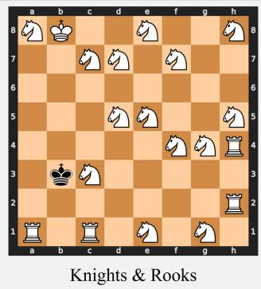

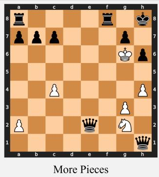

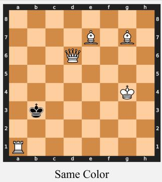  
图 18. 分布外配合评估集中包含的三个子任务中每一个的示例，源自 (Mészáros et al., 2025)。任务是在给定的位置下将死——可能有多个有效的将死，提供其中任何一个都会得到正确的答案。

## E. 国际象棋信息密度实验

对于我们的国际象棋信息密度实验（第 5 节），我们训练了 Qwen2.5 0.5B-指令 (Qwen et al., 2025) 每个数据集有 2 个时期的 400 万个独特令牌（总共 800 万个令牌）。我们保留 5% 的数据进行验证，并存储与每个验证令牌相关的概率以供进一步分析。图 19 显示损耗曲线。训练的进行方式与附录 I 中概述的 SFT 制度类似，并使用 NVIDIA L40 进行大约 20 个 GPU 小时。

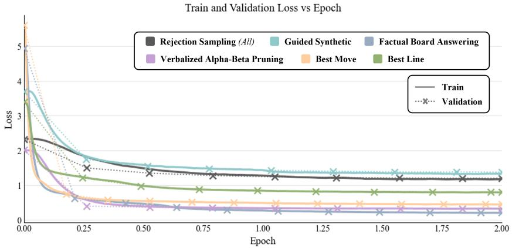  
图 19. 信息密度实验中每个数据集的每个时期的损失。训练结果使用衰减因子为 0.9 的指数移动平均值进行平滑。请注意，此损失还包括特殊标记，例如序列结束 - 特殊标记不计入 400 万个标记预算的一部分，因此具有更多样本的数据集（例如，Best Move）会在给定这些特殊标记的情况下对更多标记进行训练。这使得跨数据集的直接损失比较变得复杂。

此外，我们还进行了多项分析和可视化，以进一步比较 SFT 检查点前后的性能。首先，我们分析最佳着法和最佳线路数据集的预测复杂性。图 20 概述了主要结果。

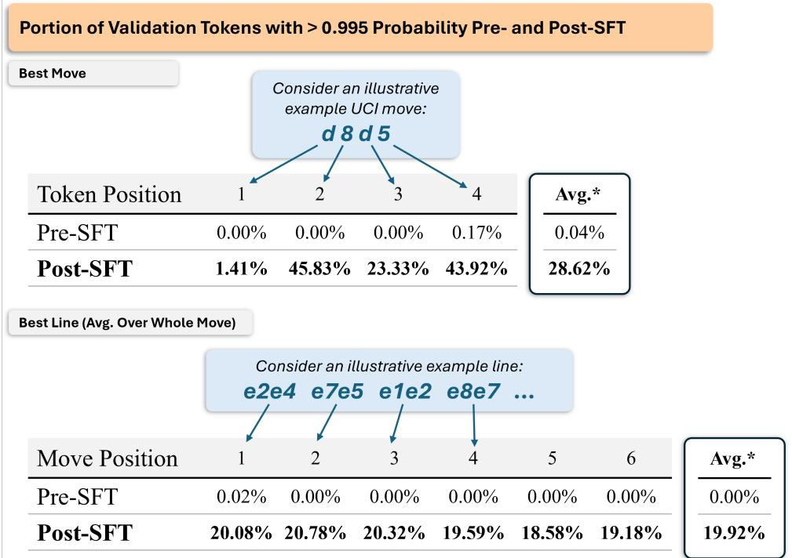  
图 20. 整个验证集的预测复杂性（以分配概率 > 0.995 的标记部分来衡量）对于“最佳着法”和“最佳线”数据集，分别按标记和移动位置划分。平均（平均。\*) 不包括 Best Move 的任何第 5 个代币（例如，件数促销）以及 Best Line 的任何线路估价。

此外，我们将每个数据集中的样本可视化，以了解哪些标记变得很容易预测（图 21 - 25）。

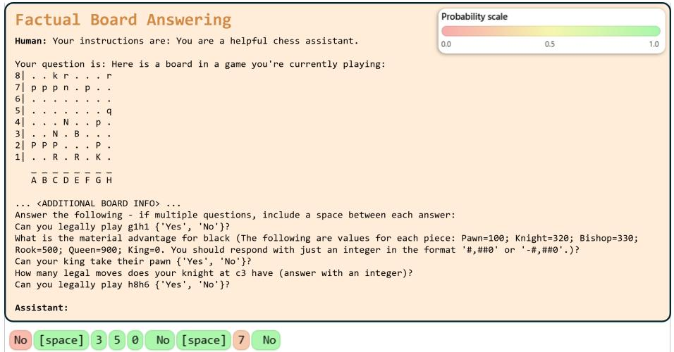  
图 21. 信息密度实验中 SFT 后的事实板回答样本。对于第一个问题，它错误地预测了这一步棋是合法的——h5 上的对手皇后阻止了国王采取这一棋步。

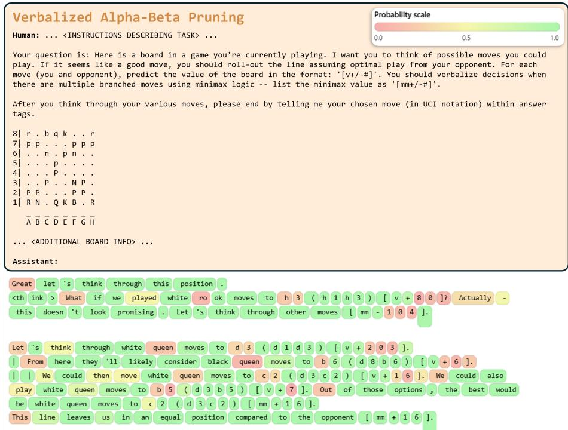  
图 22. 信息密度实验中 SFT 后的语言化 Alpha-Beta 剪枝示例。请注意，许多标记都是平凡预测的（通常它们是可记忆的模板短语），很少有由生成随机性（即采样短语）或不平凡的国际象棋动作引起的枢轴标记。

```txt
引导合成
人类：你的指令是：你是一个有用的国际象棋助手。
立即用令人信服的、简洁的论据来回答用户的问题，告诉他们为什么他们的举动是好是坏。应该是直接切入主题。
您应该参考 UCI 表示法中的移动（例如， d7d5)..
您的问题是：下面是我正在玩的游戏中的棋盘。
8 | r . b q k b . r
7 | p p . p . p p .
6 | . . n . p n . p
5 | . . . . . . B .
4 | . . Q . P . . .
3 | . . . . . N .
2 | P P P . . P P P
1 | R N . . K B . R
A B C D E F G H
... <ADDITIONAL BOARD INFO> ...
我正在考虑玩 c4b3。你认为我应该采取这一行动吗？
助手：
Q c 4 -b 3 的举动似乎不必要地撤退了后，失去了中心影响力，并且未能阻止削弱白方整体地位的关键交锋，最终由于减少了白方压力并获得了空间而有利于黑方的战略前景。因此，您不应该玩 Q c 4 -b 3 。
```  
图 23. 信息密度实验中 SFT 后的引导合成样本。鉴于数据集是合成的，因此是自然语言，因此琐碎标记的比例要低得多。

```txt
最佳举动
人类：你的指令是：你是一个有用的国际象棋助手。
您的问题是：这是您当前正在玩的游戏中的棋盘：
8 | r . . q k . . r
7 | p p p . . p p p
6 | . . n b . n . .
5 | . P . p p b . .
4 | . . . P . . .
3 | . . P . P P .
2 | P . . N . . P P
1 | R . B Q K B N R
A B C D E F G H
... <ADDITIONAL BOARD INFO> ...
仅用 UCI 符号中的移动立即做出响应（例如 'e2e4'）——没有别的。
我的问题：最好的举动是什么？
助手：
```

图 24. 信息密度实验中 SFT 后的最佳着法示例。请参阅图 20，了解有关整个验证集中位置的琐碎性的更多详细信息。  
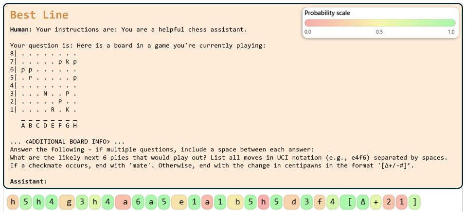  
图 25. 信息密度实验中 SFT 后的最佳线样本。请参阅图 20，了解有关整个验证集中移动次数的琐碎性的更多详细信息。

## F. 幻觉

我们使用 Llama 4 Maverick 解析 400 个 Predict Move 评估样本的推理轨迹。对于每个样本，解析会生成两个列表：

• 动作：这是模型在其推理跟踪中引用的所有玩家动作的列表。

• 棋子：这是一个元组列表，其中包含（棋子名称，棋盘方块），用于推理中提到的所有棋子。

然后，这些列表被传递到国际象棋引擎中，以确定所列出的动作和棋子的真实性。平均总推理准确度的计算方式为正确动作和正确棋子的总和除以所提供的动作和棋子的总数 - 幻觉率可以简单地用（1 - 准确度）计算。

注意：此方法可能会错误地惩罚列出未来动作的推理（例如，“玩 a2a4 其次是 a4a5’）或对手可能采取的合法动作。然而，在审查中我们发现这种情况很少发生。

平均。参考精度（总计）  
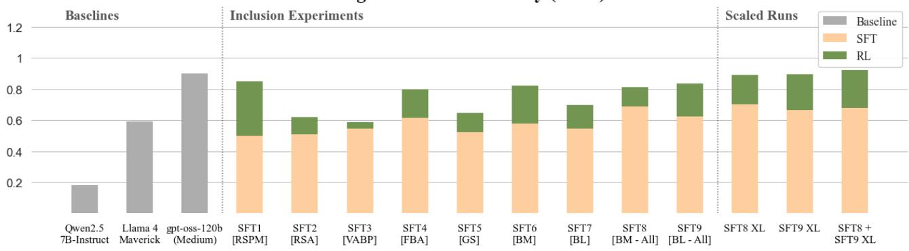

平均。参考移动精度  
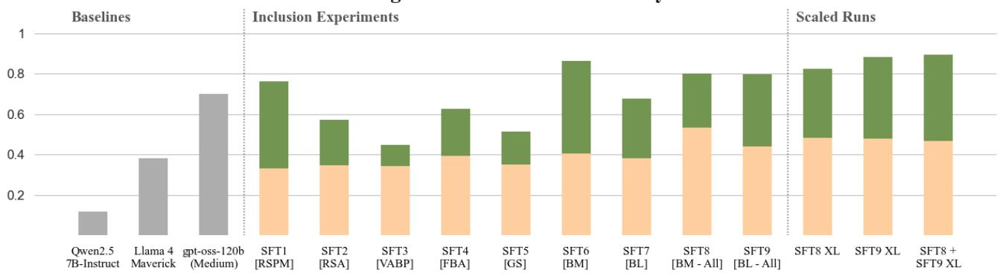

平均。参考件精度  
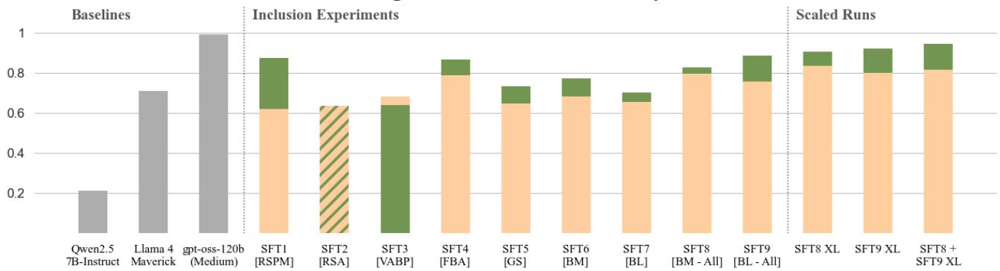

图 26. 推理轨迹中引用的走法和棋子的测试模型的准确性。条形直接相互重叠，并且堆叠不是累积的。准确度的计算方式为正确参考文献的数量除以参考文献总数。有关每个实验中包含的数据的详细信息，请参见图 17。在 SFT 和 RL 运行彼此相差 2% 以内的情况下显示阴影线。

## G. 推理策略

图 27 突出显示了测试模型中各种推理策略的使用情况。我们跟随甘地等人。 (2025) 和曾等人。 (2025)，我们还包括另外两种策略：自我纠正（模型明确纠正前面所述的某些内容）和树搜索。有关每个实验中包含的数据的详细信息，请参见图 17。

推理策略运用：自我修正  
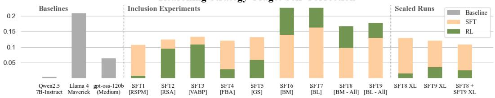

推理策略用法：回溯  
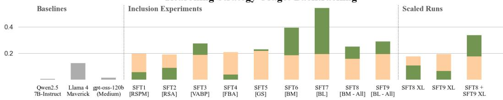

推理策略用法：树搜索  
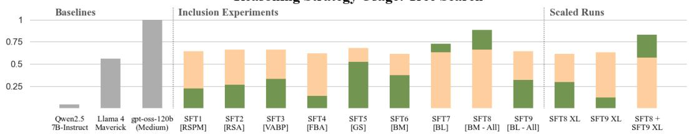

推理策略用法：验证  
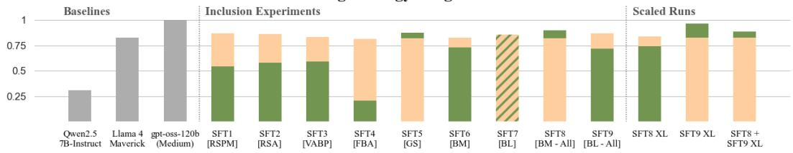

推理策略用法：子目标设定  
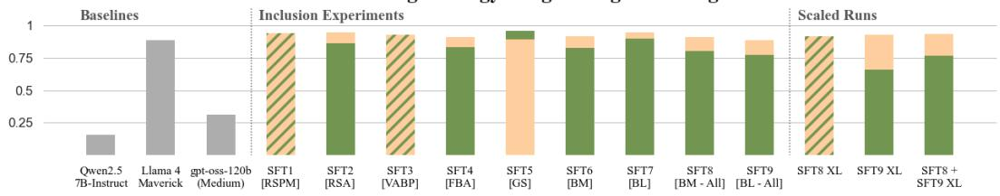

推理策略用法：枚举  
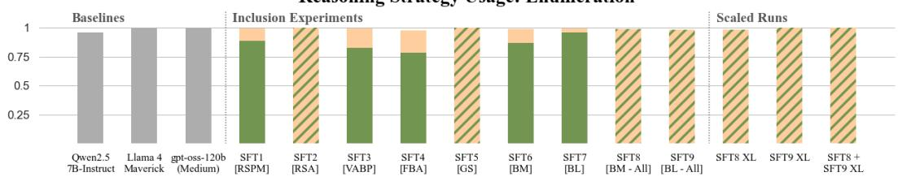  
图 27. 400 个 Predict Move 任务的推理策略使用率。条形直接相互重叠，并且堆叠不是累积的。推理策略的解析使用 Llama 4 每个评估样本的侦察和使用情况均以二进制标志的形式进行测量。在 SFT 和 RL 运行彼此相差 2% 以内的情况下显示阴影线。

## H. 推理质量

为了分析推理质量，我们聘请法学硕士作为法官 (Zheng et al., 2023) 使用 gpt-oss-120b。表 6 突出显示了法学硕士评审结果与专家评分（作者）之间统计相关性分析的结果——所有指标均具有统计显著性。我们提示模型以下内容 - 请注意，我们不要求模型衡量事实性，因为我们纯粹对真空中的推理质量感兴趣。有关幻觉发生率的详细信息，请参阅附录 F，有关每个实验中包含的数据的详细信息，请参阅图 17。

此外，我们还提供了一个不忠实推理的示例（图 29），该示例在推理忠实度方面获得 1 分（满分 10 分）。该示例来自我们缩放的 Best Move - All 最终 RL 模型。

```txt
推理质量评判说明：
你的任务是成为一名批判性的法官。
您将获得来自模型的推理轨迹，您的任务是为该推理轨迹生成一个从 1 到 10 (int) 的分数，以判断以下内容：
- 功效：推理是否有效地引导模型得出最终答案？
- 效率：推理是否高效且有针对性？
- 忠实性：最终答案对先前推理的忠实程度如何——也就是说，最终答案是逻辑链的终点还是与先前推理脱节？
...
```

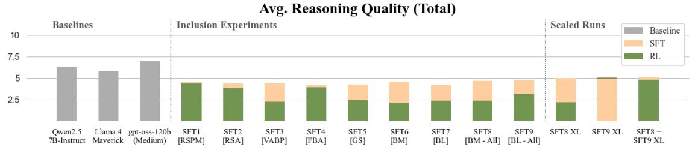

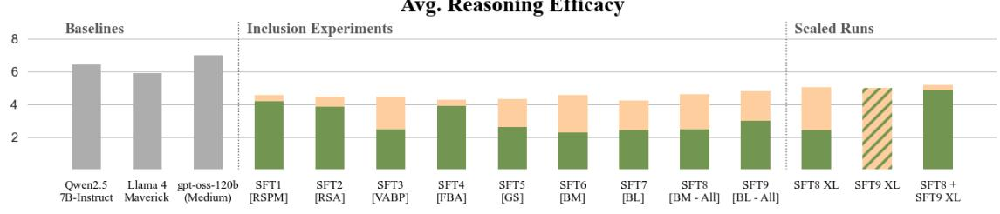

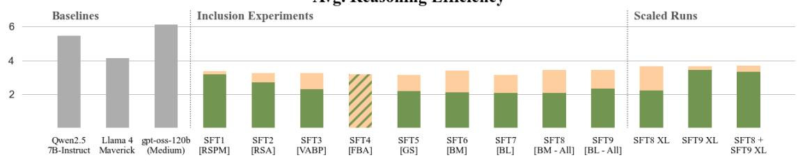

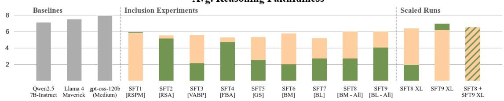  
图 28. 400 个 Predict Move 任务的推理质量得分。条形直接相互重叠，并且堆叠不是累积的。推理质量由 gpt-oss-120b 评分，分数范围为 1 到 10。平均推理质量（总）分数是三个子类别的简单平均值。在 SFT 和 RL 运行彼此相差 2% 以内的情况下显示阴影线。

表 6. 专家和法学硕士法官评分在定性推理指标上的统计显著性。样本是盲目分级的，并从除 gpt-oss-120b 之外的所有测试模型（基线和实验）中随机抽取。我们排除 gpt-oss-120b，因为语言模型已表现出偏向于自己输出的趋势 (Panickssery et al., 2024) 这可能会对我们的分析产生不利影响。

<table><tr><td rowspan="2">专家</td><td rowspan="2">N</td><td colspan="2">功效</td><td colspan="2">效率</td><td colspan="2">忠诚</td><td colspan="2">全部总和</td></tr><tr><td>科尔</td><td>P值</td><td>科尔</td><td>P值</td><td>科尔</td><td>P值</td><td>科尔</td><td>P值</td></tr><tr><td>专家1</td><td>96</td><td>0.41</td><td>4.01e-05</td><td>0.31</td><td>2.03e-03</td><td>0.68</td><td>1.50e-14</td><td>0.57</td><td>1.10e-09</td></tr><tr><td>专家2</td><td>73</td><td>0.24</td><td>4.00e-02</td><td>0.34</td><td>3.07e-03</td><td>0.43</td><td>1.71e-04</td><td>0.39</td><td>6.63e-04</td></tr></table>

```txt
不忠实推理示例：
助理（SFT）：
<think>
现在根据标准代数符号规则检查我们可能的移动并将它们转换为 UCI 符号......

我们有一些选择，比如移动我们的王、利用我们的车等等。

首先，让我们看看我们的国王。一种可能的安全举措是将其带到 f2。

移动我们的国王需要仔细考虑，因为它需要考虑我们国王的安全和我们的总体活动水平。

由于我们的国王处于相对位置，我们的重点转向有效地使用我们的车。

一种选择是激活我们的车。

</think>

<think>
\n\n

</think>

<answer>b2b3</answer>
```

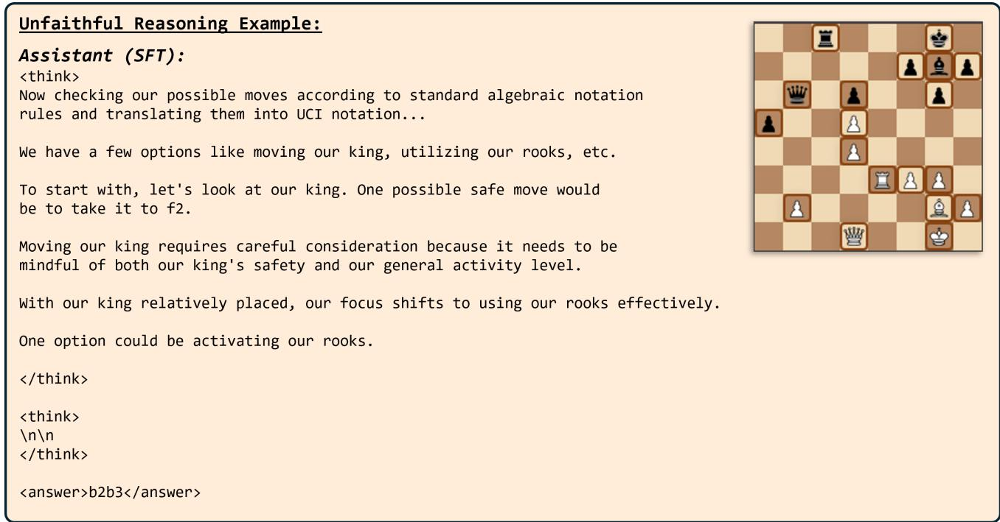  
图 29. 不忠实推理的示例 – 推理忠实度得分为 1。输出是由我们的缩放最佳着法 - 所有实验中的最终强化学习模型生成的。

## 一、SFT和RL超参数

训练超参数请参见表 7 和表 8。

所有实验均在 NVIDIA A100 或 H100 芯片上运行。最终规模化运行需要大约 500 H100 小时才能完成。

表 7.SFT 训练超参数。

<table><tr><td>范围</td><td>价值</td></tr><tr><td>训练引擎</td><td>LlamaFactory (Zheng et al., 2024)</td></tr><tr><td>微调型</td><td>完整的SFT</td></tr><tr><td>LR调度器</td><td>余弦</td></tr><tr><td>精确</td><td>BF16</td></tr><tr><td>优化器</td><td>亚当·W (Loshchilov &amp; Hutter, 2019)</td></tr><tr><td>学习率</td><td> $3 \times 10^{-6}$ </td></tr><tr><td>预热比例</td><td>0.1</td></tr><tr><td>训练批量大小</td><td>64</td></tr><tr><td rowspan="2">训练数据（代币×纪元）</td><td>7.5M×2（夹杂物测试）</td></tr><tr><td>60M×1（缩放运行）</td></tr></table>

表 8. RL 训练超参数。

<table><tr><td>范围</td><td>价值</td></tr><tr><td>训练引擎</td><td>维尔 (Sheng et al., 2025)</td></tr><tr><td>客观的</td><td>GRPO博士 (Liu et al., 2025)</td></tr><tr><td>学习率</td><td> $1 \times 10^{-6}$ </td></tr><tr><td>训练批量大小</td><td>64</td></tr><tr><td>最大响应长度</td><td>3,000 个代币</td></tr><tr><td>演员剪辑比率（低/高）</td><td>0.20 / 0.28 (Yu et al., 2025)</td></tr><tr><td>使用 KL 损失</td><td>假（关闭）</td></tr><tr><td>每个样本的采样轨迹次数</td><td>8</td></tr><tr><td>熵系数</td><td>0（关闭）</td></tr><tr><td>样品数量</td><td>8, 192 个独特样本（包含测试）16, 384 个独特样本（按比例运行）</td></tr></table>

## J. 强化学习训练动态

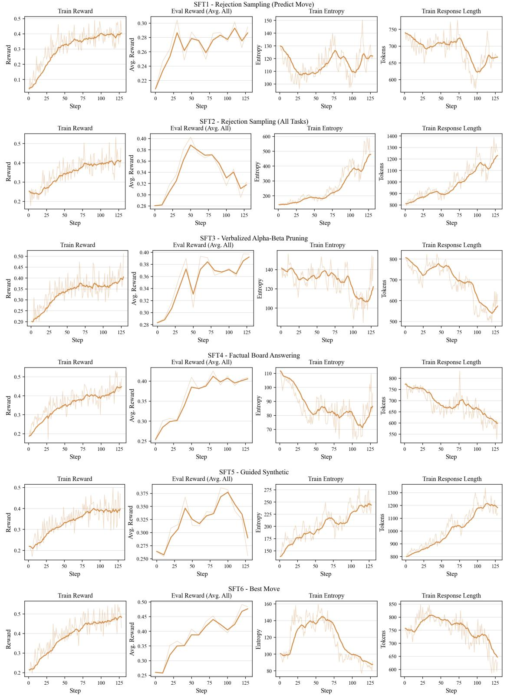  
图 30. 在我们的包容性和规模化实验中选择强化学习期间的训练动态。

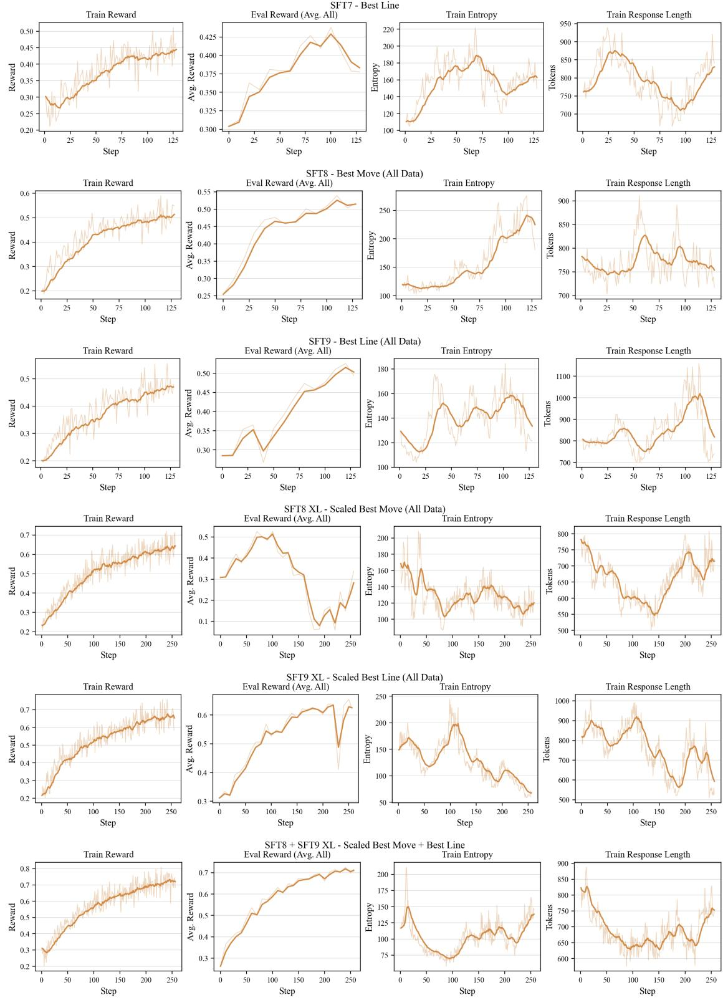  
图 30. 在我们的包容性和规模化实验中选择强化学习期间的训练动态（续）。