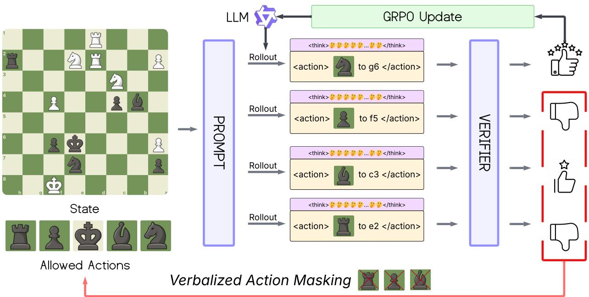
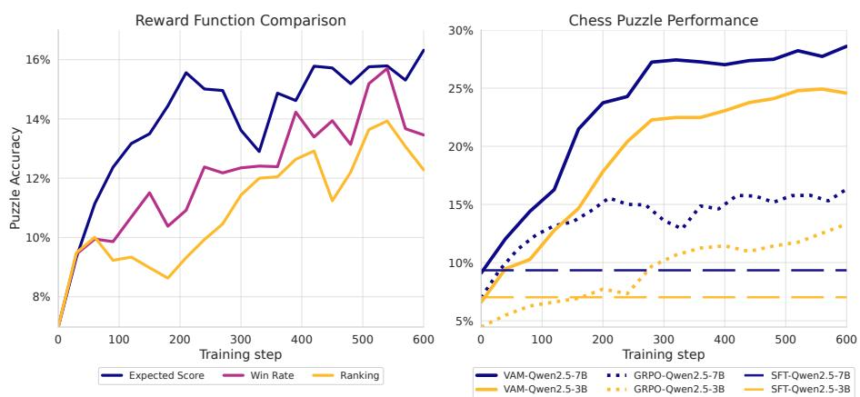
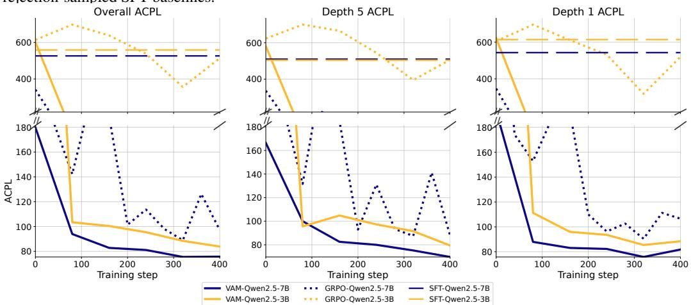
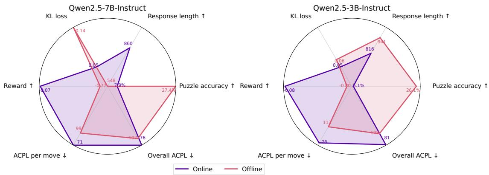
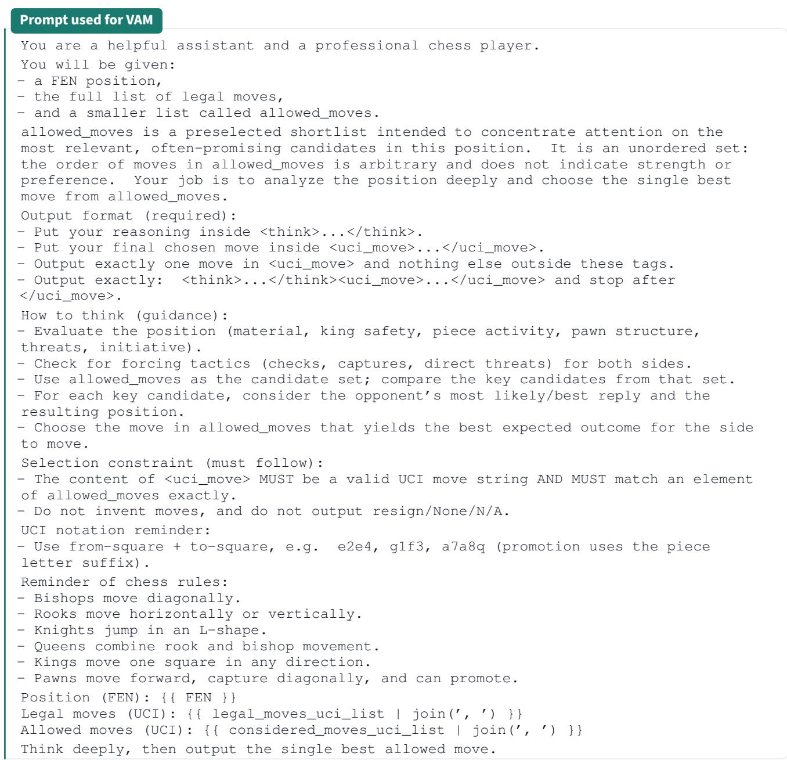
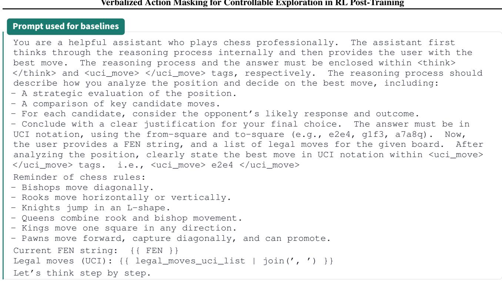

# VAM：用于强化学习后训练中可控探索的语言化动作掩码——国际象棋案例研究

Zhicheng Zhang <sup>1</sup> Ziyan Wang <sup>2</sup> Yali Du <sup>2</sup> Fei Fang <sup>1</sup>

## 摘要

探索仍然是大语言模型 (LLM) 强化学习 (RL) 训练后的一个关键瓶颈，其中稀疏的反馈和大的动作空间可能导致过早崩溃为重复行为。我们提出了语言化动作掩码（VAM），它在提示中用言语表达动作掩码，并强制模型从掩码集中输出动作。在此接口的基础上，我们引入了迭代动作空间剪枝：如果目标动作没有被采样，我们从掩码中删除有效的采样动作，并在减少的候选集下重新采样，重复直到目标被采样或固定预算耗尽。我们研究国际象棋中的 VAM，并在两种训练机制下对其进行评估：一种是通过与引擎对手对弈来生成状态的引擎对弈机制，另一种是从带有验证者分数的固定位置数据集进行训练的固定数据集机制。在通过平均 百分兵 损失 (ACPL) 衡量的国际象棋谜题和完整对局中，VAM 在强基线上提高了学习效率和最终表现，强调语言化掩码作为 LLM RL 训练后可控探索的实用机制。

## 一、简介

具有可验证奖励的强化学习 (RLVR) 为训练后大语言模型 (LLM) 提供了可扩展的方案 (Cobbe et al., 2021; Lightman et al., 2023; OpenAI et al., 2024; Team et al., 2025)，其中模型根据自动检查信号进行训练，例如精确的正确性或严格的输出格式合规性。这种“验证者优先”的框架实现了完全自动化、同策略 RL 循环，并在最近的工作中推动了推理繁重任务的显著改进 (Guo et al., 2025).

然而，RLVR 并没有消除 RL 的核心困难：探索。当奖励稀疏且有效操作空间很大时，如果策略没有对信息行为进行采样，即使进行了确定性验证，同策略更新也会停止。在许多 LLM 训练后环境中，这种失败模式很容易被忽视，因为“环境”通常只是一个评估器。学习问题没有改变：策略必须在巨大的可能字符串空间中发现高奖励动作（严格接口下的有效输出）。

经典强化学习经常通过环境交互访问新状态来进行探索。相比之下，许多 RL 训练后设置从固定分布中采样提示，并针对每个提示执行多次采样轨迹，例如使用组相对策略优化 (GRPO) 等分组同策略目标 (Guo et al., 2025)。在这种情况下，关键的探索瓶颈是单个状态内的动作选择。给定相同的提示，模型实际上是否尝试了不同的看似合理的操作，或者是否重复采样相同的高概率输出？当采样轨迹组崩溃为几乎相同的操作时，组相关更新提供的学习信号很少，并且额外的样本很大程度上浪费了计算。

我们提出语言化动作掩码（VAM）来使动作空间探索可控。提示明确列出了可接受的操作集，确定性验证器检查模型是否从该集中输出有效操作。选择掩码外操作会受到固定惩罚并终止，这会将操作有效性转变为适合 RLVR 的可验证信号。这是一个提示级别的界面，而不是 logit 级别的屏蔽；每次采样轨迹都是根据所提供的候选集从模型中同策略采样的。然后，我们使用此接口通过迭代动作空间剪枝来强制探索。对于固定状态，我们运行多轮分组采样，从候选集中删除已经采样的有效动作，并在剪枝集下重新采样，直到找到目标动作或耗尽固定预算。此过程将重复采样转换为动作空间的受控覆盖，而不是重复相同的几个动作。

我们在国际象棋中研究这些想法，这提供了一个异常干净的测试平台。每个位置都承认有限的、可枚举的动作集，合法的动作和合法性检查是精确的。此外，强大的引擎评估器可以提供永久价值估计，作为密集的、确定性的奖励。与此同时，国际象棋暴露了语言模型策略的实际失败。之前的工作，包括 Hwang 等人。 (2025) 和国际象棋法学硕士 (Kolasani et al., 2025)，发现提供合法的移动列表和执行结构化输出对于学习和评估至关重要，并且界面选择可以主导性能。我们实例化用于国际象棋走法选择的 VAM，其中模型必须以严格的格式从提供的候选列表中输出单个走法，并且我们使用平均 百分兵 损失 (ACPL) 评估对保留谜题的一步走法选择以及与引擎对手的整场比赛。

  
图 1. 具有迭代动作空间剪枝的语言化动作掩码 (VAM) 概述。给定一个状态和一组允许的操作，我们提示 LLM 和示例采样轨迹组进行组相对策略优化 (GRPO)。每个采样的输出都被解析为一个动作，然后由验证者进行评估以产生奖励反馈。如果当前回合不满足目标条件（例如，未对目标操作进行采样），我们会将不同的有效采样操作从允许的操作集中屏蔽出来，并在更新的提示下重新采样。这种迭代修剪过程增加了状态内动作的覆盖范围，并产生信息更丰富的分组同策略更新。

总之，我们的贡献如下：

1. 我们将动作掩蔽形式化为 MDP 增强，将动作有效性转化为可验证的奖励和终止信号；

2. 我们提出了具有迭代动作空间剪枝的 VAM，从而在分组策略 RL 下实现可控的动作空间探索；

3. 我们提出了两种实用的训练流程，固定数据集训练和引擎播放位置生成，它们共享相同的修剪机制；

4. 我们在国际象棋方面进行了广泛的实验，证明 VAM 在谜题选择和完整对局玩法的强大基线上提高了学习效率和最终表现。

## 2.相关工作

具有可验证奖励的强化学习 (RLVR) 最近的工作表明，具有自动可检查结果奖励的强化学习可以改进 LLM 推理，而无需依赖人类偏好标签。这与使用执行反馈作为奖励信号的代码生成方法相一致 (Le et al., 2022; Yang et al., 2023). DeepSeek-R1 (Guo et al., 2025) 使用 GRPO 式的后训练以及基于规则的正确性信号和明确的输出格式约束，证明可验证的奖励和结构化生成可以有意义地塑造模型行为。因为我们的设置也允许确定性验证（国际象棋中的输出解析和合法性检查），所以我们采用类似的“验证者优先”哲学来进行奖励设计。文等人。 (2025) 请注意，普遍报道的 pass@k 改进可能会掩盖推理本身是否得到改进；他们提出了 pass@k 的 CoT 感知变体，需要正确的最终答案和正确的思路。

强化学习训练后的探索 具有可验证奖励的强化学习训练后可能会遭遇探索失败，即使有结果验证者，策略更新也会破坏多样性。最近的工作通过多种机制解决了这一挑战，包括结果层面的探索激励、代理环境的试错交互，以及支撑罕见的长期解决方案的部分监督。基于结果的探索 (Song et al., 2025) 在最终结果上添加强盗启发的奖金或批次内重复惩罚，以鼓励在 GRPOstyle 训练下尝试多样化的解决方案。基于探索的轨迹优化 (ETO) (Song et al., 2024) 交替推出 LLM 代理来收集失败轨迹，并通过轨迹级偏好优化更新策略，将失败与更高奖励轨迹进行对比。补充分析研究 RLVR 如何在减少 pass@k 多样性的同时锐化 pass@1，并提出保留探索的算法旋钮，例如用于熵控制的剪切变体和 KL 正则化下的参考策略重置 (Deng et al., 2025; Park et al., 2025; Liu et al., 2025)。在这种情况下，基于提示和离策略的指导方法在训练期间注入部分原理、解决方案前缀或专家轨迹，以构建罕见的长期解决方案，包括 StepHint (Zhang et al., 2025a)、阿达贝克 (Amani et al., 2025)，特权同策略探索（POPE） (Qu et al., 2026)，以及来自专家主播的分支采样轨迹（BREAD） (Zhang et al., 2025b)。相关方法包括离策略指导（LUFFY） (Yan et al., 2025) 以及诸如STAR等自我提升方法 (Zelikman et al., 2022) 和自我完善 (Madaan et al., 2023)。我们的方法针对相同的瓶颈，但我们不是揭示原理或塑造结果奖励，而是对动作空间进行干预：我们通过 VAM 提供明确的候选集，并通过跨轮修剪已经采样的动作来强制覆盖。

国际象棋法学硕士 最近的几项著作研究了法学硕士是否可以通过监督学习或强化学习获得国际象棋能力 (Veeriah et al., 2025; Feng et al., 2025)。黄等人。 (2025) 对法学硕士进行国际象棋谜题 GRPO 后训练，并报告提供明确的合法棋步列表对于学习很重要；他们的分析表明，表现停滞不前以及对国际象棋规则的有限理解是一个瓶颈。相比之下，国际象棋法学硕士 (Zhang et al., 2025c) 研究完整对局的大规模监督训练，并报告基于引擎的强大评估，强调长期数据和评估在完整对局设置中的作用。 ChessGPT 和 Chess-CLIP (Feng et al., 2023) 将国际象棋视为语言建模和对齐问题，将游戏记录与自然语言注释配对，并提出涵盖状态跟踪、价值判断和战术策略探测的广泛评估套件。最后，法学硕士国际象棋 (Kolasani et al., 2025) 通过代理工具界面对国际象棋比赛进行基准测试，发现指令遵循和工具使用失败（不仅仅是非法走法）是故障的主要根源，而且界面选择会对性能产生重大影响。这些发现促使我们关注通过严格的输出解析和明确的动作掩码进行候选限制的移动选择。

## 3. 预赛

国际象棋记数法和合法走法 我们将国际象棋位置表示为福赛思-爱德华记法 (FEN) 字符串，将棋步表示为通用国际象棋接口 (UCI) 字符串（例如， e2e4, $\mathfrak { g l f } 3 )$ 。在讨论先前的工作时，我们还参考标准代数表示法（SAN）来表示紧凑的、人类可读的移动（例如，e4、Nf3、O-O）。 SAN 还可以包含注释，例如 $\mathrm { a s ~ + }$ （检查）和 # （将死），这对人类来说很方便，但可以使战术后果明确，从而充当额外的着法质量提示；因此，我们对模型输出使用严格的 UCI，并将 SAN 仅视为辅助符号。对于一个职位 $s ,$ 让 $\boldsymbol { \mathcal { A } } ( \boldsymbol { s } )$ 表示合法动作的集合。在我们的实验和评估中，模型需要以严格的 UCI 格式输出单步棋步，格式错误的输出（或非法棋步）将被视为无效。为了量化整个游戏过程中的着法质量，我们使用平均 百分兵 损失 (ACPL) 作为基于引擎的指标。

组相对策略优化 (GRPO) 我们使用组相对策略优化 (GRPO) 对策略进行后训练 (Guo et al., 2025)，一种在策略方法，可以从采样响应的提示组中估计优势，避免学习批评家/价值函数。给出提示 $q \sim P ( Q )$ , GRPO 采样一组 $G$ 输出 $\{ o _ { i } \} _ { i = 1 } ^ { G } \sim \pi _ { \theta _ { \mathrm { o l d } } } ( O \mid q )$ ，计算标量奖励 $r _ { i }$ 和群体相对优势

$$
A _ {i} = \frac {r _ {i} - \mathrm{mean} (\{r _ {1} , \ldots , r _ {G} \})}{\mathrm{std} (\{r _ {1} , \ldots , r _ {G} \})},\tag{1}
$$

并优化裁剪目标

$$
\begin{array}{l}J _ {\mathrm{GRPO}} (\theta) = \mathbb {E} _ {\underset {\{o _ {i} \} _ {i = 1} ^ {G} \sim \pi_ {\theta_ {\mathrm{old}}} (O | q)} {q \sim P (Q)}} \left[ \frac {1}{G} \sum_ {i = 1} ^ {G} \Big (\min \big (\rho_ {i} (\theta) A _ {i}, \right.\left. \right.\\\left. \operatorname{clip} \left(\rho_ {i} (\theta), 1 - \epsilon , 1 + \epsilon\right) A _ {i}\right)\\\left. - \beta D _ {\mathrm{KL}} \left(\pi_ {\theta} \| \pi_ {\text {ref}}\right)\right) \Bigg ],\end{array}\tag{2}
$$

在哪里 $\rho _ { i } ( \theta ) = \pi _ { \theta } ( o _ { i } \mid q ) / \pi _ { \theta _ { \mathrm { o l d } } } ( o _ { i } \mid q ) , \epsilon > 0$ 是 PPOstyle 裁剪参数，并且 $\beta \geq 0$ 将 KL 惩罚加权到参考策略 $\pi _ { \mathrm { r e f } }$ （根据采样输出计算）。

## 4. 方法

动作空间探索一直是 RL 训练后的一个核心挑战，并具有可验证的奖励。在分组同策略目标中，例如组相对策略优化 (GRPO) (Shao et al., 2024)，每个提示都与一组采样输出配对，学习取决于组内的奖励差异。当每个状态的动作空间很大时，策略可能会崩溃为高概率动作的一小部分，从而在每个组内产生低多样性和弱学习信号。我们提出了语言化动作掩码（VAM），它使可接受的动作集成为 RL 接口的显式部分。具体来说，我们（i）形式化一个动作屏蔽MDP，当策略选择掩码外动作时分配固定惩罚，（ii）通过在提示中描述掩码并使用确定性解析器和验证器强制执行来实现LLM策略的接口，以及（iii）通过迭代动作空间剪枝改进探索，它对相同基本提示的GRPO大小的采样轨迹组重复采样，同时缩小掩码以避免重新采样先前生成的有效动作。 VAM 可以在两种机制下进行训练，这两种机制的区别仅在于获得状态和验证者分数的方式不同：固定数据集机制，使用预先计算的验证者分数从固定数据集中对状态进行采样；引擎播放机制，生成同策略状态，例如通过与引擎对手对战并在遇到的位置上查询验证者。我们首先在通用动作选择设置中呈现 VAM，然后描述我们实验中使用的国际象棋实例。

## 4.1.动作屏蔽 MDP

直观上，动作掩码指定当前允许哪些动作。如果代理选择此掩码之外的操作，环境会将其视为约束违规，分配固定惩罚，并终止采样轨迹。这将动作有效性转变为可以由同策略 RL 算法使用的确定性验证器信号，并且它提供了一个干净的句柄来操纵重复采样的可用动作空间。

正式地，考虑马尔可夫决策过程（MDP） $( S , { \mathcal { A } } , P , R , \gamma )$ 与国家 $s \in S$ , 动作 $a \in { \mathcal { A } } .$ , 过渡核 $P ( s ^ { \prime } \mid s , a )$ ，奖励函数 $R ( s , a )$ ，和折扣因子 $\gamma \in [ 0 , 1 )$ 。让 1[·] 表示指示函数。我们假设在每个状态 s 环境可以枚举有限的可接受的动作集 ${ \mathcal { A } } ( s ) \subseteq A .$ 。动作掩码是一个子集 ${ \mathcal { M } } \subseteq A ( s )$ 当前允许的操作。动作屏蔽 MDP 使用显式屏蔽变量来增强状态。具体来说，定义一个增强状态空间

$$
\tilde {\mathcal {S}} = \{(s, \mathcal {M}): s \in \mathcal {S}, \mathcal {M} \subseteq \mathcal {A} (s) \},\tag{3}
$$

和一个动作屏蔽 MDP $( \tilde { S } , \mathcal { A } , \tilde { P } , \tilde { R } , \gamma )$ 。掩码可能取决于底层状态，并且可以根据所选操作进行更新；我们写 $U ( \mathcal { M } ^ { \prime } \mid s , a , \mathcal { M } )$ 对于（可能是确定性的）掩码更新内核。然后对于掩码内的动作，增强的转换分解为

$$
\tilde {P} \big ((s ^ {\prime}, \mathcal {M} ^ {\prime}) \mid (s, \mathcal {M}), a \big) = P (s ^ {\prime} \mid s, a) U (\mathcal {M} ^ {\prime} \mid s, a, \mathcal {M}).\tag{4}
$$

如果一个 $\notin \mathcal { M }$ ，我们将转换视为终止（相当于到吸收终止状态的转换），因此不应用下一状态动态和掩模更新。

增强奖励为掩码内的操作分配基本奖励，否则分配固定惩罚：

$$
\begin{array}{c} \tilde {R} \big ((s, \mathcal {M}), a \big) = \mathbf {1} [ a \in \mathcal {M} ] \cdot R (s, a) \\ + \big (1 - \mathbf {1} [ a \in \mathcal {M} ] \big) \cdot (- \text {Penalty}), \end{array}\tag{5}
$$

处罚地点 $> 0$ 是一个常数。当选择超出掩码的操作时，我们立即终止采样轨迹。同样，定义一个完成指标

$$
d (s, a, \mathcal {M}) = \mathbf {1} [ a \notin \mathcal {M} ],\tag{6}
$$

并在任何时候终止 $d ( s , a , { \mathcal { M } } ) = 1$ 。惩罚控制掩模是软约束还是硬约束。当惩罚是有限的时，目标会阻止不合时宜的行为，同时仍然为所有行为定义奖励值。在极限情况下处罚 $ \infty .$ ，任何超出掩码的操作都会产生无界损失，并且最优策略将零概率质量分配给 M 之外的操作，从而恢复操作掩码的硬版本。

## 4.2.语言化动作掩码 (VAM)

动作屏蔽 MDP 指定了掩码应如何影响奖励和终止，但它没有规定掩码如何表示给策略。在法学硕士设置中，我们通过在提示中描述掩码来实现操作掩码。每个提示都包含状态的描述和明确的操作掩码 ${ \mathcal { M } } \subseteq A ( s )$ 然后模型输出单个动作，确定性解析器和验证器将输出映射到预测动作 a^ 并检查 M 中的成员资格。如果解析失败或者如果 ${ \hat { a } } \notin { \mathcal { M } } .$ ，我们将结果视为掩码外操作，触发终止和由操作掩码 MDP 定义的惩罚。

```txt
语言化动作掩码 (VAM)
状态描述{任务提示}
格式规范 <think>...</think>
<action>...</action>
允许的操作 [act1, ..., actk]
```  
图 2. VAM 提示界面。提示输入包括状态描述、格式规范、允许的动作列表；占位符指示每个出现的位置。

VAM 保留策略数据收集。掩码是观察的一部分，我们根据提示从当前策略中进行采样，而不应用逻辑级别掩码或事后过滤。因此，每个采样组对于其相应的掩码条件提示都是在策略的，这使得该方法与标准分组的在策略 RL 实现兼容。

```txt
具有迭代动作空间剪枝的算法 1 VAM
1：过程 PRUNEANDSAMPLE(π, s, a*)  
2：参数：组大小G、最大轮数Rmax、奖励 \(\t伊尔德{R}\)  
3: \(\mthcal{M} \l左箭头 \mathcal{A}（s）\), \(\m阿斯卡{D}_s \l左箭头 \e空集\)  
4：对于 r = 1 至 Rmax 执行  
5：样本{o_i}_{i=1}^G \s我是 \pi(\c点 | s, \mthcal{M})\) 并解析为 {a_i}_{i=1}^G  
6：电脑_i \(\l左箭头 \tilde{R}((s, \mathcal{M}), 一个_i)\) 对于 i = 1，...，G  
7: \(\m阿斯卡{D}_s \l左箭头 \m阿斯卡{D}_s \c向上 \{(\mathcal{M}, \{(o_i, r_i)\}_{i=1}^G)\}\)  
8: V \(\l左箭头 \{a_i : a_i \in \mthcal{M}\}\)  
9：如果* ε V 则  
10：打破  
11: \(\mthcal{M} \l左箭头 \mthcal{M} \s埃特米努斯V\)  
12：结束  
13：返回 \(\m阿斯卡{D}_s\)  
14：程序 TRAINVAM(π, D, T, B)  
15：输入：策略 π、数据集 D、总步数 T、批量大小 B  
16：对于 t = 1 到 T 做  
17：样本{s_j}_{j=1}^B 来自 D 并设置 B \(\l左箭头 \e空集\)  
18：对于 j = 1 到 B 做  
19: 阅读 A(s_j) 并设置* ε arg 最大值_{a∈A(s_j)} μ(s_j, a)  
20: D_{s_j} \(\l左箭头\) 修剪和样本(π, s_j, a*)  
21: B \(\l左箭头\) B ∪ D_{s_j}  
22：结束  
23：用 B 上的 GRPO 更新 π (§3)  
24：结束  
25：返回π
```

## 4.3.迭代动作空间剪枝

动作掩码定义了哪些动作是可接受的，但它本身并不能确保单个状态内的多样化探索。为了避免重复采样相同的几个动作，我们引入了迭代修剪过程，该过程在分组采样的轮次中逐渐缩小掩码。

基于验证者的奖励和目标行动在具有可验证奖励的强化学习后训练中，任务奖励是使用外部验证者根据模型输出计算得出的。我们假设对于每个州 s 和可接受的行动 $a \in { \mathcal { A } } ( s )$ ，验证者提供标量分数 $\mu ( s , a ) \ \in \ \mathbb { R }$ 该分数可以是二进制的（例如，精确的正确性检查）或分级的（例如，测试分数或启发式质量度量）。我们用它来定义基本奖励 $R ( s , a ) = \mu ( s , a )$ 用于掩码内的操作。为了使接口可验证，我们还对原始输出字符串 o 定义了格式奖励：如果 o 与所需的标签格式不匹配（例如， <action>...</action> 或者 <uci\_move> $\cdots ^ { < / \mu \mathrm { c } \dot { \mathrm { 1 } } }$ \_move>)，或者如果解析的动作 a^ 不在 $\mathcal { M } ,$ 然后 $r _ { \mathrm { f o r m a t } } ( o , { \mathcal { M } } ) = - \mathrm { P e n a l t y }$ ，否则 $r _ { \mathrm { f o r m a t } } ( o , { \mathcal { M } } ) = 0$ 这对应于将不可解析的输出和超出掩码的操作视为约束违规，并通过分配固定的惩罚 ${ \tilde { R } } ,$ 并如动作屏蔽 MDP 中那样终止。

给定一个状态 s 和一个掩码 ${ \mathcal { M } } \subseteq A ( s )$ ，我们将目标动作定义为

$$
a ^ {\star} (s, \mathcal {M}) \in \arg \max _ {a \in \mathcal {M}} \mu (s, a),\tag{7}
$$

当多个动作共享最高分时使用确定性抢七。

对于每个基状态 s，修剪过程从初始掩码开始 $\mathcal { M } _ { 0 } \subseteq \mathcal { A } ( s )$ 。在引擎播放机制中，我们使用完整的法律集 $\mathcal { M } _ { 0 } = \mathcal { A } ( s )$ ，而在固定数据集状态下 $\mathcal { M } _ { 0 }$ 可以是完整的合法集或数据集提供的候选子集​​。我们将目标定为 $a ^ { \star } = a ^ { \star } ( s , \mathcal { M } _ { 0 } )$ 。每轮都使用一个新的提示，该提示仅在屏蔽操作列表中有所不同，并对一组展开进行采样 $G$ 候选人，与 GRPO 小组规模相匹配 (§3)。如果目标动作不存在，我们从候选集中删除采样的掩码内动作并重新采样，直到最大轮数 $R _ { \mathrm { m a x } }$ 。每个修剪回合都为 GRPO 定义一个单独的掩码条件提示，因此该过程自然会为每个基本状态生成一系列 GRPO 组。我们将 GRPO 应用于所有收集的组，而无需在各轮中进行额外的加权。算法 1 总结了完整的 VAM 训练循环，包括迭代剪枝、重采样和 GRPO 更新。算法 2 显示了用于同策略生成训练状态的可选引擎运行过程；当不使用引擎播放位置生成时，我们假设提供了带有验证者分数的固定状态数据集。

## 4.4.国际象棋实施细节

我们的实验实例化了国际象棋走法选择中的 VAM。

状态、动作和提示界面 我们将状态 s 表示为国际象棋位置（FEN 字符串），将动作 a 表示为严格 UCI 格式的走法。允许的行动集 $\boldsymbol { \mathcal { A } } ( \boldsymbol { s } )$ 是合法动作的集合。为了实现 VAM，每个提示都包含与掩码对应的显式候选列表 ${ \mathcal { M } } \subseteq A ( s )$ （完整的合法集或受限子集），以及有序的合法着法列表。

<div class="mineru-algorithm" style="white-space: pre-wrap; font-family:monospace;">
算法 2 引擎播放位置生成（可选）
1：过程COLLECTBYPLAY（π，E，验证者，B）
2：输入：环境E，目标数据大小B，池大小N
3：初始化或复用  $E = \{e_1, \ldots, e_N\}$  从 E 开始，并设置  $D_{play} \leftarrow \emptyset$ 
4：同时  $|D_{play}| &lt; B$  做
5：检索当前状态  $\{s_i\}_{i=1}^N$  来自E
6：对于 i = 1 到 N 做
7：阅读  $\mathcal{A}(s_i)$  并查询验证器  $\mu(s_i, a)$  为所有人  $a \in \mathcal{A}(s_i)$ 
8：追加  $(s_i, \mathcal{A}(s_i), \mu(s_i, \cdot))$  到  $D_{play}$ 
9：如果  $|D_{play}| \geq B$  然后
10：打破
11：结束
12：步进E中的所有实例
13：结束时
14：返回  $D_{play}$ 

带语言化面具的国际象棋提示
原版国际象棋提示{原版国际象棋提示}
当前 FEN 字符串 {FEN}
合法转会 (UCI) {UCI 转会列表}
允许的操作{允许的 UCI 移动列表}
</div>

图 3.带有语言掩码的国际象棋提示。提示输入包括原始提示、FEN、合法动作、允许动作；占位符指示每个出现的位置。

该模型必须输出一个动作 <uci\_move> 标签。确定性解析器和验证器检查输出是否格式良好、在底层位置是否合法以及是否位于提供的掩码中。附录 A.5 指定了确切的解析和有效性规则。

基于引擎的验证器分数我们实例化 $\mu ( s , a )$ 使用 Stockfish 国际象棋引擎 (The Stockfish Developers, 2024)。给定固定的分析设置， Stockfish 可以提供不同的确定性每次移动评估信号，包括 百分兵 分数、赢平局输概率和预期分数代理。任何选择的标量信号都可以用作验证者分数 $\mu ( s , a )$ 定义奖励和目标。在我们的实验中，训练位置与引擎派生的每次移动值图（例如，预期得分或获胜概率代理）配对，充当 $\mu ( s , a )$

固定数据集训练在固定数据集制度中，训练状态s是从固定数据集中采样的，每个状态都带有一个合法的移动列表和一个引擎派生的值图 $\mu ( s , a )$ 超过法律行动。初始掩码 $\mathcal { M } _ { 0 }$ 可以是完整的合法集 $\boldsymbol { \mathcal { A } } ( \boldsymbol { s } )$ 或数据集提供的候选子集​​。训练遵循算法 1 中的 VAM 循环，该循环执行迭代修剪并对所有收集的掩码条件组应用 GRPO 更新。

引擎对弈位置生成对于引擎对弈训练数据，我们通过与固定的引擎对手进行游戏来生成国际象棋位置流。因为学习问题只需要一个状态，所以无论要移动哪一侧，我们都会记录位置。对于每个记录的状态 s，我们枚举合法的动作 $\boldsymbol { \mathcal { A } } ( \boldsymbol { s } )$ ,查询引擎衍生的验证者分数 $\mu ( s , a )$ 超过法律行动，并将结果状态记录添加到训练缓冲区中。算法 2 总结了这个可选的引擎播放位置生成过程；然后，这些状态可以被算法 1 中的相同 VAM 训练循环所消耗。

## 5. 实验

我们在纯文本国际象棋设置中评估 VAM，其中模型必须从提供的列表中选择一步，而无需访问搜索或外部工具。我们报告（i）无搜索国际象棋拼图位置的一步移动选择 (Ruoss et al., 2024) (ii) 与固定引擎对手的整场比赛，通过平均 百分兵 损失 (ACPL) 来衡量。

## 5.1.研究问题

我们围绕三个问题组织实证研究：

1. RQ1：与基线相比，VAM 是否改善了探索？

2. RQ2：与基线相比，VAM 是否改善了整场比赛的表现？

3. RQ3：引擎播放位置生成和固定数据集的相对优势是什么？

## 5.2.实验装置

我们进行实验的模型 Qwen2.5-3B-Instruct 和 Qwen2.5-7B-Instruct (Qwen et al., 2025).

语言化掩码界面 每个决策提示均提供 FEN 字符串形式的位置、要移动的一侧以及严格小写 UCI 格式的合法着法的有序列表。在语言化掩蔽设置中，我们还提供了一个候选子集，允许\_移动，并要求模型从这个子集中进行选择。模型在严格的小写 UCI 中输出单个动作 <uci\_move> 标签，我们使用确定性解析器和合法性检查器进行评估。我们使用与 Hwang 等人相同的提示模板。 (2025) （附录 A）。附录 A.5 指定了确切的解析和有效性规则。

训练制度和数据我们专注于从确定性的、引擎提供的信号中学习的训练后方法。每个训练位置都与引擎派生的每次移动价值图配对 $\mu ( s , a ) \ \in \ [ 0 , 1 ]$ 超过合法的动作，我们用它来定义奖励信号（§4.3）。我们考虑训练位置的两个来源：与 Chess-R1 对齐的固定数据集 (Hwang et al., 2025) 包含 100,000 个位置，以及通过引擎对战固定引擎对手生成的策略位置流。这些对应于第 4 节中的固定数据集和引擎播放机制。在这两种情况下，训练都遵循算法 1 中相同的 VAM 循环，该循环将 GRPO 应用于通过迭代修剪生成的所有掩模条件组。在引擎比赛机制中，训练状态是通过使用算法 2 与引擎对手比赛来同策略生成的，而在固定数据集机制中，我们假设提供了一个数据集。在 RQ1 中，我们使用固定数据集训练来隔离修剪对移动选择探索的影响，而在 RQ2 中，我们使用引擎播放位置生成来评估 VAM，并在相同的提示界面和引擎验证器下与基线进行比较。 RQ3 直接对比了 VAM 的引擎训练与固定数据集训练。

谜题基准 我们评估 Searchless Chess 中 Lichess 谜题位置的一步走法选择 (Ruoss et al., 2024)。每个位置都提供一个 FEN 字符串、一个有序的 UCI 合法着法列表以及一个提供的谜题解决移动。我们使用所有 10,000 个位置作为谜题评估的保留测试集。我们将提供的解决方案移动视为谜题准确性的目标动作。

完整对局基准 我们通过从标准初始位置针对固定位置玩完整对局来评估端到端游戏 Stockfish 对手（技能等级 0），分别报告深度 1 和深度 5。附录 A.7 规定了游戏终止规则、无效着法处理和 ACPL 计算细节。

指标 对于谜题，我们报告在候选集下选择提供的谜题解决方案的 pass@1 准确度。对于完整对局，我们报告由单独的计算得出的 ACPL Stockfish 分析器运行在深度 20，充当专家评估器。附录 A.7 指定了评估工具使用的确切 ACPL 计算和聚合。

## 5.3.基线

我们将 VAM 与 GRPO 基线进行比较，这些基线使用相同的引擎验证器和严格的 UCI 输出契约，但省略迭代修剪。此设置遵循Chess-R1 (Hwang et al., 2025)，经过修改，我们使用严格的 UCI（而不是 SAN）来避免 SAN 注释（例如将或将死）充当额外的战术提示。为了探讨奖励设计如何影响 GRPO 下的探索，我们评估了从引擎信号派生的三个奖励定义：预期得分、获胜率和动作排名。我们包括在同一固定数据集上训练的拒绝采样监督微调（SFT）基线作为监督参考点。附录 A 提供了额外的训练细节。

来自引擎信号的奖励定义。对于每个位置 s 和合法的移动 $a \in { \mathcal { A } } ( s )$ , Stockfish (The Stockfish Developers, 2024) 提供我们将其转换为标量验证者分数的评估 $\mu ( s , a ) \in [ 0 , 1 ]$ ]。在我们的主要实验中，我们使用基于赢/平/输 (WDL) 的预期分数代理：如果引擎报告赢/平/输可能性 $\left( p _ { W } ( s , a ) , p _ { D } ( s , a ) , p _ { L } ( s , a ) \right)$ （和 $p _ { W } + p _ { D } + p _ { L } = 1 )$ ，我们定义

$$
\mu_ {\mathrm{exp}} (s, a) = p _ {W} (s, a) + \frac {1}{2} p _ {D} (s, a).\tag{8}
$$

我们考虑 GRPO 基线的两个额外奖励变体：(i) 胜率奖励 $\mu _ { \mathrm { w i n } } ( s , a ) = p _ { W } ( s , a )$ ，以及（ii）根据位置内排序计算出的基于排名的奖励 $\mu _ { \mathrm { e x p } } ( s , a )$

$$
\mu_ {\mathrm{rank}} (s, a) = 1 - \frac {\mathrm{rank} _ {\downarrow} (\mu_ {\mathrm{exp}} (s , a)) - 1}{| \mathcal {A} (s) | - 1},\tag{9}
$$

排名在哪里<sub>↓</sub> 将排名 1 分配给得分最高的动作（确定性地打破平局）。除非另有说明，VAM 和 GRPO 基线使用 µ<sub>经验值</sub>.

## 5.4.结果

RQ1：谜题探索 图 4 研究了移动选择谜题任务的学习动态。在左图中，我们仅改变 GRPO 使用的奖励定义，并观察到学习曲线的明显差异，其中预期得分信号在我们测试的奖励变体中产生最强的曲线。为了后续比较的一致性，我们使用预期分数作为 GRPO 基线和 VAM 的引擎衍生奖励。在右图中，我们在相同的固定数据集下将 VAM 与 GRPO 进行比较，发现 VAM 对于两种模型大小都达到了更高的拼图精度。在保留谜题上，GRPO 和 VAM 都优于拒绝采样的 SFT 基线，这表明 SFT 设置不能很好地泛化到未见过的谜题位置。有趣的是，越小 Qwen2.5-3B-Instruct 使用 VAM 训练的模型超越了更大的模型 Qwen2.5-7B-Instruct 使用 GRPO 训练的模型。

RQ2：完整对局 图 5 报告了训练过程中完整对局评估期间的 ACPL。在两个评估对手（深度 1 和深度 5）中，VAM 实现的 ACPL 低于 GRPO 基线，表明完整对局中的走棋质量更强。拒绝采样的 SFT 基线产生了更高的 ACPL，这表明 SFT 设置不能推广到我们的评估协议下的完整对局。在基于 RL 的方法中，迭代剪枝比标准 GRPO 提供了进一步的改进。由于 ACPL 随着变小而变得更难降低，因此较低 ACPL 的持续差距对应于比赛中有意义的差异。



图 4. 在保留的国际象棋谜题上的表现。在 10,000 个位置的测试集上选择数据集提供的解决方案的通过@1 精度。左图比较了三个引擎衍生奖励信号下的固定数据集 GRPO 基线（预期得分代理 µ<sub>经验值</sub>, 胜率 $\mu _ { \mathrm { w i n } } ,$ 和基于等级的 $\mu _ { \mathrm { { r a n k } } } ;$ 等式。 8 和 9)。右侧面板将 VAM 与迭代动作空间剪枝与 GRPO 进行比较，在相同的固定数据集和匹配的采样轨迹预算下 Qwen2.5-3B-Instruct 和 Qwen2.5-7B-Instruct。横轴计数 GRPO 梯度更新，每个点在整个测试集上使用固定解码设置评估当前策略。水平虚线表示拒绝采样的 SFT 基线。  
  
图 5. 整场比赛的着法质量 Stockfish。在针对固定值进行评估期间的平均 百分兵 损失（ACPL；越低越好） Stockfish 深度 1 和深度 5 的对手，如图所示 Qwen2.5-3B-Instruct 和 Qwen2.5-7B-Instruct。我们总体报告 $\mathsf { A C P I }$ L 以及每个对手 ACPL 训练轨迹。 VAM 通过引擎播放位置生成和迭代动作空间剪枝进行训练，而 GRPO 基线使用相同的验证器和提示界面，但省略了修剪。水平虚线表示拒绝采样的 SFT 基线。 VAM 在不同的对手和模型尺寸下始终达到较低的 ACPL，这表明在整场比赛中着法质量更强。

RQ3：引擎对战与固定数据集制度 图 6 对比了在提供的固定数据集上训练的 VAM 与在针对固定引擎对手的游戏生成的状态上训练的 VAM。我们观察到一步选择和长期游戏之间存在明显的权衡：固定数据集训练可以产生更强的谜题准确性，而引擎游戏位置生成可以产生更好的完整对局 ACPL。除了这些标题指标之外，引擎播放机制还与较长的响应和较小的 KL 损失相关，这与当前策略引起的状态分布的训练一致。

## 6. 讨论

当 VAM 非常适合时，当环境可以枚举每个状态的有限操作集并且可以确定性地检查允许集中的成员资格时，VAM 最合适。在这种设置中，掩码合规性成为可靠的信号，可用于训练（作为硬性惩罚）和评估（作为格式和合法性度量），同时保留策略采样，因为我们不应用逻辑级掩码或事后过滤。

探索作为可控的界面选择迭代动作空间剪枝将重复采样转变为受控探索过程：在各轮中，模型被迫提出不同的动作，因为先前采样的有效动作被从提示指定的候选集中删除。这种观点有助于理清 RL 训练后失败的两个根源：重复采样下有限的策略熵和有限的动作空间覆盖。

  
图 6. VAM 的固定数据集与引擎运行训练方案。雷达图总结了在固定数据集上训练的 VAM 的性能和训练统计数据，或者通过与固定引擎对手的比赛生成引擎比赛位置来训练，如下所示 Qwen2.5-7B-Instruct （左）和 Qwen2.5-3B-Instruct （正确的）。轴报告 pass@1 谜题准确性、参考策略的 KL 损失、平均响应长度、平均验证者奖励以及由 ACPL 衡量的完整对局着法质量（总体和每次移动）。在每个模型中，每个指标都在两个方案中线性归一化以进行可视化，并且数字注释指示原始值。这些配置文件强调了跨机制的一步解谜性能和完整对局质量之间的权衡。

## 七、结论

我们引入了言语动作掩码（VAM），这是一种用于 RL 训练后的提示级动作空间接口，具有可验证的奖励，以及迭代动作空间剪枝程序，可通过防止在状态内重复采样相同动作来改进探索。我们在具有严格 UCI 输出的纯文本国际象棋走法选择中实例化了这些想法，并在一步谜题选择和与引擎对手的完整对局对战中对其进行了评估。根据经验，我们发现预期分数是谜题 GRPO 基线的最强奖励选择，并且与模型大小的这些基线相比，VAM 显著提高了谜题准确性和完整对局 ACPL。我们还观察到固定数据集和引擎播放机制之间的互补优势，这表明状态分布是结构化动作空间中 RL 后训练的关键设计选择。

局限性和未来的工作。国际象棋是一个理想的测试平台，因为合法的走法是可枚举的，并且可以使用引擎确定性地检查动作有效性（严格解析和走法合法性）和走法质量。许多结构化决策问题不提供这些属性，因此在具有非常大的动作空间或没有强确定性评估器的领域中应用 VAM 将需要动态候选生成和近似验证器。

## 致谢

这项工作得到了 NSF 拨款 IIS-2046640（职业）的部分支持。这项工作得到了工程和物理科学研究委员会的支持 [授权号 EP/Y003187/1 和 UKRI849].

## 影响报告

本文提出的工作旨在推动机器学习领域的发展，特别是在可验证的约束下对大语言模型进行强化学习后训练的方法。提高法学硕士能力和更广泛地采用强化学习后训练会产生许多潜在的社会后果，我们认为这里没有必要特别强调这些后果。

## 参考文献

Amani, M. H.、Lotfi, A.、Baldwin, N. M.、Bengio, S.、Farajtabar, M.、Abbe, E. 和 West, R. Rl 通过自适应揭示基本原理进行推理。 arXiv 预印本 arXiv:2506.18110, 2025。

Cobbe, K.、Kosaraju, V.、Bavarian, M.、Chen, M.、Jun, H.、Kaiser, L.、Plappert, M.、Tworek, J.、Hilton, J.、Nakano, R. 等。训练验证员解决数学应用题。 arXiv 预印本 arXiv:2110.14168, 2021。

邓J.、陈J.、陈Z.、程D.、白F.、张B.、敏Y.、高Y.、赵W.X.和温J.-R。从试错到改进：rlvr中llm探索机制的系统分析。 arXiv 预印本 arXiv:2508.07534, 2025。

冯X.，罗Y.，王Z.，唐华，杨明，邵K.，

Mguni, D.、Du, Y. 和 Wang, J. Chessgpt：桥接策略学习和语言建模。神经信息处理系统的进展，36：7216–7262，2023 年。

Feng, X.、Veeriah, V.、Chiam, M.、Dennis, M.、Pachauri, R.、Tumiel, T.、Barbero, F.、Obando-Ceron, J.、Shi, J.、Singh, S. 等。生成创意国际象棋谜题。 arXiv 预印本 arXiv:2510.23881, 2025。

郭大、杨大、张红、宋杰、张瑞、徐瑞、朱启、马生、王平、毕新等。 Deepseek-r1：通过强化学习激励 llms 的推理能力。 arXiv 预印本 arXiv:2501.12948, 2025。

Hwang, D.、Lee, H.、Choo, J.、Park, D. 和 Park, J. 大语言模型能否发展策略推理？学习国际象棋的训练后见解。 arXiv 预印本 arXiv:2507.00726, 2025。

Kolasani, S.、Saplin, M.、Crispino, N.、Montgomery, K.、Davis, J. Q.、Zaharia, M.、Wang, C. 和 Wang, C. Llm chess：通过国际象棋在 llms 中进行基准推理和指令跟踪，2025 年。URL https：//arxiv.org/abs/2512.01992。

Le, H.、Wang, Y.、Gotmare, A. D.、Savarese, S. 和 Hoi, S. C. H. Coderl：通过预训练模型和深度强化学习掌握代码生成。神经信息处理系统的进展，35：21314–21328，2022。

Lightman, H.、Kosaraju, V.、Burda, Y.、Edwards, H.、Baker, B.、Lee, T.、Leike, J.、Schulman, J.、Sutskever, I. 和 Cobbe, K. 让我们逐步验证一下。第十二届学习表征国际会议，2023 年。

Liu, M.、Diao, S.、Lu, X.、Hu, J.、Dong, X.、Choi, Y.、Kautz, J. 和 Dong, Y. Prorl：延长强化学习扩展了大语言模型中的推理边界。 arXiv 预印本 arXiv:2505.24864, 2025。

Madaan, A.、Tandon, N.、Gupta, P.、Hallinan, S.、Gao, L.、Wiegreffe, S.、Alon, U.、Dziri, N.、Prabhumoye, S.、Yang, Y. 等。自我细化：通过自我反馈进行迭代细化。神经信息处理系统的进展，36：46534–46594，2023。

OpenAI, :, Jaech, A., Kalai, A., Lerer, A., Richardson, A., El-Kishky, A., Low, A., Helyar, A., Madry, A., Beutel, A., Carney, A., Iftimie, A., Karpenko, A., Passos, A. T., Neitz, A., Prokofiev, A., Wei, A., Tam, A.、Bennett, A.、Kumar, A.、Saraiva, A.、Vallone, A.、Duberstein, A.、Kondrich, A.、Mishchenko, A.、Applebaum, A.、Jiang, A.、Nair, A.、Zoph, B.、Ghorbani, B.、Rossen, B.、Sokolowsky, B.、Barak, B.、McGrew, B.、Minaiev, B.,郝，B.，贝克，

B.、Houghton, B.、McKinzie, B.、Eastman, B.、Lugaresi, C.、Bassin, C.、Hudson, C.、Li, C. M.、de Bourcy, C.、Voss, C.、Shen, C.、Zhang, C.、Koch, C.、Orsinger, C.、Hesse, C.、Fischer, C.、Chan, C.、Roberts, D., Kappler, D.、Levy, D.、Selsam, D.、Dohan, D.、Farhi, D.、Mely, D.、Robinson, D.、Tsipras, D.、Li, D.、Oprica, D.、Freeman, E.、Zhang, E.、Wong, E.、Proehl, E.、Cheung, E.、Mitchell, E.、Wallace, E.、Ritter, E.、Mays, E.、Wang, F.、Such、F.P.、Raso, F.、Leoni, F.、Tsimpourlas, F.、Song, F.、von Lohmann, F.、Sulit, F.、Salmon, G.、Pararascandolo, G.、Chabot, G.、Zhao, G.、Brockman, G.、Leclerc, G.、Salman, H.、Bao, H.、Sheng, H.、Andrin, H., Bagherinezhad, H.、Ren, H.、Lightman, H.、Chung, H. W.、Kivlichan, I.、O’Connell, I.、Osband, I.、Gilaberte, I.C.、Akkaya, I.、Kostrikov, I.、Sutskever, I.、Kofman, I.、Pachocki, J.、Lennon, J.、Wei, J.、Harb, J., Twore, J.、Feng, J.、Yu, J.、Weng, J.、Tang, J.、Yu, J.、Candela, J. Q.、Palermo, J.、Parish, J.、Heidecke, J.、Hallman, J.、Rizzo, J.、Gordon, J.、Uesato, J.、Ward, J.、Huizinga, J.、Wang, J.、Chen, K.、Xiao, K., Singhal, K.、Nguyen, K.、Cobbe, K.、Shi, K.、Wood, K.、Rimbach, K.、Gu-Lemberg, K.、Liu, K.、Lu, K.、Stone, K.、Yu, K.、Ahmad, L.、Yang, L.、Liu, L.、Maksin, L.、Ho, L.、Fedus, L.、Weng, L.、Li, L.、McCallum, L.、Held, L.、Kuhn, L.、Kondraciuk, L.、Kaiser, L.、Metz, L.、Boyd, M.、Trebacz, M.、Joglekar, M.、Chen, M.、Tintor, M.、Meyer, M.、Jones, M.、Kaufer, M.、Schwarzer, M.、Shah, M.、Yatbaz, M.、Guan, M. Y.、徐, M.、Yan, M.、Glaese, M.、Chen, M.、Lampe, M.、Malek, M.、Wang, M.、Fradin, M.、McClay, M.、Pavlov, M.、Wang, M.、Wang, M.、Murati, M.、Bavarian, M.、Rohaninejad, M.、McAleese, N.、Chowdhury, N.、Chowdhury, N.、Ryder, N.、Tezak, N.、Brown, N.、Nachum, O.、Boiko, O.、Murk, O.、Watkins, O.、Chao, P.、Ashbourne, P.、Izmailov, P.、Zhokhov, P.、Dias, R.、Arora, R.、Lin, R.、Lopes, R. G.、Gaon, R.、Miyara, R.、Leike, R.、Hwang, R.、Garg, R.、Brown, R.、James, R.、Shu, R.、Cheu, R.、Greene, R.、Jain, S.、Altman, S.、Toizer, S.、Toyer, S.、Miserendino, S.、Agarwal, S.、Hernandez, S.、Baker, S.、McKinney, S.、Yan, S.、Zhao, S.、Hu, S.、Santurkar, S.、Chaudhuri, S.R.、Zhang, S.、Fu, S.、Papay, S.、Lin, S.、Balaji, S.、Sanjeev, S.、Sidor, S.、Broda, T.、Clark, A.、Wang, T.、Gordon, T.、Sanders, T.、Patwardhan, T.、Sottiaux, T.、Degry, T.、Dimson, T.、Zheng, T.,加里波夫，T.，斯塔西，T.，班萨尔，T.，克里奇，T.，彼得森，T.，埃隆杜，T.，齐，V.，科萨拉朱，V.，摩纳哥，V.，庞，V.，福缅科，V.，郑，W.，周，W.，麦凯布，W.，扎伦巴，W.，杜布瓦，Y.，卢，Y.，陈，Y.，查， Y.、白Y.、何Y.、张Y.、王Y.、邵Z.、李Z. Openai o1系统卡，2024年。URL https://arxiv.org/abs/2412.16720. Park, J. R.、Kim, J.、Kim, G.、Jo, J.、Choi, S.、Cho, J. 和 Ryu, E.K. 在大语言模型的强化学习中，低剪辑会增加熵，高剪辑会减少熵。 arXiv 预印本 arXiv:2509.26114, 2025。

Qu, Y.、Setlur, A.、Smith, V.、Salakhutdinov, R. 和 Ku-

mar，A. Pope：通过特权在策略探索学习对难题进行推理。 arXiv 预印本 arXiv:2601.18779, 2026。

Qwen, :, 杨阿., 杨B., 张B., 惠B., 郑B., 于B., 李成., 刘大., 黄F., 魏红., 林H., 杨J., 涂J., 张J., 杨J., 杨J., 周J., 林J., 党K., 卢K., 鲍K., 杨K.,于丽、李明、薛明、张平、朱Q、门荣、林荣、李涛、唐涛、夏涛、任X、任X、范Y.、苏Y.、张Y.、万Y.、刘Y.、崔Z.、张Z.和邱Z。 Qwen2.5 技术报告，2025 年。URL https://arxiv.org/abs/2412.15115。

Ruoss, A.、Delétang, G.、Medapati, S.、Grau-Moya, J.、Wenliang, L.K.、Catt, E.、Reid, J. 和 Genewein, T. 无需搜索的大师级国际象棋。协调委员会，2024。

邵Z.、王平、朱Q.、徐R.、宋J.、毕X.、张H.、张明、李Y.、吴Y.等。 Deepseekmath：在开放语言模型中突破数学推理的极限。 arXiv 预印本 arXiv:2402.03300, 2024。

Song, Y., Yin, D., Yue, X., Huang, J., Li, S., and Lin, B. Y. 试验与错误：基于探索的 llm 智能体轨迹优化。 arXiv 预印本 arXiv:2403.02502, 2024。

Song, Y.、Kempe, J. 和 Munos, R. 基于结果的 LLM 推理探索。 arXiv 预印本 arXiv:2509.06941, 2025。

团队，G.、Kamath, A.、Ferret, J.、Pathak, S.、Vieillard, N.、Merhej, R.、Perrin, S.、Matejovicova, T.、Ramé, A.、Rivière, M.、Rouillard, L.、Mesnard, T.、Cideron, G.、bastien Grill, J.、Ramos, S.、Yvinec, E.、Casbon, M., Pot, E.、Penchev, I.、Liu, G.、Visin, F.、Kenealy, K.、Beyer, L.、Zhai, X.、Tsitsulin, A.、Busa-Fekete, R.、Feng, A.、Sachdeva, N.、Coleman, B.、Gao, Y.、Mustafa, B.、Barr, I.、Parisotto, E.、Tian, D.、Eyal, M.、Cherry, C.、Peter, J.-T.、Sinopalnikov, D.、Bhupatiraju, S.、Agarwal, R.、Kazemi, M.、Malkin, D.、Kumar, R.、Vilar, D.、Brusilovsky, I.、Luo, J.、Steiner, A.、Friesen, A.、Sharma, A.、Sharma, A.、Gilady, A. M., Goedeckemeyer, A.、Saade, A.、Feng, A.、Kolesnikov, A.、Bendebury, A.、Abdagic, A.、Vadi, A.、György, A.、Pinto, A. S.、Das, A.、Bapna, A.、Miech, A.、Yang, A.、Paterson, A.、Shenoy, A.、Chakrabarti, A.、Piot, B., Wu, B.、Shahriari, B.、Petrini, B.、Chen, C.、Lan, C. L.、Choquette-Choo, C. A.、Carey, C.、Brick, C.、Deutsch, D.、Eisenbud, D.、Cattle, D.、Cheng, D.、Paparas, D.、Sreepathihalli, D.S.、Reid, D.、Tran, D.、Zelle, D.、Noland, E.、Huizenga, E.、Kharitonov, E.、Liu, F.、Amirkhanyan, G.、Cameron, G.、Hashemi, H.、Klimczak-Plucinska, H.、Singh, H.、Mehta, H.、Lehri,´ H. T.、Hazimeh, H.、Ballantyne, I.、Szpektor, I.、Nardini, I.、Pouget-Abadie, J.、Chan, J.、Stanton, J.、Wieting, J.、Lai, J.、Orbay, J.、Fernandez, J.、Newlan, J.、young Ji,

J.、Singh, J.、Black, K.、Yu, K.、Hui, K.、Vodrahalli, K.、Greff, K.、Qiu, L.、Valentine, M.、Coelho, M.、Ritter, M.、Hoffman, M.、Watson, M.、Chaturvedi, M.、Moynihan, M.、Ma, M.、Babar, N.、Noy, N.、Byrd, N.、Roy, N.、Momchev, N.、Chauhan, N.、Sachdeva, N.、Bunyan, O.、Botarda, P.、Caron, P.、Rubenstein, P. K.、Culliton, P.、Schmid, P.、Sessa, P. G.、Xu, P.、Staczyk, P.、Tafti, P.、Shivanna, R.、Wu, R.、Pan, R.、Rokni, R.、Willoughby, R.、Vallu, R.、Mullins, R.、Jerome, S.、Smoot, S.、Girgin, S.、Iqbal, S.、Reddy, S.、Sheth, S.、Põder, S.、Bhatnagar, S.、Panyam, S. R.、Eiger, S.、Zhang, S.、Liu, T.、Yacovone, T.、Liechty, T.、Kalra, U.、Evci, U.、Misra, V.、Roseberry, V.、Feinberg, V.、Kolesnikov, V.、Han, W.、Kwon, W.、Chen, X.、Chow, Y.、Zhu, Y.、Wei, Z.、Egyed, Z.、Cotruta, V.、Giang, M.、Kirk, P.、Rao, A.、Black, K.、Babar, N.、Lo, J.、Moreira, E.、Martins, L. G.、Sanseviero, O.、Gonzalez, L.、Gleicher, Z.、Warkentin, T.、Mirrokni, V.、Senter, E.、Collins, E.、Barral, J.、Ghahramani, Z.、Hadsell, R.、Matias, Y.、Sculley, D.、Petrov, S., Fiedel, N.、Shazeer, N.、Vinyals, O.、Dean, J.、Hassabis, D.、Kavukcuoglu, K.、Farabet, C.、Buchatskaya, E.、Alayrac, J.-B.、Anil, R.、Dmitry、Lepikhin、Borgeaud, S.、Bachem, O.、Joulin, A.、Andreev, A.、Hardin, C., Dadashi, R. 和 Hussenot, L. Gemma 3 技术报告，2025 年。URL https://arxiv.org/abs/2503.19786.

这 Stockfish 开发商。 Stockfish，2024 年。网址 https://stockfishchess.org/。源代码可在 https://github.com/official-stockfish/Stockfish.

Veeriah, V.、Barbero, F.、Chiam, M.、Feng, X.、Dennis, M.、Pachauri, R.、Tumiel, T.、Obando-Ceron, J.、Shi, J.、Hou, S. 等。计算机创造力评估：人工智能国际象棋作品的专家评审。 arXiv 预印本 arXiv:2510.23772, 2025。

文X.，刘Z.，郑S.，叶S.，吴Z.，王Y.，徐Z.，梁X.，李J.，苗Z.，等。具有可验证奖励的强化学习隐式地激励了基础 LLMS 中的正确推理。 arXiv 预印本 arXiv:2506.14245, 2025。

Yan，J.，Li，Y.，Hu，Z.，Wang，Z.，Cui，G.，Qu，X.，Cheng，Y.，和Zhang，Y.在非策略指导下学习推理。 arXiv 预印本 arXiv:2504.14945, 2025。

Yang, J.、Prabhakar, A.、Narasimhan, K. 和 Yao, S. Intercode：通过执行反馈对交互式编码进行标准化和基准测试。神经信息处理系统的进展，36：23826–23854，2023。

Zelikman, E.、Wu, Y.、Mu, J. 和 Goodman, N. Star：用推理引导推理。神经信息处理系统的进展，35：15476–15488，2022 年。

张，K.，吕，A.，李，J.，王，Y.，王，F.，胡，H.，和严，R.Stephint：多级逐步提示en-

帮助强化学习进行推理。 arXiv 预印本 arXiv:2507.02841, 2025a。

张 X.、黄 Z.、李 Y.、倪 C.、陈 J. 和 Oymak, S. Bread：专家锚桥 sft 和 rl 的分支采样轨迹用于推理。 arXiv 预印本 arXiv:2506.17211, 2025b。

张Y.，韩X.，李H.，陈K.，林S.完整的国际象棋游戏使我成为国际象棋大师。 arXiv 预印本 arXiv:2501.17186, 2025c。

## A. 其他实验细节

本附录指定了对可重复性很重要的评估细节，但这些细节太低级，无法包含在主要实验叙述中。

## A.1.训练数据

训练职位来源 我们考虑两种训练职位来源。首先，与 Chess-R1 对齐的固定数据集 (Hwang et al., 2025)，包含 100,000 个国际象棋棋局。其次，通过引擎对抗引擎对手生成的策略数据集，我们记录遇到的游戏状态（来自双方）并查询引擎以获得 $\mu ( s , a )$ 超过合法的移动列表（算法 2）。

每个训练位置的字段 每个训练示例包括位置 (FEN)、严格 UCI 中的有序合法着法列表以及引擎提供的每次移动价值图 $\mu ( s , a )$ 用于奖励计算。对于固定数据集，每个示例还包括 UCI 中数据集提供的解决方案移动。对于 VAM 样式的选择提示，我们另外指定允许的有序候选子集\_作为初始蒙版的动作 $\mathcal { M } _ { 0 } ;$ 当数据集未提供候选子集时， $\mathcal { M } _ { 0 }$ 可以设置为完整的合法集 A(s) (§4.3)。

## A.2.拒绝采样监督微调 (SFT) 基线

我们从 §A.1 中描述的相同固定 100,000 个位置数据集构建了监督基线数据集。每个示例都提供了 UCI 中数据集提供的解决方案移动。我们使用没有候选子集的基线提示界面，并对模型生成应用拒绝采样，仅保留解析的严格 UCI 移动与数据集提供的解决方案匹配的生成（拒绝格式错误或非法输出）。此过程产生 45,806 个可接受的示例 Qwen2.5-3B-Instruct （5.73% 接受度）和 71,181 个接受的例子 Qwen2.5-7B-Instruct （8.90% 接受）。表 1 列出了用于该基线的设置。

## A.3.引擎派生的验证者分数

Stockfish-based 评分 我们实例化验证者分数 $\mu ( s , a )$ 使用 Stockfish (The Stockfish Developers, 2024)。在主要实验中，我们使用预期分数代理 $\mu _ { \mathrm { { e x p } } } \left( \mathrm { E q . } \ 8 \right)$ 从引擎的获胜/平局/失败概率中得出，并将候选集中的目标动作定义为 $\mu \cdot$ - 具有确定性抢七的最佳动作 $( \ S 4 . 3 )$ 。第 5.3 节定义了额外的奖励变体 $( \mu _ { \mathrm { w i n } }$ 和 $\mu _ { \mathrm { r a n k } } )$ 用于 GRPO 奖励函数比较。

候选掩码下的奖励分配 对于 VAM 和 GRPO 基线，奖励是根据解码的走法和当前位置的引擎元数据计算的。如果解码的棋步格式正确、合法并且（对于选择提示）在允许的范围内\_移动，它接收引擎派生的分数 $\mu ( s , a )$ 。否则（缺少标签、格式错误的 UCI、非法着法或超出候选移动），我们将输出视为无效并分配固定的负惩罚，终止采样轨迹（§4）。

## A.4.超参数

表 1 总结了实验中使用的主要超参数。共享优化设置在 RL 方法之间进行匹配，以进行公平比较，并且 VAM 特定控制列在 VAM 列中。最后两列报告拒绝采样的 SFT 基线设置。

## A.5.提示界面及解析

每个决策的输入 每个决策都包含 FEN 字符串、显式的要移动字段以及严格小写 UCI 格式的合法着法的有序列表。在候选限制（选择）设置中，我们另外提供允许的有序子集\_移动（也称为考虑的\_动作\_uci）并要求模型从该子集中进行选择。

所需输出模型必须输出一个动作 <uci\_move> 标签，使用严格的小写 UCI 字符串作为负载（例如， e2e4）。促销包括单件信件（例如， e7e8q）。王位易位在 UCI 中被视为王招（例如， e1g1 用于白色王侧易位）。

有效性检查 我们将任何无法解析的输出、非法着法或（对于选择提示）候选移动视为无效。对于选择提示，解码的走法必须与提供的候选字符串之一完全匹配。

## A.6.谜题评测详情

数据字段 每个拼图行提供 fen，一个有序的合法的\_动作\_uci 列表，以及 UCI 中提供的解决方案移动。有些行还包含在合法着法列表上定义的每次移动值映射，存储为由 UCI 字符串作为键控的 JSON。价值图包括引擎导出的预期分数或获胜概率代理 [0, 1].

目标和指标我们将数据集提供的解决方案移动视为目标操作 $a ^ { \star }$ 进行评估。主要论文报告了 pass@1 准确率（如果 $\hat { a } = a ^ { \star } )$ ，其中无效输出算作失败。我们还跟踪格式和合法性合规性，并且当价值图可用时，平均选择的移动价值 $\mathbb { E } [ \mu ( s , \hat { a } ) ]$ ].

表 1.GRPO、VAM 和 SFT 的超参数。

<table><tr><td>范围</td><td>GRPO</td><td>VAM</td><td>范围</td><td>SFT</td></tr><tr><td>批量大小</td><td>128</td><td>128</td><td>全局批量大小</td><td>32</td></tr><tr><td>小批量</td><td>128</td><td>128</td><td>总来源提示</td><td>100,000</td></tr><tr><td>GRPO 团体规模</td><td>8</td><td>8</td><td>每个提示的样本</td><td>8</td></tr><tr><td>取样温度</td><td>1.0</td><td>1.0</td><td>取样温度</td><td>0.6</td></tr><tr><td>采样top-p</td><td>1.0</td><td>1.0</td><td>采样top-p</td><td>0.9</td></tr><tr><td>最大响应令牌数</td><td>2000</td><td>2000</td><td>最大响应令牌数</td><td>2000</td></tr><tr><td>纪元</td><td>1</td><td>1</td><td>纪元</td><td>2</td></tr><tr><td>优化器</td><td>亚当·W</td><td>亚当·W</td><td>优化器</td><td>亚当·W</td></tr><tr><td>学习率</td><td>1e-6</td><td>1e-6</td><td>基础学习率</td><td>1e-5</td></tr><tr><td>LR时间表</td><td>持续的</td><td>持续的</td><td>LR时间表</td><td>余弦</td></tr><tr><td>预热比例</td><td>10步</td><td>10步</td><td>预热比例</td><td>0.1</td></tr><tr><td>重量衰减</td><td>0.01</td><td>0.01</td><td>重量衰减</td><td>0.01</td></tr><tr><td>渐变裁剪</td><td>1</td><td>1</td><td>渐变裁剪</td><td>1</td></tr><tr><td>KL损失系数</td><td>1e-3</td><td>1e-3</td><td>#SFT 示例</td><td>Qwen2.5-3B: 45,806</td></tr><tr><td>熵系数</td><td>0</td><td>0</td><td></td><td>Qwen2.5-7B: 71,181</td></tr><tr><td>削波比</td><td>0.2</td><td>0.2</td><td></td><td></td></tr><tr><td>奖励功能</td><td> $\mu_{exp}/\mu_{win}/\mu_{rank}$ </td><td> $\mu_{exp}$ </td><td></td><td></td></tr><tr><td> $R_{max}$ </td><td>/</td><td>4</td><td></td><td></td></tr><tr><td>在线对手</td><td>/</td><td>鳕鱼干（技能 0，深度 1）</td><td></td><td></td></tr></table>

## A.7.全游戏评测详情

比赛设置 比赛从标准初始位置开始，最多 200 层。我们不会自动要求平局。除非另有说明，我们在每个评估深度（深度 1 和深度 5）玩 50 场游戏，并使用每个深度的颜色平衡和确定性洗牌。

无效移动如果模型输出无法解析或非法，我们将重试最多三次尝试。持续失败将被视为放弃或放弃，这会影响获胜率，并且在没有采取有效行动时可能会产生最坏情况的 ACPL。

ACPL 计算 我们使用单独的方法计算 百分兵 损失 Stockfish 分析器位于深度 20，每次移动大约分析 1 秒。配合分数映射为 1000，百分兵 值固定在固定上限，与评估工具语义相匹配。每次移动 百分兵 损失 (CPL) 使用之前和之后的评估，评估转换为移动者的观点并剪裁为 0：

$$
\mathrm{CPL} = \max \left(0, E _ {\text { before }} - E _ {\text { after }}\right).\tag{10}
$$

我们首先计算每场比赛的 ACPL 作为该场比赛中模型动作的平均 CPL。然后，我们报告一批游戏的两个聚合：(i) 总体 ACPL，每场游戏 ACPL 值的平均值（每个游戏均等加权），以及 (ii) 每一步的 ACPL，该批次中所有模型动作的移动加权平均值。

## A.8.迅速的

我们在图 7 和图 8 中包含了实验中使用的确切提示模板。

  
图 7. 用于语言化动作掩码 (VAM) 的提示。

  
图 8. 用于基线方法的提示。