# 找到着法并不等于赢得比赛：用于闭环评估 LLM 智能体的 XiangqiBench

Yekun Chai $^{1,2}$, Qiwei Peng $^{1,3}$, Haoyi Xiong $^{4}$

$^{1}$ FloatAI, $^{2}$ ETH Zurich, $^{3}$ University of Copenhagen, $^{4}$ Independent Researcher

静态评估会因为语言模型说出了正确着法而给它记分，但智能体必须在对手应招的情况下贯彻计划，直到取得经过验证的结果。我们提出 XiangqiBench，这是一个可执行的基准，用于衡量中国象棋中的这种差异：从 119 个由引擎搜索或仅限将军的搜索支持其存在强制杀棋的战术残局出发，LLM 智能体必须击败引擎防守方并将其将死。交互式 REPL 界面将真实着法、状态查询和前向模拟分开；我们记录了 12 个前沿 LLM 在两种观测协议下的 8,568 条多轮轨迹。三个看似体现能力的信号都会高估闭环成功率。(i) 转化差距：模型在 26.1% 的可观测 试验中走出了保存的参考首着，但这些试验中仅有 13.9% 最终获胜。(ii) 稳定性差距：领先模型的 pass@3 达到 38.7%，pass^3 却只有 5.9%；它在曾赢过的 46 个局面中，仅有 7 个局面三次试验全部获胜。(iii) 模拟差距：32.3% 被接受的模拟调用以非法着法告终；在 49.3% 的可比案例中，真实防守方的应招与智能体模拟的着法线不同。智能体自行编写的推演可以检查合法性，却无法预判对手。找到着法并不等于赢得比赛：智能体评估应以闭环结果计分，并在报告覆盖率的同时报告可靠性。

日期：2026 年 10 月 5 日 代码：https://github.com/floatai/xiangqibench


## 1 引言

谜题求解、着法预测等静态评估会因为语言模型说出了好着法而给它记分（Chen et al., 2025）。对智能体的要求不同：它必须在对手主动应对时贯彻计划，直到取得经过验证的结果（Kolasani et al., 2025; Liu et al., 2026）。因此，成功取决于能否完成转化：沿着不断展开的局面分支推进，直至实现经验证的目标。静态能力是否能预测转化，很少得到直接测量，因为现有基准往往混淆了启发式着法提议、内部规划和闭环执行。

棋类残局为这一决策闭环提供了可控的测试环境：状态转移精确，着法合法性可由程序执行判定，结果则由可验证的终局状态决定（Toshniwal et al., 2022; Ruoss et al., 2024; Schultz et al., 2025）。我们研究中国象棋（Xiangqi）中的残局转化：从引擎搜索或仅限将军的搜索判定红方有强制杀棋的战术局面出发，让 LLM 智能体执红对阵引擎防守方。走法与参考着法一致不会得分；智能体必须连续多回合保持制胜变化，直到将死对方（Grace et al., 2026）。XiangqiBench 通过交互式读取—评估—打印循环（REPL）界面展示这一过程（图 1），将真实着法、当前棋盘与合法着法的状态查询，以及在克隆棋盘上进行的前向模拟沙盒分开。模拟并非外部搜索引擎：候选着法和假设的对手应招都必须由智能体提供。因此，该工具能揭示智能体的预期：它能否预判防守方的应招，还是只检查真实防守方并未走出的着法线？

我们评测了 12 个前沿 LLM：Gemini 3.1 Pro (Google DeepMind, 2026)、GPT-5.5 (OpenAI, 2026)、Qwen 3.7 Max (Qwen Team, 2026)、Claude Opus 4.7 (Anthropic, 2026)、DeepSeek V4 Pro/R1/V3.2 (Guo et al.,

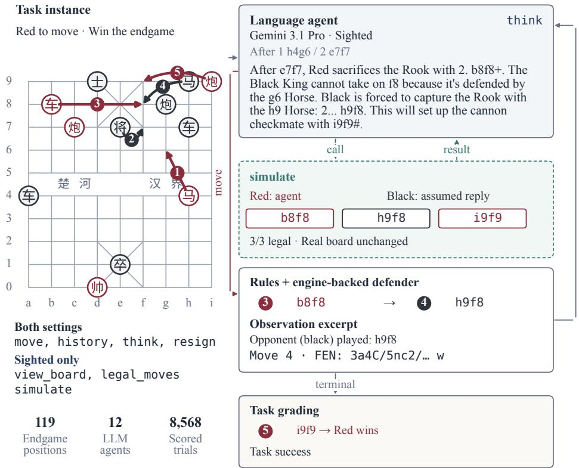  
图 1 XiangqiBench 概览。左：一个任务实例，初始棋盘上叠加了真实对局轨迹（标出半回合序号；智能体用深红色表示，防守方用炭灰色表示；曲线用于区分标注，并非棋子的移动路径）、不同设置下可用的工具，以及评测规模。右：案例 SQYQ-251 的第 3 次可观测试验中，Gemini 3.1 Pro 在真实半回合 1–2 之后第二次执红决策的过程（附录 G）。图中展示了模拟前完整的 think 响应；随后 simulate 在棋盘副本上检查模型指定的三个半回合，其中包括假设的黑方应招。防守方的真实应招会影响下一次决策，而最终红方获胜才决定任务成功。

2025; Liu et al., 2025; Xu et al., 2026), Seed 2.0 Pro (Seed, 2026), Kimi K2.5 (Team et al., 2026), Mistral Large 3 (Mistral AI, 2025), MiniMax M2.5 (Chen et al., 2026) 和 GPT-OSS 120B (Agarwal et al., 2025)；详见附录 B），并采用两种观测设置：可观测设置会提供棋盘刷新、合法着法反馈 和模拟沙盒；而受限观测设置不提供棋盘刷新、状态查询和模拟，以检验模型根据着法历史跟踪状态的能力。我们的贡献如下：

• 用于对抗式转化的基准：119 个由搜索支持的战术残局、带引擎防守方的可执行规则环境，以及记录的 8,568 条轨迹。

• 带有过程记录的决策闭环：我们追踪每次试验从首着开始，经过模拟合法性与真实着法采纳，再到防守方应招偏离和最终结果的完整过程。

• 表面能力与闭环能力之间的三种差距：转化差距（参考首着很少直接带来胜利）、稳定性差距（pass@3 远高于 pass^3）以及模拟差距（智能体自行编写的推演经常违反规则或误判防守方）；对两种表现最强的模型进行的受控消融表明，受限观测设置下的大部分性能下降可能来自提示词和反馈，而非仅仅来自看不到棋盘。

## 2 相关工作

交互式智能体评估。AgentBench、SWE-bench、WebArena 和 OSWorld 评估连续调用工具和控制计算机的能力（Liu et al., 2024; Jimenez et al., 2024; Zhou et al., 2024; Xie et al., 2024）。在游戏领域，GTBench、GameBench、GAMEBoT、KORGym 和 TextArena 提供了以规则为基础的策略环境（Duan et al., 2024; Costarelli et al., 2024; Lin et al., 2025; Shi et al., 2025; Guertler et al., 2025）。XiangqiBench 对这些工作作出补充：它专门考察智能体如何在引擎防守方的对抗下，将由搜索支持的必胜局面转化为胜局；评测只按终局结果计分，同时记录中间规划与真实着法执行（Grace et al., 2026）。

游戏规划、状态跟踪与模拟。棋类游戏被用作研究神经网络规划与表征能力的测试环境（Toshniwal et al., 2022; Feng et al., 2023; Ruoss et al., 2024; Schultz et al., 2025）。在国际象棋领域，ChessArena 和 LLM Chess 评估模型与其他 LLM、随机玩家及引擎进行完整对局的表现；ChessArena 还加入了只提供着法历史的蒙眼模式（Liu et al., 2026; Kolasani et al., 2025）。LMRL-Gym 将理论残局用作多轮强化学习测试环境（Abdulhai et al., 2025），Xiangqi-R1 则通过多阶段训练 7B 模型来提升着法合法性和局面分析能力（Chen et al., 2025）。与这些工作不同，我们研究通用型前沿 LLM 在多轮残局转化中的表现，并将决策闭环分解为草稿模拟、真实着法采纳，以及抵御引擎反击的能力。

可靠性指标。遵循 Chen et al. (2021) 和 Yao et al. (2025)，我们使用 pass@k（至少一次成功）和 pass^k（k 次尝试全部成功）的无偏有限样本估计量；对比二者可以看出，能够赢下一局的智能体是否也能稳定地做到这一点。

## 3 XiangqiBench：任务构建

语料。XiangqiBench 从中国象棋古典棋谱中整理了 119 个红方可强制将死对方的战术排局：其中 116 个来自《石清雅趣》$Q u ^ { 1 }$（案例编号 SQYQ-n），另外 3 个来自经典《江湖集》（JH-n）。每个条目都以 Forsyth–Edwards 记谱法（FEN）给出一个由红方走棋的初始局面；提示词和评分过程均不提供历史解法文本。评测期间，可执行的规则适配器会验证每个提议的着法。中国象棋的合法性涉及非局部约束：棋子必须遵守九宫边界和过河规则；炮吃子时必须隔一个炮架；马会被相邻棋子绊腿；将帅不能在同一条无棋子的直线上相对。

搜索支持的纳入标准。历史棋谱可能存在转录错误或遗漏的防守，因此我们不直接采信原始解法。相反，我们使用 Pikafish（Official Pikafish Contributors, 2026）筛选每个局面。这是一款强大的开源中国象棋引擎，源自 Stockfish，将 alpha–beta 搜索与 NNUE 评估网络结合起来。纳入时，对每个局面运行单线程、限时搜索；当引擎报告红方有强制杀棋时，该局面便纳入基准。报告的杀棋步数和引擎偏好的首着被保存为案例元数据；后者在第 5 节中用作根节点参考着法。引擎无法确认的排局，则可能通过仅限将军的杀棋搜索纳入，并另行标记（附录 A）。评测时由同一系列引擎执黑防守（第 4 节）。由于纳入标准依赖有界搜索而非完整的证明树，我们将这些局面描述为“搜索支持”，而不称为形式化证明；此外，我们还人工检查了全部 119 个局面，以确认红方可以强制将死。

为何研究残局。与 LMRL-Gym 的国际象棋残局任务类似（Abdulhai et al., 2025），我们从残局而非完整对局开始：目标（将死）固定且可达，因此未能将死可归因于智能体；开局记忆和长局消耗因素被排除；少数几步精确计算即可决定胜负。LMRL-Gym 研究的是由少量棋子构成、对阵 1200 Elo 引擎的理论残局；我们的任务则是战术排局残局（棋子数中位数为 14），局面由连续将军、杀棋威胁和牵制构成，并由强引擎防守，因此智能体不能依靠对手失误取胜。

局面类别与搜索深度。红方在每个局面中都能强制将死；两个类别的区别只在于黑方是否能反击。纳入时，也会在黑方走棋的条件下运行同一引擎或求解器。如果此时黑方也能强制将死，该局面就属于竞速杀棋：红方必须持续将军，因为一着缓手可能让黑方先完成杀棋。否则属于无对手杀棋：未发现黑方能反杀，因此缓手会损失先手，但本身不会让黑方获胜。记录的杀棋距离为 3 至 11 个半回合（中位数为 9；图 2）。$40$ 回合上限超过最长记录距离的三倍，为迂回和恢复留出了空间；而在此距离范围内，成功率已经显著下降（第 5 节）。更长的排局会使几乎所有模型的成绩降至零，而当前距离范围仍能区分表现最强的模型。

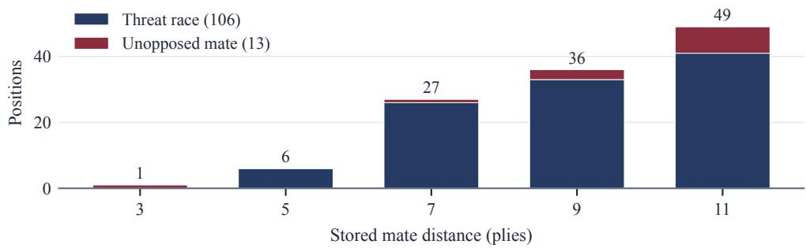  
图 2 按类别划分的 119 个局面的记录杀棋距离。距离取自纳入时 Pikafish 或仅限将军求解器的报告，按类别堆叠：106 个竞速杀棋（若轮到黑方走棋，黑方也有强制杀棋）和 13 个无对手杀棋（未发现此类反杀）。这些距离是纳入时的元数据，并非评测中轨迹长度的限制。

表 1 REPL 动作空间与可观测性约定。只有 $\mathcal { A } _ { \mathrm { e n v } }$ 会改变真实棋盘。

<table><tr><td>类别</td><td>命令与操作语义</td><td>可观测</td><td>受限</td></tr><tr><td rowspan="2"> $\mathcal{A}_{env}$  (状态转移)</td><td>move(from_to)：验证并提交真实着法；触发防守方应招</td><td>√</td><td>√</td></tr><tr><td>resign()：认输；以防守方获胜结束试验</td><td>√</td><td>√</td></tr><tr><td rowspan="3"> $\mathcal{A}_{query}$  (感知)</td><td>view_board()：渲染 ASCII 棋盘、FEN、当前行棋方和棋子清单</td><td>√</td><td>✕</td></tr><tr><td>get_legal_moves()：列出当前局面的所有合法着法</td><td>√</td><td>✕</td></tr><tr><td>get_history()：返回带棋子注释的着法序列</td><td>√</td><td>√</td></tr><tr><td rowspan="2"> $\mathcal{A}_{sim}$  (假设)</td><td>simulate(moves)：在克隆状态上执行交替着法线；验证合法性</td><td>√</td><td>✕</td></tr><tr><td>think(text)：记录尚未执行的思考过程</td><td>√</td><td>√</td></tr></table>

## 4 交互与评测协议

REPL 动作空间。智能体执红对阵引擎防守方，最多进行 40 个半回合。每回合它会收到观测 $o _ { t }$（以及交互历史 $h _ { t } )$，并在输出自由文本的同时发出三类命令之一（表 1）：状态转移 $\mathcal { A } _ { \mathrm { e n v } } .$，用于以 ICCS 坐标提交着法（例如 move h2h9）并触发防守方应招，或认输；只读查询 $A _ { \mathrm { { q u e r y } } }$，用于查看棋盘、合法着法或历史，但不推进对局；以及假设操作 $\mathcal { A } _ { \mathrm { s i m } }$，其中 simulate 会在棋盘克隆体上执行最多 8 个由模型提供的交替半回合并报告其合法性，think 则记录思考过程。

观测设置。在可观测设置下，每次环境步之后都会向智能体提供更新后的棋盘、FEN 和合法着法，并允许它使用所有查询和模拟器；这用于测试带外部感知的智能体系统。在受限观测设置下，棋盘和 FEN 只在开始时显示一次；此后智能体只能收到着法坐标和吃子信息，view\_board、get\_legal\_moves 和 simulate 均不可用，因此它必须根据着法历史跟踪局面。两种设置还使用不同的系统提示词（附录 A.3）。

引擎防守与终止条件。每次接受智能体着法后，黑方会依据单线程 Pikafish（Official Pikafish Contributors, 2026）固定深度 18 的搜索结果应招；环境回退机制见附录 A。若红方将死黑方，或令黑方无合法着法（无子可动者判负），则试验以智能体获胜结束。若黑方将死红方、智能体认输、用尽 40 个半回合预算、连续出现超过 3 次非法着法，或发生三次重复局面，则试验失败。

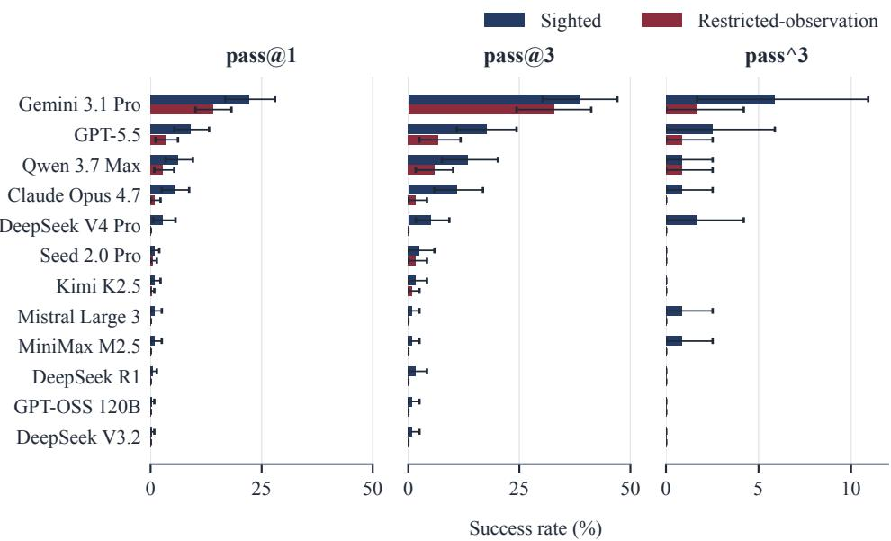  
图 3 前沿 LLM 的多轮残局转化表现。柱形分别表示 119 个局面上的平均 pass@1（单次试验成功率）、pass@3（三次尝试至少成功一次）和 pass^3（三次尝试全部成功；每种模型/设置各有 357 次试验）。误差线表示按案例聚类的 95% 自助法区间。

根据正式规则，长将者判负；我们的回放使用简化的长将规则裁定持续将军（附录 A.5）。

指标：探索能力与稳定性。令 $c _ { i }$ 表示案例 $i$ 的 $n _ { i } = 3$ 次试验中成功的次数，共有 $|I| = 119$ 个局面。我们报告以下指标（Chen et al., 2021; Yao et al., 2025）：

$$
\widehat{\text{pass@k}} = \frac{1}{|\mathcal{I}|} \sum_{i=1}^{|\mathcal{I}|} \left[1 - \frac{\binom{n_i-c_i}{k}}{\binom{n_i}{k}}\right], \qquad \widehat{\text{pass}^k} = \frac{1}{|\mathcal{I}|} \sum_{i=1}^{|\mathcal{I}|} \frac{\binom{c_i}{k}}{\binom{n_i}{k}} \quad (1)
$$

pass@k 估计 $k$ 次尝试中至少成功一次的概率（探索性触达），pass^k 则估计 $k$ 次尝试全部成功的概率（稳定性）。

## 5 评测结果

## 5.1 稳定性差距：偶尔成功与可靠转化

在所有模型和观测设置下，单次试验转化率（pass@1）都较低（图 3）。在可观测设置下，Gemini 3.1 Pro 以 22.1% 的 pass@1（79/357 次试验）领先，其后是 GPT-5.5 的 9.0%（32/357）和 Qwen 3.7 Max 的 6.2%（22/357）。在受限观测设置下，所有模型的表现都下降：Gemini 降至 14.0%，GPT-5.5 降至 3.4%，Qwen 降至 2.8%；其中 9 个模型的成绩不超过 0.8%。

重复尝试揭示了“能赢一次”与“能稳定复现”的差别。在可观测设置下，Gemini 3.1 Pro 的 pass@3 为 38.7%（119 个局面中有 46 个至少赢过一次），但 pass^3 只有 5.9%（7/119）：在这 46 个局面里，它仅有 7 个局面三次试验全部获胜。GPT-5.5 对应的局面数为 21 和 3（17.6% 和 2.5%）。5 个模型在两种设置下的 pass^3 均为零，另有 9 个模型在受限观测下为零。获胜局面也并非均匀分布。假设 Gemini 的单次试验胜率 22.1% 在每个局面上独立成立，则 pass@3 应为 52.7%，pass^3 应为 1.1%；实际观察到的 38.7% 和 5.9% 表明，胜利集中在一部分局面上。在可观测设置下，Mistral Large 3 和 MiniMax M2.5 各自只在一个局面上三次试验全部获胜。即使在这部分局面内，结果也随尝试而变化：Gemini 至少赢过一次的 46 个局面中，它赢下了 57% 的试验（79/138）；其中分别赢 1 次、2 次和 3 次的局面数为 20、19 和 7，接近按该胜率独立试验时的预期数 16、21 和 9。因此，模型能力取决于具体局面；即使能力确实存在，单次运行也不能可靠地体现出来。

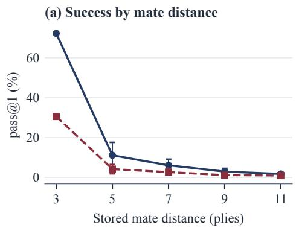

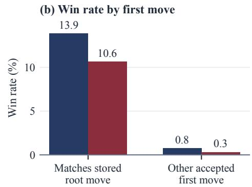  
图 4 转化差距的分解。(a) 按记录杀棋距离划分的 12 个 LLM 平均 pass@1，分别显示各观测设置（按案例自助法计算的 95% 区间；3 个半回合的区间只有一个局面）。(b) 根据智能体首着是否与保存的参考着法一致进行条件化后的胜率。

## 5.2 转化差距：找到着法与赢得比赛

成功率随记录杀棋距离增加而急剧下降（图 4a）：12 个 LLM 的可观测设置平均 pass@1 在 5 个半回合时为 11.1%，7 个时为 6.1%，9 个时为 2.9%，11 个时为 1.8%。杀棋距离为 9 和 11 个半回合的 85 个局面占基准的 71%。

为定位转化失败发生在哪里，我们将智能体的第一个真实着法与引擎保存的参考着法进行比较（图 4b）。在所有可观测试验中，26.1% 的首着与参考着法一致，远高于从根节点合法着法中均匀随机选择时的预期值 3.3%；Gemini 3.1 Pro 在 45.1% 的试验中与参考着法一致，GPT-5.5 则为 42.9%。然而，走出正确首着很少能带来胜利。以参考着法开局的试验中，仅有 13.9% 获胜（155/1,117），也就是说，超过 86% 的试验随后仍输掉了比赛。以其他任何被接受的着法开局时，可观测设置下的胜率为 0.8%，受限观测设置下为 0.3%；首着不同并不一定会输，因为某些局面可能有多个制胜首着。因此，实际中参考着法近乎必要（178 场可观测胜局中有 155 场以它开局），但远非充分条件。各模型内部也存在相同差距：Gemini 在 45.1% 的试验中走出参考着法，但转化率只有 22.1%；GPT-5.5 与参考着法一致的比例为 42.9%，但转化率为 9.0%。我们将此称为转化差距：若评测只给首着评分，这些模型获得的成绩会约为其完整对局实际成功率的 2 至 5 倍。

## 5.3 受限观测的影响

受限观测会降低每个模型的 pass@1。平均 pass@1 从可观测设置下的 4.15% 降至受限观测下的 1.82%，下降 2.33 个百分点（按案例自助法计算的 95% 区间为 [1.42, 3.41]），降幅超过一半。首着一致率降至 15.1%，而以非法动作或未发出命令导致终止的平均试验比例则从 2.7% 升至 27.6%（第 6 节）。不过，受限观测也改变了提示词。附录 E 通过固定提示词，并分别移除状态刷新和命令进行消融，发现性能降幅缩小：在两个模型于可观测设置下曾解决的局面上，GPT-5.5 和 Gemini 在两者都移除时的胜率分别为 38.1% 和 41.7%；两者都保留时分别为 39.7% 和 48.3%，而在受限观测设置下则分别为 9.5% 和 20.0%。因此，这一降幅反映的是整个设置的影响，而非单独由看不到棋盘造成。

## 6 行为分析

## 6.1 模型如何使用 REPL 界面

图 5 显示各模型如何在不同 REPL 命令间分配动作；可以观察到三种规律。模拟次数与成功率并不同步。在可观测设置下，simulate 占 Gemini 3.1 Pro 动作的 45%，但也分别占 DeepSeek V3.2 和 DeepSeek V4 Pro 动作的 44% 和 43%，而后两者的 pass@1 分别只有 0.3% 和 2.8%。12 个模型中有 7 个在 357 条可观测轨迹中至少有 290 条请求模拟（表 8）；只有 DeepSeek R1（占动作的 1.1%）和 GPT-OSS 120B（5.0%）基本不使用模拟。着法线长度也无法区分模型：Qwen 3.7 Max 和 Mistral Large 3 请求的着法线最长（平均 4.2 和 3.9 个半回合），而 GPT-5.5 在 71.9% 的已接受调用中只模拟一个半回合（表 9）。着法线合法性可以区分两端模型，却无法区分中间组：GPT-5.5 和 Gemini 分别在 353/356 和 299/332 条模拟轨迹中至少得到一条完全合法的着法线，而 Mistral Large 3 为 14/213；但 DeepSeek V3.2 达到 292/352，残局转化率仍几乎为零。显式状态查询很少见，也并未集中在表现最强的模型上。由于可观测界面每步都会返回棋盘和合法着法，两个最强模型几乎从不调用 view\_board 或 get\_legal\_moves（最多占动作的 2.2%）；使用最多的是 DeepSeek V3.2（12% 和 8.4%）与 DeepSeek V4 Pro（8.6% 和 5.8%）。在受限观测设置下，表现最弱的模型以被拒绝动作居多。没有状态刷新时，Gemini、GPT-5.5 和 Claude Opus 4.7 的被拒绝动作仍占 5–9%，中间组升至 24–42%，Mistral Large 3 和 MiniMax M2.5 则分别达到 93% 和 79%（图 5）。这两个模型贡献了受限观测下 5,850 次被拒绝动作中的 2,101 次，却只从中恢复不到 5%；而 Gemini 3.1 Pro、GPT-5.5、Claude Opus 4.7 和 Qwen 3.7 Max 在两种设置下的恢复率都至少为 88%（附录图 19；时间变化见第 6.2 节）。

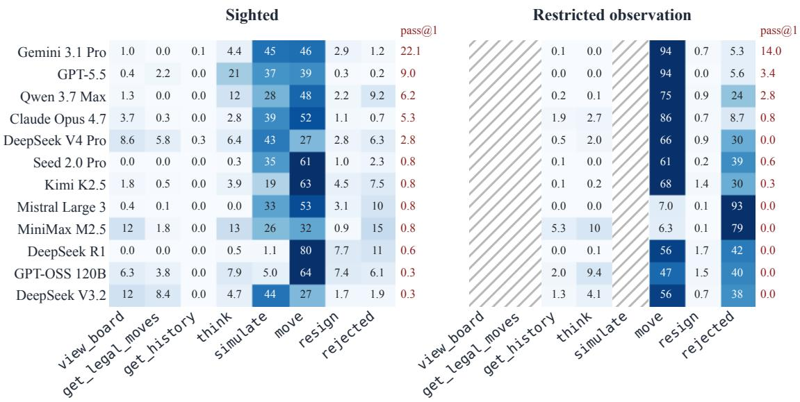  
图 5 各模型的动作构成。每个单元格给出完整轨迹中智能体所有 REPL 调用里各表 1 命令所占比例（%）；simulate 包含因超预算而被拒绝的调用，move 统计被接受的着法，rejected 则统计被拒绝的着法以及图 6 中其他被拒绝的调用。每行合计为 100%。斜线填充的单元格表示受限观测设置下不可用的命令。红色数字表示 pass@1（%）。

## 6.2 轨迹中的 REPL 使用情况

图 6 按试验相对进度 [0, 1] 跟踪 REPL 调用的构成。

• 思考与超预算模拟（可观测设置）：成功试验中，think 占调用的 14.9%（轨迹的第一个四分位中为 17.4%），而失败试验中为 7.6%。失败试验中，有 14.2% 的调用是因超过单回合预算而被拒绝的模拟请求；成功试验中这一比例为 8.6%。这些请求不会推进棋局。在失败轨迹的最后一个四分位中，认输调用升至 9.3%。

• 持续出现非法着法（受限观测）：失败的受限观测试验中，被拒绝的着法占全部调用的 33.3%，而成功试验中为 6.7%。从一开始这一比例就很高（第一个四分位为 29.1%，最后一个为 33.1%），说明状态跟踪错误很早便会出现，并非只是在局势恶化过程中逐渐累积。

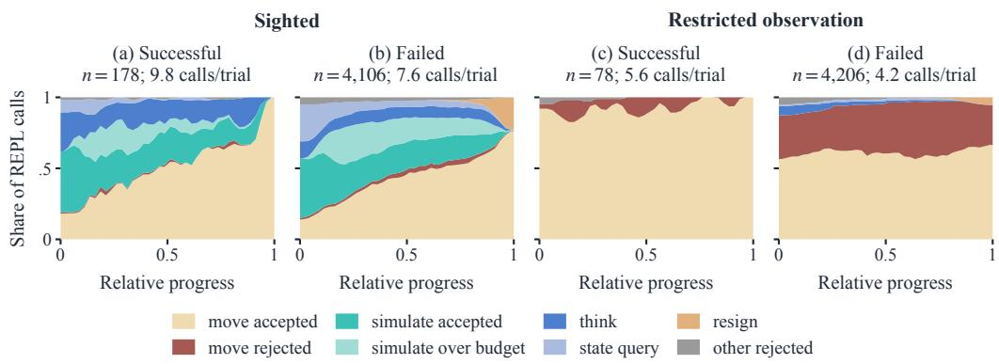  
图 6 轨迹中的 REPL 调用构成。将全部 12 个 LLM 的调用按归一化轨迹进度 [0, 1] 合并；每次智能体调用恰好属于一个类别。状态查询统计表 1 中被接受的只读感知调用（view\_board、get\_legal\_moves、get\_history；受限观测下仅包括 get\_history）；其他拒绝项包括未知或格式错误的命令、没有推理内容的 think 调用，以及超出限制或已禁用的查询。与失败试验相比，成功的可观测试验将更多调用用于 think、较少用于超预算模拟；失败的受限观测试验中，被拒绝的着法始终占比较高。

在整个基准中，攻击方被将死或陷入无子可动仍是主要失败方式（可观测设置 3,124 次，受限观测设置 2,777 次）；此外，受限观测还导致 1,178 次因非法动作而终止弃权（表 11）。

按模型拆分的结果（图 14–17）显示，可观测设置下 Gemini 3.1 Pro 的差异最明显：其获胜试验中 think 占调用的 14.0%，超预算模拟占 8.7%；失败试验中则分别为 2.4% 和 19.0%。GPT-5.5 是个例外，无论胜负，它都会交替使用 think 和模拟，直至最后一着（think 占比为 24.4% 和 21.2%）。在受限观测设置下，被拒绝的着法占 Gemini 3.1 Pro 和 GPT-5.5 调用的 5.2% 和 5.6%，但占 MiniMax M2.5 的 77.6% 和 Mistral Large 3 的 92.9%。每个模型最多只有 79 场胜局，因此这些差异仅作描述性分析。

## 6.3 模拟差距：检查合法性并不等于预判对手

一种自然的假设是，前向模拟沙盒 $\left( \mathcal { A } _ { \mathrm { s i m } } \right)$ 能让模型在执行战术着法线前先行验证。可观测设置下发出的 11,342 次模拟请求揭示了它在验证方面的两个局限（图 7a、b）；受控消融则表明，它仍有助于完成转化（图 7c）。

着法线越长，合法性越低。在 6,749 次被接受的模拟调用中，4,474 次合法执行了完整候选序列，2,178 次（32.3%）在遇到非法着法时停止，其余 97 次因模拟到达终局或达到 8 个半回合上限而提前结束。单步请求几乎总是合法（2,592 次调用中有 96.3% 合法），但完整着法线的合法率在 3–4 个半回合时降至 47.6%（1,110/2,332），在 5–8 个半回合时降至 37.4%（357/955）。在自己的思维草稿中，模型会让棋子越过九宫边界、忽略牵制，或漏掉炮架。

模型假设的对手应招常与真实防守方不同。每条多步模拟着法线都包含一个由模型自行选择的防守方应招。在智能体将一条完全合法着法线的首着用于真实棋盘的 1,677 个案例中，真实防守方有 49.3% 的情况（826/1,677）走出了不同应招，因此模型后续的着法线不再是先前检查过的那条线。这些数据记录的是应招不一致，并不代表假设应招的质量；沙盒只验证模型对对手的假设，而防守方往往并不认同这一假设。

沙盒仍能帮助表现最强的模型。这些限制并不意味着模拟毫无用处。我们在主评测中分别选取 Gemini 3.1 Pro 至少解出过一次的 20 个局面，以及 GPT-5.5 至少解出过一次的 21 个局面，在可观测设置下重新运行这两个模型，比较启用和禁用 simulate 的表现；两种条件使用相同提示词和正确的将军字段（附录 E）。消融还会禁用 view\_board 和 get\_legal\_moves，但由于每步都会刷新状态，两个模型几乎从不调用这两项工具（每回合最多 0.05 次，而原本分别为 0.75 次和 0.98 次）。

(a) 模拟请求

占比（%）
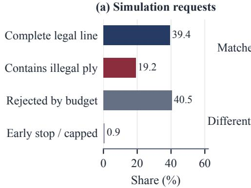

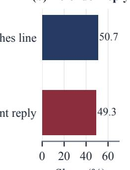  
(c) 未启用 simulate

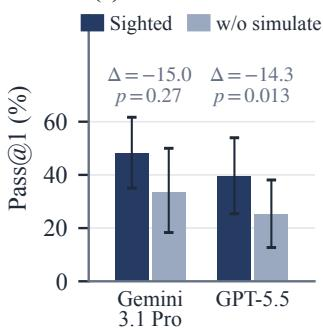  
图 7 模拟能检查合法性，却不能预判对手；但移除模拟会减少胜局。(a) 可观测设置下全部 11,342 次模拟请求的结果；“提前结束/达到上限”包括 93 个合法模拟终局，以及 4 条截断在 8 个半回合的合法前缀。(b) 在 1,677 条被采用且假设的防守方应招合法的候选着法线中，真实防守方是否也走了该应招。(c) 在各模型于可观测设置下曾经解出的局面上进行受控消融，每个局面进行三次试验（附录 E）：比较启用与禁用 simulate；消融还会禁用 view\_board 和 get\_legal\_moves，因为状态刷新后两个模型都不会使用它们。柱形表示带 95% 案例自助法区间的 pass@1；∆ 表示配对的百分点差异；p 表示按局面进行的精确符号检验。

次模拟调用）。禁用 simulate 后，Gemini 的 pass@1 从 48.3% 降至 33.3%，GPT-5.5 则从 39.7% 降至 25.4%（图 7c）。GPT-5.5 的配对降幅具有统计显著性 $( p = 0 . 0 1 3 )$；Gemini 的降幅方向相同，但不显著 $( p = 0 . 2 7 )$。因此，模拟有助于表现最强的模型取得胜利，尽管它只能验证模型自己对对手的假设。没有状态刷新的情况下，禁用相同命令并不会进一步降低 pass@1（附录 E）。

失败的智能体被防守方抢先将死。对局如何结束揭示了这一差距的代价（图 8）。胜局很少偏离最短路线：178 场可观测胜局中有 142 场、78 场受限观测胜局中有 62 场恰好在记录的杀棋距离结束。失败则更早结束：77.8% 的可观测失败试验和 83.8% 的受限观测失败试验都在达到该距离之前停止。8,568 条轨迹中只有 80 条达到第 40 个半回合：76 条到达回合上限（可观测 29 条，受限观测 47 条），另有 4 条在该半回合因重复局面和棋。大多数失败发生在棋盘上，而且失败比例与防守方的反杀威胁相关：在 106 个竞速杀棋局面中，失败比例为 81.8%（可观测）和 70.4%（受限观测）；在 13 个无对手杀棋局面中则为 28.2% 和 29.8%。在防守方威胁一步杀的 81 个局面中，23.8% 的可观测试验和 30.0% 的受限观测试验在第 2 个半回合结束：智能体的首着没有阻止威胁，防守方随即将死。失败的智能体并非停滞不前，而是被其未预料到的应招抢先击败。即使落败，较强模型也能存活更久：在 12 个模型中，失败试验的中位相对长度随获胜局数增加而上升（Spearman $\rho = 0 . 7 1$，可观测；0.89，受限观测）。

## 7 讨论

结果为“找到好着法”与“将优势局面转化为胜局”之间的差距提供了两种可能解释。二者都是与数据相符的解读，而非已经证实的原因。

摊销策略与对抗搜索。要将优势局面转化为胜局，每一步都必须经得住防守方的最佳应招，也就是需要在棋盘状态 $s_t$ 上近似计算 $V^{*}(s_t) = \max_{a_t} \min_{a_{\mathrm{def}}} V^{*}(s_{t+1})$。而语言模型是从主要受预训练塑造的摊销策略 $P_{\theta}(a_t \mid o_t, h_t)$ 中采样每个动作。正如首着 26.1% 的一致率所示，这种策略能够掌握熟悉的战术模式，但其中并没有机制逐一检查每步后续变化能否抵御反击。若模型在第 $t$ 步出错的概率为 $\epsilon_t$，那么长度为 $H$ 的着法线上的成功率大致会按 $\prod_{t=1}^{H}(1 - \epsilon_t)$ 递减。这一简化解释与 pass@1 随杀棋距离增加而急剧下降的现象相符，也与 Gemini 首着一致率为 45.1%、但转化率只有 22.1% 的差距相符。不过，该解释并不完整：不同着法之间的错误并非相互独立，胜局也集中在特定局面上。

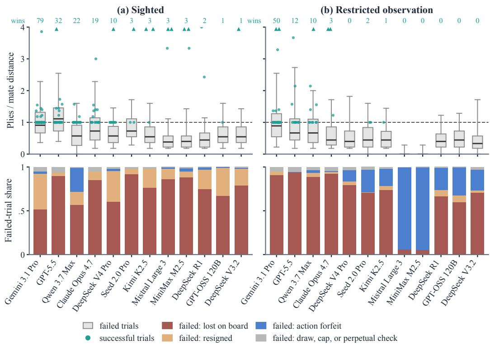  
图 8 失败轨迹提前结束，成功轨迹则在参考长度结束。上图：已走半回合数除以案例的记录杀棋距离（虚线表示长度相等）。箱线图汇总失败试验（须线表示第 5–95 百分位数），散点表示成功试验，各面板上方数字表示 357 次试验中的胜局数。三角形表示 15 场长度超过杀棋距离四倍的胜局，均出现在 JH-084；该局面中防守方因长将而判负。下图：失败试验的结束方式；“棋盘上落败”表示攻击方已无合法着法，“动作弃权”包括非法动作、未发出命令和超出动作上限导致的失败。

模拟检查合法性，却不能验证对手。每条模拟着法线的双方着法都由智能体填写。三分之一被接受的模拟会因非法着法而停止；当合法着法线以实际走出的着法开局时，约一半案例中的真实防守方会选择不同应招（第 6 节）。这并不能证明模型想象的应招不好，因为多个防守着法可能同样有力；但它说明沙盒无法提供对手的真实选择。在对抗环境中依赖自行编写推演的智能体，仍需要外部的对手行为来源。

对智能体评估的启示。(i) 评估闭环转化能力：首着一致并不代表有能力赢下整局，因此基准应包含与主动对手的对局。(ii) 在报告覆盖率的同时报告可靠性：这里的 pass@k 和 pass^k 差距显著，应同时报告。(iii) 每次只改变一种能力条件：受限观测使 pass@1 降低一半以上，但受控消融将大部分降幅归因于提示词和反馈，而非棋盘信息缺失，因此观测设置之间应只在所测试的能力条件上有所差异。

## 8 结论

我们提出了 XiangqiBench，这是一个可执行基准，要求语言智能体在对阵引擎防守方时，将经搜索支持的中国象棋残局优势转化为将死。基于 12 个前沿 LLM 的 8,568 条轨迹，我们发现，找到着法并不等于赢得比赛：首着一致率、pass@3 和智能体自行编写的模拟都会高估闭环成功率。要缩小这些差距，可能不能只改进单步着法提议；智能体还必须稳定获胜，并预判对手的应对。XiangqiBench 为衡量这两种能力提供了可控的测试环境。

## 参考文献

Marwa Abdulhai, Isadora White, Charlie Victor Snell, Charles Sun, Joey Hong, Yuexiang Zhai, Kelvin Xu, and Sergey Levine. LMRL Gym: Benchmarks for multi-turn reinforcement learning with language models. In Proceedings of the 42nd International Conference on Machine Learning, volume 267 of Proceedings of Machine Learning Research, pp. 126–153. PMLR, 2025. URL https://proceedings.mlr.press/v267/abdulhai25a.html.

Sandhini Agarwal, Lama Ahmad, Jason Ai, Sam Altman, Andy Applebaum, Edwin Arbus, Rahul K Arora, Yu Bai, Bowen Baker, Haiming Bao, et al. gpt-oss-120b & gpt-oss-20b model card. arXiv preprint arXiv:2508.10925, 2025.

Anthropic. Claude Opus 4.7, 2026. URL https://www.anthropic.com/news/claude-opus-4-7.

Aili Chen, Aonian Li, Baichuan Zhou, Bangwei Gong, Binyang Jiang, Boji Dan, Changhao Zhang, Changqing Yu, Chao Wang, Cheng Ma, et al. The minimax-m2 series: Mini activations unleashing max real-world intelligence. arXiv preprint arXiv:2605.26494, 2026.

Mark Chen, Jerry Tworek, Heewoo Jun, Qiming Yuan, Henrique Ponde de Oliveira Pinto, Jared Kaplan, Harri Edwards, Yuri Burda, Nicholas Joseph, Greg Brockman, et al. Evaluating large language models trained on code. arXiv preprint arXiv:2107.03374, 2021. URL https://arxiv.org/abs/2107.03374.

Yuhao Chen, Shuochen Liu, Yuanjie Lyu, Chao Zhang, Jiayao Shi, and Tong Xu. Xiangqi-R1: Enhancing spatial strategic reasoning in LLMs for chinese chess via reinforcement learning. arXiv preprint arXiv:2507.12215, 2025. URL https://arxiv.org/abs/2507.12215.

Anthony Costarelli, Mat Allen, Roman Hauksson, Grace Sodunke, Suhas Hariharan, Carlson Cheng, Wenjie Li, Joshua M. Clymer, and Arjun Yadav. GameBench: Evaluating strategic reasoning abilities of LLM agents. arXiv preprint arXiv:2406.06613, 2024. URL https://arxiv.org/abs/2406.06613.

Jinhao Duan, Renming Zhang, James Difenderfer, Bhavya Kailkhura, Lichao Sun, Elias Stengel-Eskin, Mohit Bansal, Tianlong Chen, and Kaidi Xu. GTBench: Uncovering the strategic reasoning capabilities of LLMs via game-theoretic evaluations. In Advances in Neural Information Processing Systems, volume 37, 2024. doi: 10.52202/079017-0885. URL https://proceedings.neurips.cc/paper\_files/paper/2024/hash/ 3191170938b6102e5c203b036b7c16dd-Abstract-Conference.html.

Xidong Feng, Yicheng Luo, Ziyan Wang, Hongrui Tang, Mengyue Yang, Kun Shao, David Mguni, Yali Du, and Jun Wang. ChessGPT: Bridging policy learning and language modeling. In Advances in Neural Information Processing Systems, volume 36, pp. 7216–7262, 2023.

Google DeepMind. Gemini 3.1 Pro, 2026. URL https://deepmind.google/models/gemini/pro/.

Mikaela Grace, Jeremy Hadfield, Rodrigo Olivares, and Jiri De Jonghe. Demystifying evals for AI agents. Anthropic Engineering, January 2026. URL https://www.anthropic.com/engineering/ demystifying-evals-for-ai-agents. Published January 9, 2026.

Leon Guertler, Bobby Cheng, Simon Yu, Bo Liu, Leshem Choshen, and Cheston Tan. TextArena. arXiv preprint arXiv:2504.11442, 2025. URL https://arxiv.org/abs/2504.11442.

Daya Guo, Dejian Yang, Haowei Zhang, Junxiao Song, Peiyi Wang, Qihao Zhu, Runxin Xu, Ruoyu Zhang, Shirong Ma, Xiao Bi, et al. Deepseek-r1: Incentivizing reasoning capability in llms via reinforcement learning. arXiv preprint arXiv:2501.12948, 2025.

Carlos E. Jimenez, John Yang, Alexander Wettig, Shunyu Yao, Kexin Pei, Ofir Press, and Karthik Narasimhan. SWE-bench: Can language models resolve real-world GitHub issues? In International Conference on Learning Representations, 2024. URL https://openreview.net/forum?id=VTF8yNQM66.

Sai Kolasani, Maxim Saplin, Nicholas Crispino, Kyle Montgomery, Jared Quincy Davis, Matei Zaharia, Chi Wang, and Chenguang Wang. LLM Chess: Benchmarking reasoning and instruction-following in LLMs through chess. arXiv preprint arXiv:2512.01992, 2025. URL https://arxiv.org/abs/2512.01992

Wenye Lin, Jonathan Roberts, Yunhan Yang, Samuel Albanie, Zongqing Lu, and Kai Han. GAMEBoT: Transparent assessment of LLM reasoning in games. In Proceedings of the 63rd Annual Meeting of the Association for Computational Linguistics, pp. 7656–7682, 2025. doi: 10.18653/v1/2025.acl-long.378. URL https: //aclanthology.org/2025.acl-long.378/.

Aixin Liu, Aoxue Mei, Bangcai Lin, Bing Xue, Bingxuan Wang, Bingzheng Xu, Bochao Wu, Bowei Zhang, Chaofan Lin, Chen Dong, et al. Deepseek-v3. 2: Pushing the frontier of open large language models. arXiv preprint arXiv:2512.02556, 2025.

Jincheng Liu, Sijun He, Jingjing Wu, Xiangsen Wang, Yang Chen, Zhaoqi Kuang, Siqi Bao, and Yuan Yao. Ches sArena: A chess testbed for evaluating strategic reasoning capabilities of large language models. In Proceed ings of the 64th Annual Meeting of the Association for Computational Linguistics, pp. 7901–7954, 2026. doi: 10.18653/v1/2026.acl-long.360. URL https://aclanthology.org/2026.acl-long.360/.

Xiao Liu, Hao Yu, Hanchen Zhang, Yifan Xu, Xuanyu Lei, Hanyu Lai, Yu Gu, Hangliang Ding, Kaiwen Men, Kejuan Yang, Shudan Zhang, Xiang Deng, Aohan Zeng, Zhengxiao Du, Chenhui Zhang, Sheng Shen, Tianjun Zhang, Yu Su, Huan Sun, Minlie Huang, Yuxiao Dong, and Jie Tang. AgentBench: Evaluating LLMs as agents. In International Conference on Learning Representations, 2024. URL https://openreview.net/forum?id=zAdUB0aCTQ.

Mistral AI. Introducing Mistral 3, 2025. URL https://mistral.ai/news/mistral-3/.

Official Pikafish Contributors. Pikafish: A free and strong UCI xiangqi engine. https://github.com/ official-pikafish/Pikafish, 2026. Accessed 2026-07-31.

OpenAI. Introducing GPT-5.5, 2026. URL https://openai.com/index/introducing-gpt-5-5/.

Qwen Team. Qwen3.7: The agent frontier, May 2026. URL https://qwen.ai/blog?id=qwen3.7.

Anian Ruoss, Grégoire Delétang, Sourabh Medapati, Jordi Grau-Moya, Li Kevin Wenliang, Elliot Catt, John Reid, Cannada A. Lewis, Joel Veness, and Tim Genewein. Amortized planning with large-scale transformers: A case study on chess. In Advances in Neural Information Processing Systems, volume 37, 2024. doi: 10.52202/079017-2102. URL https://proceedings.neurips.cc/paper\_files/paper/2024/hash/ 78f0db30c39c850de728c769f42fc903-Abstract-Conference.html.

Philipp Schmid. Pass@k vs. Pass^k: Understanding agent reliability. Technical blog post, March 2025. URL https: //www.philschmid.de/agents-pass-at-k-pass-power-k. Published March 24, 2025.

John Schultz, Jakub Adamek, Matej Jusup, Marc Lanctot, Michael Kaisers, Sarah Perrin, Daniel Hennes, Jeremy Shar, Cannada A. Lewis, Anian Ruoss, Tom Zahavy, Petar Veličković, Laurel Prince, Satinder Singh, Eric Malmi, and Nenad Tomasev. Mastering board games by external and internal planning with language models. In Proceedings of the 42nd International Conference on Machine Learning, volume 267 of Proceedings of Machine Learning Research, pp. 53581–53644. PMLR, 2025. URL https://proceedings.mlr.press/v267/schultz25a.html.

Bytedance Seed. Seed2. 0 model card: Towards intelligence frontier for real-world complexity. arXiv preprint arXiv:2607.00248, 2026.

Jiajun Shi, Jian Yang, Jiaheng Liu, Xingyuan Bu, Jiangjie Chen, Junting Zhou, Kaijing Ma, Zhoufutu Wen, Bingli Wang, Yancheng He, Liang Song, Hualei Zhu, Shilong Li, Xingjian Wang, Wei Zhang, Ruibin Yuan, Yifan Yao, Wenjun Yang, Yunli Wang, Siyuan Fang, Siyu Yuan, Qianyu He, Robert Tang, Yingshui Tan, Wangchunshu Zhou, Zhao-Xiang Zhang, Zhoujun Li, Wenhao Huang, and Ge Zhang. KORGym: A dynamic game platform for LLM reasoning evaluation. In Advances in Neural Information Processing Systems, volume 38, 2025. doi: 10.52202/085713-5384. URL https://proceedings.neurips.cc/paper\_files/paper/2025/ hash/ebfa4297cd6419f64efe86f657ba49d0-Abstract-Conference.html.

Kimi Team, Tongtong Bai, Yifan Bai, Yiping Bao, SH Cai, Yuan Cao, Ziwei Chai, Y Charles, HS Che, Cheng Chen, et al. Kimi k2. 5: Visual agentic intelligence. arXiv preprint arXiv:2602.02276, 2026.

Shubham Toshniwal, Sam Wiseman, Karen Livescu, and Kevin Gimpel. Chess as a testbed for language model state tracking. In Proceedings of the AAAI Conference on Artificial Intelligence, volume 36, pp. 11385–11393, 2022. doi: 10.1609/aaai.v36i10.21390.

Tianbao Xie, Danyang Zhang, Jixuan Chen, Xiaochuan Li, Siheng Zhao, Ruisheng Cao, Toh Jing Hua, Zhoujun Cheng, Dongchan Shin, Fangyu Lei, Yitao Liu, Yiheng Xu, Shuyan Zhou, Silvio Savarese, Caiming Xiong, Victor Zhong, and Tao Yu. OSWorld: Benchmarking multimodal agents for open-ended tasks in real computer environments. In Advances in Neural Information Processing Systems, 2024.

Anyi Xu, Bangcai Lin, Bing Xue, Bingxuan Wang, Bingzheng Xu, Bochao Wu, Bowei Zhang, Chaofan Lin, Chen Dong, Chenchen Ling, et al. Deepseek-v4: Towards highly eficient million-token context intelligence. arXiv preprint arXiv:2606.19348, 2026.

Shunyu Yao, Noah Shinn, Pedram Razavi, and Karthik R. Narasimhan. τ-bench: A benchmark for tool-agentuser interaction in real-world domains. In International Conference on Learning Representations, 2025. URL https://openreview.net/forum?id=roNSXZpUDN.

Shuyan Zhou, Frank F. Xu, Hao Zhu, Xuhui Zhou, Robert Lo, Abishek Sridhar, Xianyi Cheng, Tianyue Ou, Yonatan Bisk, Daniel Fried, Uri Alon, and Graham Neubig. WebArena: A realistic web environment for building autonomous agents. In International Conference on Learning Representations, 2024. URL https://openreview.net/forum? id=oKn9c6ytLx.

## 附录

## A 基准与协议

## A.1 局面

每个案例记录标识符和来源、规范化 FEN、进攻方、纳入方式、一个根节点参考着法、报告的杀棋半回合数、局面类别和棋子标签。模型输出不参与纳入判定。由引擎纳入的案例来自单线程、定时（默认 800 毫秒）的 Pikafish 搜索；若搜索报告存在强制杀棋，便纳入该局面。引擎最终偏好的着法被保存为参考着法，且所有参考着法都经规则回放确认合法。Pikafish 无法加载的局面则通过仅限将军的杀棋搜索纳入，并单独标注。搜索日志、主要变化和每个案例的搜索设置均未存档，因此若要精确重建结果，还需要引擎构建版本及网络文件。

局面类别来自黑方走棋时进行的第二次搜索。竞速杀棋（106个案例）指黑方也有强制杀棋的局面；无对手杀棋（13 个案例）指在搜索限制内未发现黑方能反杀的局面。引擎纳入案例的搜索受时间限制（默认 300 毫秒），求解器纳入案例的搜索则受深度限制。

## A.2 防守方

每次轮到黑方走棋时，环境都会将当前 FEN 发送给 Pikafish，并执行其单线程深度 18 搜索给出的着法。若引擎无法加载局面或返回错误，则改由基于规则的防守方应招：它使用深度 5 的红方强制杀棋搜索为每个黑方合法着法评分，并优先选择搜索未发现杀棋的着法，其次选择能延长被杀步数的着法，再次选择将军着法；若仍然并列，则按着法字符串打破平局。两个由求解器纳入的案例 JH-084 和 JH-327 将黑方一枚兵放在己方底线，这种排局会被 Pikafish 拒绝，因此这两个案例中的黑方几乎每一步都由基于规则的防守方下出。这两个案例贡献了 178 场可观测胜局中的 39 场，以及 78 场受限观测胜局中的 17 场；其中包括 20 次长将获胜中的 18 次（附录 A.5）。记录只在初始化时记录防守方类型；每步着法的来源根据引擎拒绝情况推断。

## A.3 界面、预算与终止条件

两种设置共用表 1 中的命令界面；真实着法是坐标命令，例如 move h2h9。可观测设置的提示词要求模型强制将死。第一条消息提供棋盘、FEN 和合法着法；此后每条消息都会重复这些信息，并附带吃子和将军状态。受限观测设置使用通用的蒙眼提示词，其中描述的是标准开局局面，尽管第一条消息实际展示的是残局棋盘和 FEN。后续消息只报告着法、吃子、将军状态和子力；棋盘查看、合法着法查询和模拟均被禁用，但仍可使用 get\_history。提示词不匹配也反映在行为中：受限观测下被拒绝的首回合着法中，有 70.5%（2,330/3,304）仅在标准开局下合法；可观测设置下这一比例为 2.6%。由于提示词和观测条件同时变化，我们将设置对比视为描述性结果，并在附录 E 单独分析观测因素。两种提示词均在附录 C 中给出。

每次试验最多进行 40 个半回合。在占主导地位的配置中，每回合允许 8 次动作、查看一次棋盘、进行一次最多包含 8 个模型自选半回合的模拟、出现 3 次被拒绝动作（包括未知命令），以及连续 5 次未发出命令的回复。用尽任一预算都会导致试验弃权；达到回合上限仍未获胜则计为失败。不过，可观测提示词称超出动作上限时会强制走棋；有 25 次可观测试验因此以动作上限弃权结束。另有 75 条可观测记录使用 4 次动作上限，2 条使用 5 次拒绝上限。以 API 错误、超时或异常结束的记录，以及少量结果不确定或超出动作预算的记录，均不计入评分。

## A.4 轨迹记录与筛选

每条记录都保存初始棋盘和 FEN、每一步着法及着法前后的局面、每回合合法着法、每条提示词、模型文本和命令、服务提供方的 token 使用量、环境反馈以及终局结果。模拟结果以渲染后的反馈形式保存，并据此恢复每个半回合着法的合法性。在 2,856 个“模型—案例—设置”单元格中，我们按开始时间保留前三条计分记录，共得到 8,568 条轨迹。这样会遗漏另外 8 条记录，它们都以失败告终，且来自 Mistral Large 3 的 3 个可观测单元格；这些单元格中保留的试验也均告失败。API 重试次数用尽的请求不会留下记录，因此实际尝试的请求总数未知。

## A.5 规则回放与重复局面

将军标记。数据采集环境在每一步之后使用规则库的 is\_checking() 谓词设置将军标记。该谓词检查当前行棋方是否攻击对方将帅；合法走棋后这一条件永远不成立。因此，显示给智能体的 57,000 个 Check 字段，以及模拟输出中每个半回合对应的字段，都显示为 No。这个缺陷没有改变棋盘状态转移、着法合法性或胜者，但它将所有将死都标记成无子可动，并禁用了采集时的长将规则。

规则回放。我们使用 cchess 1.25.5 回放所有被接受的动作，并丢弃 423 条重复上一着的合成弃权记录。回放将存档中的 6,137 次无子可动拆分为 6,034 次将死和 103 次真正无子可动，但没有改变任何胜负结果。

重复局面。由于该标记始终为 false，采集时所有三次重复局面都按和棋计分。我们改为采用已发布环境的长将规则：三次重复时，自首次出现以来每一步都将军的一方判负；其他重复局面均为和棋。回放 138 条重复局面轨迹会复现所有存档局面，只改变终局标签。43 次持续将军中，攻击方造成的 23 次仍判为失败（可观测 16 次、受限 7 次）；防守方造成的 20 次则改判为胜局（分别为 14 次和 6 次），其中 18 次发生在 JH-084 的基于规则防守方对局中。如果所有重复局面都计为和棋，则可观测胜局为 164 场、受限观测胜局为 72 场，平均 pass@1 分别为 3.83% 和 1.68%，两种设置相差 2.15 个百分点（[1.38, 2.99]）。该规则简化了正式规则中的长将与长捉裁定。由于智能体从未收到正确的将军信号，它们的下法可能不同于获得正确信号时的表现；重新标记结果无法还原这种反事实。

## A.6 指标与不确定性

Pass@1 是每个模型和设置下 357 个二元结果的平均值。每个案例有三次试验；pass@k 使用 Chen et al. (2021) 的估计量，pass^k 使用 Yao et al. (2025) 的估计量：pass@3 是至少获胜一次的 119 个案例所占比例，pass^3 则是三次全部获胜的案例比例。我们只报告 $k \leq 3$。插件估计量 $( c _ { i } / n _ { i } ) ^ { k }$（Schmid, 2025）是另一种有限样本估计量，本研究未使用。设置比较的区间来自案例自助法：重采样 119 个案例，并将所有模型、设置和试验附在各自案例上（重采样 4,000 次，随机种子为 2027）。

## B 模型

表 2 列出了 12 个模型；每个模型在两种设置下的每个案例均有三次计分试验。模型名称沿用服务提供方的命名；部署版本未经独立验证。我们也尝试过 Kimi K2.6、GLM 5.1 和 Seed 2.1 Pro，但因凭据错误或请求超时而未能完成采集，因此将它们省略，而不是计为失败。

表 2 参评模型。Model ID 是轨迹存储时使用的名称；Weights 表示是否公开发布权重。每个模型在每种设置下贡献 357 条计分轨迹。

<table><tr><td>Model</td><td>Developer</td><td>Weights</td><td>Model ID</td></tr><tr><td>Gemini 3.1 Pro</td><td>Google</td><td>Closed</td><td>gemini-3.1-pro</td></tr><tr><td>GPT-5.5</td><td>OpenAI</td><td>Closed</td><td>gpt-5.5</td></tr><tr><td>Qwen 3.7 Max</td><td>Alibaba</td><td>Closed</td><td>qwen3.7-max</td></tr><tr><td>Claude Opus 4.7</td><td>Anthropic</td><td>Closed</td><td>claude-opus-4.7</td></tr><tr><td>DeepSeek V4 Pro</td><td>DeepSeek</td><td>Open</td><td>deepseek-v4-pro</td></tr><tr><td>Seed 2.0 Pro</td><td>ByteDance</td><td>Closed</td><td>seed-2.0-pro</td></tr><tr><td>Kimi K2.5</td><td>Moonshot AI</td><td>Open</td><td>kimi-k2.5</td></tr><tr><td>Mistral Large 3</td><td>Mistral AI</td><td>Open</td><td>mistral-large-3</td></tr><tr><td>MiniMax M2.5</td><td>MiniMax</td><td>Open</td><td>minimax-m2.5</td></tr><tr><td>DeepSeek R1</td><td>DeepSeek</td><td>Open</td><td>deepseek-r1</td></tr><tr><td>GPT-OSS 120B</td><td>OpenAI</td><td>Open</td><td>gpt-oss-120b</td></tr><tr><td>DeepSeek V3.2</td><td>DeepSeek</td><td>Open</td><td>deepseek-v3.2</td></tr></table>

## C 提示词模板

本附录重现了轨迹记录中的智能体提示词；发布版本中包含生成这些提示词的脚本。受限观测提示词在全部 4,284 条轨迹中完全相同。此处展示的可观测提示词用于其中 4,209 条；其余 75 条规定每回合最多四次动作，而不是八次。每回合消息以模板形式呈现，其中〈占位符〉代表会随回合变化的内容。为便于排版，我们省略了英文术语旁附带的中文释义，将使用中文棋子字符绘制的棋盘图替换为占位符，并将 Unicode 标点改写为 ASCII；其余措辞保持不变。

提示词有四处与实际评测配置不一致。可观测提示词称超出动作上限时会强制走棋，而实际配置会判试验弃权。两种提示词都将 40 个半回合的上限称为和棋，但实际计分时将其作为转化失败。受限观测提示词称棋盘始终不会显示，尽管第一条消息确实显示了一次；它还规定连续三次将军判负，但该规则从未触发，也未用于计分。最后，由于附录 A.5 所述缺陷，每个 Check 字段都显示为 No。

## C.1 系统提示词

````text
可观测系统提示词
你正在解决一个中国象棋（Xiangqi）残局。
这不是开局——这是一个局势尖锐的残局，现在轮到你走棋。你是当前行棋方。你的任务是找出精确的强制着法序列，将对手将死。请精准走棋：在这些局面中，一步松缓、缺乏强制性的着法就可能让对手逃脱或发动决定性的反击。这里无法和棋——要通过将死赢下对局。
================
1. 游戏规则 =================
棋盘：9 列（a-i）× 10 行（0-9），中间隔着一条河界。
红方占据第 0-4 行（下方），黑方占据第 5-9 行（上方）。
双方各有一个九宫——将帅周围的 3×3 区域。
棋子与走法：
K/k 将帅——沿直线走一步，且只能在九宫内活动。双方将帅不能在中间没有棋子的同一条竖线上相对（将帅照面）。
A/a 士——斜走一步，且只能在九宫内活动。
B/b 象——斜走两步，不能过河；若中间点被占则受阻。
N/n 马——走“日”字。若第一步正交相邻格被占则受阻。
R/r 车——沿直线走任意距离；不能越子。
C/c 炮——走法与车相同；吃子时必须恰好越过一个棋子（“炮架”）。P/p 兵向前走一步；过河后还可以横走一步。不能后退。

2. 胜负

- 将死：对方将帅被将军且无合法应对着法 -> 你获胜。

- 困毙：对方没有合法着法（即使没有被将军）-> 对方判负（与西洋棋不同）。

- 回合上限：若对局超过 40 个半回合，则按和棋计分（即你未能完成转化）——所以不要拖延。

3. 着法格式
每步着法恰好由 4 个字符组成：<起始列><起始行><目标列><目标行>
列：a b c d e f g h i（从左到右）
行：0 1 2 3 4 5 6 7 8 9（从下到上，红方底线 = 0）
示例：h2e2（炮从 h2 走到 e2），b0c2（马从 b0 走到 c2），a0a1（车从 a0 走到 a1）。
4. 棋盘状态——以什么信息为准

你会看到三种棋盘信息；请按以下顺序采信：

1. 棋子位置清单——每个棋子的坐标真值。这是权威信息；不要依赖记忆（常见错误是看错棋子字形，例如把 〈将帅字形〉误认成 〈象字形〉）。

2. FEN 字符串——完整棋盘的紧凑编码（行从第 9 行到第 0 行排列；N=马，B=象）。

3. ASCII 棋盘——使用中文棋子字形；便于直观观察，但容易看错。每步棋前都要根据清单/FEN 校正自己的局面理解。

5. 可用工具

每回合你最终必须调用 `move`（或 `resign`）来结束回合。在此之前你应该先调用 `think`，并且可以使用辅助工具：

think(reasoning) —— \*\*务必先调用此项。\*\*记录你对杀棋构想、候选强制着法和已计算着法线的分析。调用后回合不会结束。

move(from\_to) —— 走一步棋。回合结束。

resign() —— 认输（你会输）。仅当局面确实无望时使用。view\_board() —— 显示棋盘和 FEN（每回合最多调用一次）。

simulate(moves) —— 测试假设着法线，且不会影响真实对局。双方着法都由你提供：[你的着法, 假设的应招, 你的着法, ...]。每个条目表示一个半回合。每步返回移动/被吃的棋子、将军状态、FEN 和合法应招数量。每回合最多 8 个半回合、调用一次。执行真实着法前可用它验证强制杀棋。

get\_legal\_moves() —— 列出当前局面的所有合法着法。get\_history() —— 显示完整着法历史。

建议流程：think ->（使用 simulate 验证杀棋）-> move

每次调用 \`move\` 后，环境只返回客观事实（不会告诉你谁占优势——局面评估由你负责）：移动和被吃的棋子、是否将军、子力平衡、更新后的 FEN，以及下一局面的合法着法。

6. 约束条件

- 你只能通过提供的命令/工具采取行动；纯文本会被拒绝。

- 你必须在调用 `move` 之前先调用 `think`。

- 只有调用 `move` 或 `resign` 才会结束回合。辅助工具不会结束回合。

- 若你在一回合内超过 8 次动作仍未走棋，系统会替你强制走棋。

- 非法着法会被拒绝，并返回合法着法列表；请改选合法着法。

- 持续施加强制攻击。缓着通常会葬送胜局。

7. 交互协议（请仔细阅读）

你通过类似终端的命令行界面控制对局。
这是你唯一可以采取行动的方式。请忽略其他地方有关 JSON 工具调用或
`function(args)` 语法的描述——在本游戏中，你通过输入命令行动。

每回合按以下步骤操作：
    1. 用纯文本写出思考过程（这是你的私有推理——对手看不到）。
    2. 然后在代码围栏中发出且仅发出一条命令：

    ```bash
    move h2e2
    ```

环境会执行你的命令并返回终端输出（前缀为 `$ <command>`）；之后仍轮到你，直至你走棋结束回合。

可用命令（每个代码块一条）：
    move <起点><终点>    以 ICCS 格式走棋（例如 `move h2e2`）。结束回合。
    simulate <m1> <m2> ...    前向测试一条由你提供的假设着法线，双方着法都由你填写：[你的着法, 假设的对手应招, ...]
    （例如 `simulate h2e2 h9g7 b0c2`）
    view_board    显示棋盘、FEN 和真实棋子位置清单。
    legal_moves    列出当前所有合法着法。
    think <reasoning>    记录私有推理（不会结束回合）。
    history    显示着法历史。
    resign    弃权认输。结束回合。

规则：
    - 将命令放入 ``bash`` 代码块。系统只执行最后一个代码块。
    - 每个回合步骤只发一条命令。想先观察再行动时，先发送 `view_board` 或
    `simulate ...`，阅读输出后再发送 `move ...`。
    - 如果没有发出命令代码块，系统会再次询问。
    - 非法或未知命令会被拒绝，并返回合法着法列表；请继续尝试——一次失误不会
    让你失去回合，但同一回合反复输入无效命令会对你不利。
````

## 受限观测系统提示词

````text
你正在以蒙眼模式进行中国象棋（Xiangqi）对局。  
你通过在终端中输入命令与游戏环境交互（见下文“交互协议”）。  
你在任何时候都看不到棋盘、FEN 或棋子清单。你必须仅根据着法历史和提供的每步变化记录，在自己的推理中跟踪整个局面。你的记忆和脑内棋盘跟踪能力就是本次测试内容。
```

```txt
棋子与走法：
将帅——沿直线走一步，只能在九宫内活动。双方将帅不能在中间没有棋子的同一条竖线上相对（将帅照面）。
士——斜走一步，只能在九宫内活动。
象——斜走且恰好两步。不能过河；若中间点被占则受阻。
马——走“日”字。若第一步正交相邻格被占则受阻。
车——沿直线走任意距离。不能越子。
炮——走法与车相同；吃子时必须恰好越过一个棋子（炮架）。
兵——过河前只能向前一步；过河后可向前或横走一步。不能后退。
```

```rst
列为 a-i（从左到右），行号为 0-9（从下到上）。红方底线是第 0 行，
黑方底线是第 9 行。着法采用 4 字符 ICCS 格式，例如 'h2e2'。

Red: King e0 | Advisors d0 f0 | Elephants c0 g0 | Horses b0 h0 | Rooks a0 i0
Cannons b2 h2 | Pawns a3 c3 e3 g3 i3

Black: King e9 | Advisors d9 f9 | Elephants c9 g9 | Horses b9 h9 | Rooks a9 i9
Cannons b7 h7 | Pawns a6 c6 e6 g6 i6

================

3. 约束条件
================

- 你没有棋盘查看器、模拟器或合法着法列表。唯一能改变棋局的操作是 `move`。（你也可以调用 `think` 记录推理。）
- 每步之后你只会收到变化信息：移动或被吃的棋子、将军状态和子力。
对手走棋后，你也会收到关于其着法的同类变化信息——不会看到棋盘。
- 若你在单个回合内走出 3 步非法着法，则判弃权。
- 你看不到对手的推理，只能看到对方的着法。

================

交互协议（请仔细阅读）
================

你通过类似终端的命令行界面控制对局。
这是你唯一可以采取行动的方式。请忽略其他地方有关 JSON 工具调用或
`function(args)` 语法的描述——在本游戏中，你通过输入命令行动。

每回合按以下步骤操作：
    1. 用纯文本写出思考过程（这是你的私有推理——对手看不到）。
    2. 然后在代码围栏中发出且仅发出一条命令：

```bash
move h2e2
```

环境会执行你的命令并返回终端输出（前缀为 `$ <command>`）；之后仍轮到你，直至你走棋结束回合。

蒙眼模式：没有棋盘查看器、模拟器或合法着法列表。仅根据着法历史和每步变化
跟踪局面。同一回合反复走出非法着法会导致弃权。

可用命令（每个代码块一条）：
    move <起点><终点>    以 ICCS 格式走棋（例如 `move h2e2`）。结束回合。
    think <reasoning>    记录私有推理（不会结束回合）。
    history    显示着法历史。
    resign    弃权认输。结束回合。

规则：
    - 将命令放入 ``bash`` 代码块。系统只执行最后一个代码块。
    - 如果没有发出命令代码块，系统会再次询问。
    - 非法或未知命令会被拒绝；同一回合反复输入无效命令会对你不利。
````

## C.2 每回合消息

两种设置下，第一条用户消息都显示初始局面。随后，可观测设置的反馈会在每个半回合后重复完整状态；受限观测反馈则只报告着法。

<div class="mineru-algorithm" style="white-space: pre-wrap; font-family:monospace;">
可观测 | 第一条用户消息
对局开始。你执红方。
初始棋盘：
&lt;board diagram with file letters a-i and rank numbers 0-9&gt;
当前行棋方：红方（大写字母）
着法格式：&lt;ICCS 格式说明，例如 h2e2 表示将 h2 上的棋子移动到 e2&gt;
FEN：&lt;FEN&gt; w
合法着法（ $\langle n\rangle$ ）：&lt;以逗号分隔的 ICCS 着法&gt;
在一个 \`\`\`bash\`\`\` 代码块中输入一条命令来行动（例如 `move h2e2'）。你可以先调用 `view_board`、`simulate ...` 或 `legal_moves`，再调用 `move` 结束回合。
</div>

```txt
可观测 | 智能体走棋后、随后防守方应招后
已执行着法：<着法>
结果：红方 <棋子> <起点)->(终点) <未吃子 / 吃掉棋子>
吃子：你吃掉了 <棋子>。<仅在吃子时出现>
将军：<是——你正在将军！| 否>
子力——红方：R(n) N(n) B(n) A(n) C(n) P(n) | 黑方：<相同字段> | 子力平衡：<一方> <数值>（名义值）
你走棋后的棋盘：
<board diagram>
当前行棋方：黑方（小写字母）
着法格式：<ICCS 格式说明>
FEN：<FEN> b
合法着法（<n>）：<黑方合法着法>
对手（黑方）已走：<着法> -- 黑方 <棋子> <起点)->(终点) <未吃子 / 吃掉棋子>
将军：<是 / 否>
你在这一步中损失了 <棋子>。<仅在被吃子时出现>
第 <k> 步 -- FEN：<FEN> w
当前棋盘：
<board diagram>
当前行棋方：红方（大写字母）
着法格式：<ICCS 格式说明>
棋子位置（真实信息——请优先相信它，而不是记忆）：
    红方：<带坐标的棋子类型列表，例如 将 e0 | 车 i5 | 炮 g9,h5>
    黑方：<带坐标的棋子类型列表>
合法着法（<n>）：<以逗号分隔的 ICCS 着法>
现在轮到你。调用工具继续。
```

```txt
受限观测 | 第一条用户消息
对局开始。你执红方。
初始棋盘：
<board diagram with file letters a-i and rank numbers 0-9>
当前行棋方：红方（大写字母）
着法格式：<ICCS 格式说明，例如 h2e2 表示将 h2 上的棋子移动到 e2>
FEN：<FEN> w
蒙眼模式：这是你唯一一次看到棋盘。从现在起，你只会收到每步变化信息——没有棋盘、FEN 或
合法着法。请自行跟踪局面。
在一个 ``bash`` 代码块中输入一条命令来行动（例如 `move h2e2'）。你可以先调用 `think ...`，再调用 `move` 结束
回合。没有棋盘查看器或合法着法列表。
```

受限观测 | 智能体走棋后、随后防守方应招后

```txt
已执行着法：<着法>
结果：红方 <棋子> <起点)-><终点> <未吃子 | 吃掉棋子>
吃子：你吃掉了 <棋子>。<仅在吃子时出现>
将军：<是——你正在将军！| 否>
子力——红方：R(n) N(n) B(n) A(n) C(n) P(n) | 黑方：<相同字段> | 子力平衡：<一方> <数值>（名义值）

对手（黑方）已走：<着法> -- 黑方 <棋子> <起点)-><终点> <未吃子 | 吃掉棋子>
将军：<是——你被将军！| 否>
<未吃子。| 你在这一步中损失了棋子。>
现在轮到你。
```

## D 补充结果

表 3 给出了每个模型在每种设置下的 pass@1、pass@3 和 pass^3；表 4 则列出 $k = 1, 2, 3$ 时完整的 pass@k 和 pass^k。

表 3 三次试验的成功率与稳定性（%）。Pass@3 表示至少成功一次的案例比例；$pass^3$ 表示三次试验全部成功的案例比例。S/R 分别表示可观测/受限观测。

<table><tr><td rowspan="2">Model</td><td colspan="2">Pass@1</td><td colspan="2">Pass@3</td><td colspan="2"> $pass^3$ </td></tr><tr><td>S</td><td>R</td><td>S</td><td>R</td><td>S</td><td>R</td></tr><tr><td>Gemini 3.1 Pro</td><td>22.1</td><td>14.0</td><td>38.7</td><td>32.8</td><td>5.9</td><td>1.7</td></tr><tr><td>GPT-5.5</td><td>9.0</td><td>3.4</td><td>17.6</td><td>6.7</td><td>2.5</td><td>0.8</td></tr><tr><td>Qwen 3.7 Max</td><td>6.2</td><td>2.8</td><td>13.4</td><td>5.9</td><td>0.8</td><td>0.8</td></tr><tr><td>Claude Opus 4.7</td><td>5.3</td><td>0.8</td><td>10.9</td><td>1.7</td><td>0.8</td><td>0.0</td></tr><tr><td>DeepSeek V4 Pro</td><td>2.8</td><td>0.0</td><td>5.0</td><td>0.0</td><td>1.7</td><td>0.0</td></tr><tr><td>Seed 2.0 Pro</td><td>0.8</td><td>0.6</td><td>2.5</td><td>1.7</td><td>0.0</td><td>0.0</td></tr><tr><td>Kimi K2.5</td><td>0.8</td><td>0.3</td><td>1.7</td><td>0.8</td><td>0.0</td><td>0.0</td></tr><tr><td>Mistral Large 3</td><td>0.8</td><td>0.0</td><td>0.8</td><td>0.0</td><td>0.8</td><td>0.0</td></tr><tr><td>MiniMax M2.5</td><td>0.8</td><td>0.0</td><td>0.8</td><td>0.0</td><td>0.8</td><td>0.0</td></tr><tr><td>DeepSeek R1</td><td>0.6</td><td>0.0</td><td>1.7</td><td>0.0</td><td>0.0</td><td>0.0</td></tr><tr><td>GPT-OSS 120B</td><td>0.3</td><td>0.0</td><td>0.8</td><td>0.0</td><td>0.0</td><td>0.0</td></tr><tr><td>DeepSeek V3.2</td><td>0.3</td><td>0.0</td><td>0.8</td><td>0.0</td><td>0.0</td><td>0.0</td></tr></table>

表 4 完整的有限样本稳定性指标（%）。对于每个含 $n=3$ 次试验且成功 $c$ 次的案例，Pass@k $= 1 - \binom{3-c}{k}/\binom{3}{k}$，而 pass^k $= \binom{c}{k}/\binom{3}{k}$；表中数值为案例指标的平均值。未估计 $k>3$ 的任何指标。

<table><tr><td rowspan="2">Model</td><td rowspan="2">Prot.</td><td colspan="3">Pass@k</td><td colspan="3">pass^k</td></tr><tr><td>k=1</td><td>k=2</td><td>k=3</td><td>k=1</td><td>k=2</td><td>k=3</td></tr><tr><td>Gemini 3.1 Pro</td><td>S</td><td>22.1</td><td>33.1</td><td>38.7</td><td>22.1</td><td>11.2</td><td>5.9</td></tr><tr><td>Gemini 3.1 Pro</td><td>R</td><td>14.0</td><td>24.4</td><td>32.8</td><td>14.0</td><td>3.6</td><td>1.7</td></tr><tr><td>GPT-5.5</td><td>S</td><td>9.0</td><td>14.0</td><td>17.6</td><td>9.0</td><td>3.9</td><td>2.5</td></tr><tr><td>GPT-5.5</td><td>R</td><td>3.4</td><td>5.3</td><td>6.7</td><td>3.4</td><td>1.4</td><td>0.8</td></tr><tr><td>Qwen 3.7 Max</td><td>S</td><td>6.2</td><td>10.4</td><td>13.4</td><td>6.2</td><td>2.0</td><td>0.8</td></tr><tr><td>Qwen 3.7 Max</td><td>R</td><td>2.8</td><td>4.5</td><td>5.9</td><td>2.8</td><td>1.1</td><td>0.8</td></tr><tr><td>Claude Opus 4.7</td><td>S</td><td>5.3</td><td>8.7</td><td>10.9</td><td>5.3</td><td>2.0</td><td>0.8</td></tr><tr><td>Claude Opus 4.7</td><td>R</td><td>0.8</td><td>1.4</td><td>1.7</td><td>0.8</td><td>0.3</td><td>0.0</td></tr><tr><td>DeepSeek V4 Pro</td><td>S</td><td>2.8</td><td>3.9</td><td>5.0</td><td>2.8</td><td>1.7</td><td>1.7</td></tr><tr><td>DeepSeek V4 Pro</td><td>R</td><td>0.0</td><td>0.0</td><td>0.0</td><td>0.0</td><td>0.0</td><td>0.0</td></tr><tr><td>Seed 2.0 Pro</td><td>S</td><td>0.8</td><td>1.7</td><td>2.5</td><td>0.8</td><td>0.0</td><td>0.0</td></tr><tr><td>Seed 2.0 Pro</td><td>R</td><td>0.6</td><td>1.1</td><td>1.7</td><td>0.6</td><td>0.0</td><td>0.0</td></tr><tr><td>Kimi K2.5</td><td>S</td><td>0.8</td><td>1.4</td><td>1.7</td><td>0.8</td><td>0.3</td><td>0.0</td></tr><tr><td>Kimi K2.5</td><td>R</td><td>0.3</td><td>0.6</td><td>0.8</td><td>0.3</td><td>0.0</td><td>0.0</td></tr><tr><td>Mistral Large 3</td><td>S</td><td>0.8</td><td>0.8</td><td>0.8</td><td>0.8</td><td>0.8</td><td>0.8</td></tr><tr><td>Mistral Large 3</td><td>R</td><td>0.0</td><td>0.0</td><td>0.0</td><td>0.0</td><td>0.0</td><td>0.0</td></tr><tr><td>MiniMax M2.5</td><td>S</td><td>0.8</td><td>0.8</td><td>0.8</td><td>0.8</td><td>0.8</td><td>0.8</td></tr><tr><td>MiniMax M2.5</td><td>R</td><td>0.0</td><td>0.0</td><td>0.0</td><td>0.0</td><td>0.0</td><td>0.0</td></tr><tr><td>DeepSeek R1</td><td>S</td><td>0.6</td><td>1.1</td><td>1.7</td><td>0.6</td><td>0.0</td><td>0.0</td></tr><tr><td>DeepSeek R1</td><td>R</td><td>0.0</td><td>0.0</td><td>0.0</td><td>0.0</td><td>0.0</td><td>0.0</td></tr><tr><td>GPT-OSS 120B</td><td>S</td><td>0.3</td><td>0.6</td><td>0.8</td><td>0.3</td><td>0.0</td><td>0.0</td></tr><tr><td>GPT-OSS 120B</td><td>R</td><td>0.0</td><td>0.0</td><td>0.0</td><td>0.0</td><td>0.0</td><td>0.0</td></tr><tr><td>DeepSeek V3.2</td><td>S</td><td>0.3</td><td>0.6</td><td>0.8</td><td>0.3</td><td>0.0</td><td>0.0</td></tr><tr><td>DeepSeek V3.2</td><td>R</td><td>0.0</td><td>0.0</td><td>0.0</td><td>0.0</td><td>0.0</td><td>0.0</td></tr></table>

## D.1 非法动作导致的失败

表 5 报告因非法动作或缺少命令而结束的试验比例。这类弃权与模型强弱并不呈单一对应关系：Qwen 3.7 Max 在可观测设置下的胜局多于多数模型，却有 25.5% 的试验以这种方式失败；另有几个模型很少弃权，但也很少获胜。

表 5 按观测设置统计非法动作/未发出命令导致的失败率（%）。将军反馈受到附录 A.5 所述问题的影响。每个单元格在选取三条计分记录前，均排除了被归类为中止或未完成的记录；分母均为 357 次计分试验。

<table><tr><td>Model</td><td>Sighted</td><td>Restricted-observation</td></tr><tr><td>Gemini 3.1 Pro</td><td>2.2</td><td>0.3</td></tr><tr><td>GPT-5.5</td><td>0.0</td><td>0.6</td></tr><tr><td>Qwen 3.7 Max</td><td>25.5</td><td>3.4</td></tr><tr><td>Claude Opus 4.7</td><td>0.0</td><td>1.1</td></tr><tr><td>DeepSeek V4 Pro</td><td>0.0</td><td>13.2</td></tr><tr><td>Seed 2.0 Pro</td><td>0.0</td><td>25.2</td></tr><tr><td>Kimi K2.5</td><td>0.0</td><td>19.6</td></tr><tr><td>Mistral Large 3</td><td>1.1</td><td>93.8</td></tr><tr><td>MiniMax M2.5</td><td>0.8</td><td>93.8</td></tr><tr><td>DeepSeek R1</td><td>2.2</td><td>25.2</td></tr><tr><td>GPT-OSS 120B</td><td>0.8</td><td>31.9</td></tr><tr><td>DeepSeek V3.2</td><td>0.0</td><td>23.5</td></tr></table>

## D.2 重复试验

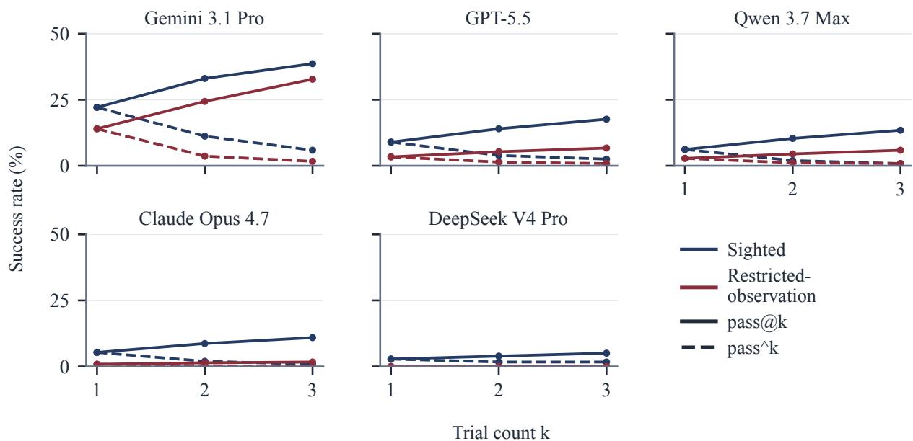  
图 9 随着 $k$ 增加，触达能力与可靠性逐渐分离。图中给出可观测设置下 pass@1 最高的五个模型在 $k = 1, 2, 3$ 时的 pass@k（实线）和 pass^k（虚线），每个案例均基于相同的三次试验计算。

在可观测设置下，Gemini 3.1 Pro 的 pass@k 随 $k = 1, 2, 3$ 从 22.1% 升至 33.1% 和 38.7%，而 pass^3 为 5.9%（图 9）。仅有三次试验，无法据此外推更大尝试预算下的表现。

## D.3 评测集规模

我们在嵌套的 $m$ 个案例子集上重新计算所有指标，每个案例仍保留三次试验（图 10）。在 1,000 个随机案例排序中，Gemini 3.1 Pro 可观测 pass@1 的第 2.5–97.5 百分位范围，从 $m = 10$ 时的 3.3–43.3% 缩小到 $m = 100$ 时的 19.7–24.3%；全部 119 个案例上的结果为 22.1%。pass^3 是最不稳定的指标：$m = 10$ 时，Gemini 的可观测子集有 50.6% 的结果为零，GPT-5.5 则有 75.5%。这些范围描述的是语料内部的变化，不是对新局面的置信区间。

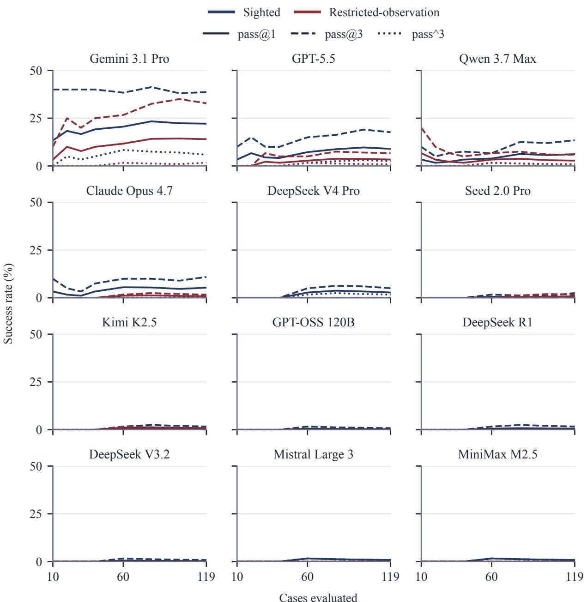  
图 10 嵌套案例子集上的估计值。在同一随机排序下，分别给出 $m =$ 10、20、30、40、60、80、100、119 个案例时的 pass@1（实线）、pass@3（虚线）和 pass^3（点线）；完整集合可复现主要结果。

## E 观测消融

受限观测改变的不只是智能体能看到的信息：它移除了状态刷新和查询命令，也使用了不同的系统提示词（附录 A.3）。为区分这些因素，我们在主要评测后进行了 2 × 2 消融；实验使用正确的将军字段和统一的残局提示词，其规则与着法格式部分均与可观测提示词一致，只有描述观测方式和命令的段落有所变化。两个因素分别是状态刷新（每条消息都附上棋盘、FEN和合法着法）以及查询命令（view\_board、legal\_moves、simulate）。完整组同时启用两项；无查询组只保留状态刷新；无刷新组只保留查询命令；两者皆无组则同时移除两项。没有状态刷新时，棋盘和FEN 只显示一次，后续消息仅报告着法、吃子、将军状态和子力。防守方、预算与计分方式均与主要评测一致。

我们在 Gemini 3.1 Pro 和 GPT-5.5 于可观测设置下至少赢过一次的局面上评测它们，因为未解出的局面在所有实验组中得分都为零：Gemini 的 46 个局面中选取 20 个，按杀棋距离分层并使用固定随机种子抽样；GPT-5.5 的 21 个局面则全部纳入。每个“模型—局面—实验组”单元格进行三次计分试验；因 API 错误而损失的试验会重跑。GPT-5.5 使用的 API 网关与主评测不同，但模型版本相同。由于局面是根据主评测中的胜局选取的，我们只在消融实验内部比较各组。

表 6 观测消融。采用 2×2 设计，分别组合逐步状态刷新与查询命令（view\_board、legal\_moves、simulate）；所有实验组共用一个系统提示词和正确的将军字段。Pass@1 基于每个局面的三次试验；Solved 统计至少赢过一次的局面数；Rej. 表示着法尝试被拒绝的比例；最后三列给出每个智能体回合的查询调用次数。作为参照，主评测在同一批局面上的成绩为：Gemini 3.1 Pro 在可观测和受限观测设置下分别为 51.7% 和 20.0%，GPT-5.5 分别为 50.8% 和 9.5%；由于局面是按可观测设置的胜局选取的，这里的可观测成绩偏高。

<table><tr><td rowspan="2">Arm</td><td colspan="2">Factors</td><td rowspan="2">Pass@1 (%)</td><td rowspan="2">Solved</td><td rowspan="2">Rej. (%)</td><td colspan="3">Queries per turn</td></tr><tr><td>Refresh</td><td>Queries</td><td>View</td><td>Legal</td><td>Sim.</td></tr><tr><td colspan="9">Gemini 3.1 Pro, 20 positions</td></tr><tr><td>Full</td><td>√</td><td>√</td><td>48.3</td><td>17/20</td><td>1.7</td><td>0.00</td><td>0.00</td><td>0.75</td></tr><tr><td>No queries</td><td>√</td><td>✕</td><td>33.3</td><td>11/20</td><td>0.7</td><td>-</td><td>-</td><td>-</td></tr><tr><td>No refresh</td><td>✕</td><td>√</td><td>35.0</td><td>14/20</td><td>4.0</td><td>0.32</td><td>0.19</td><td>1.00</td></tr><tr><td>Neither</td><td>✕</td><td>✕</td><td>41.7</td><td>15/20</td><td>6.9</td><td>-</td><td>-</td><td>-</td></tr><tr><td colspan="9">GPT-5.5, 21 positions</td></tr><tr><td>Full</td><td>√</td><td>√</td><td>39.7</td><td>15/21</td><td>0.3</td><td>0.01</td><td>0.05</td><td>0.98</td></tr><tr><td>No queries</td><td>√</td><td>✕</td><td>25.4</td><td>10/21</td><td>1.9</td><td>-</td><td>-</td><td>-</td></tr><tr><td>No refresh</td><td>✕</td><td>√</td><td>34.9</td><td>13/21</td><td>2.0</td><td>0.38</td><td>0.67</td><td>1.03</td></tr><tr><td>Neither</td><td>✕</td><td>✕</td><td>38.1</td><td>15/21</td><td>3.6</td><td>-</td><td>-</td><td>-</td></tr></table>

下文区间为 95% 案例自助法区间，p 值来自按局面执行的精确符号检验。(i) 移除查询命令会使两个模型的成绩都下降约 15 个百分点（完整组减无查询组：Gemini 下降 15.0 个百分点，[0.0, 30.0]；GPT-5.5 下降 14.3 个百分点，[1.6, 23.8]，$p = 0 . 0 1 3 )$）；智能体失去了它们大多数回合都会使用的模拟功能。(ii) 保留命令但移除状态刷新，会使 Gemini 下降 13.3 个百分点（[0.0, 25.0]，$p = 0.039$），使 GPT-5.5 下降 4.8 个百分点（[−11.1, 19.0]）；两者此时都会查询状态，而在状态刷新的情况下几乎不会这样做。(iii) 两者都移除时，两个模型分别赢下41.7%和 38.1%的试验，与完整组接近（分别相差 6.7 和 1.6个百分点，区间包含零），远高于它们在同一批局面的受限观测设置下取得的 20.0% 和 9.5%。没有状态刷新时，进一步移除命令并不会降低 pass@1，因此 (i) 中的命令效应只在刷新状态时出现；每个局面只有三次试验，我们不进一步解释这一交互作用。因此，第 5 节中受限观测带来的大部分成绩下降，反映的是整个设置（包括提示词和反馈）的影响，而不只是棋盘信息被隐藏。

## F 行为诊断

本节分析均为描述性分析。模型、局面和决策状态同时变化，因此下列对比用于刻画行为，而不能识别其原因。

## F.1 设置与失败类型

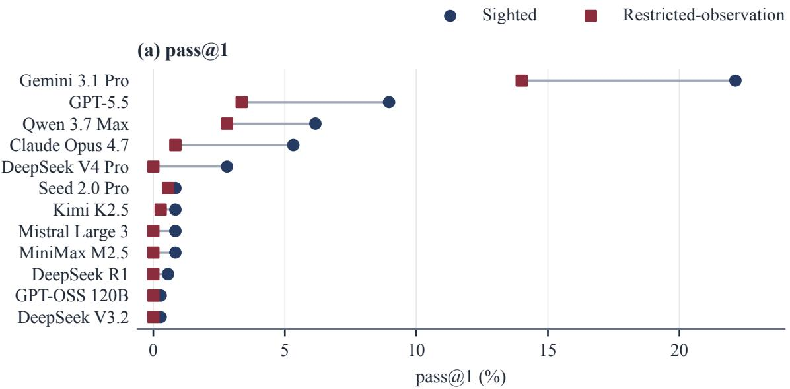

(b) 非法动作/未发命令导致的失败
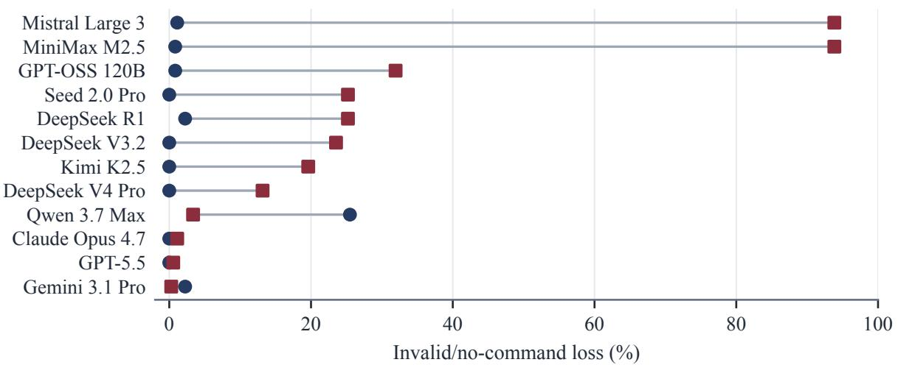  
图 11 设置差异因模型而异。(a) Pass@1；(b) 因非法动作或未发出命令而终止的失败比例；每个模型在每种设置下均基于 357 次试验。

第 6.3 节的图 8 展示对局长度。没有任何胜局会早于记录的杀棋距离结束；失败试验的中位长度在可观测设置下为 6 个半回合，在受限观测设置下为 4 个。多数失败发生在棋盘上（可观测 76.1%，受限 66.0%）。可观测失败试验中有 18.4% 以认输结束（Gemini 3.1 Pro 为 40.3%）；受限观测下这一比例仅为 3.2%，但有 28.2% 以动作弃权结束。Mistral Large 3 和 MiniMax M2.5 在受限观测的 357 次试验中，分别有 310 次和 313 次在走棋前弃权。

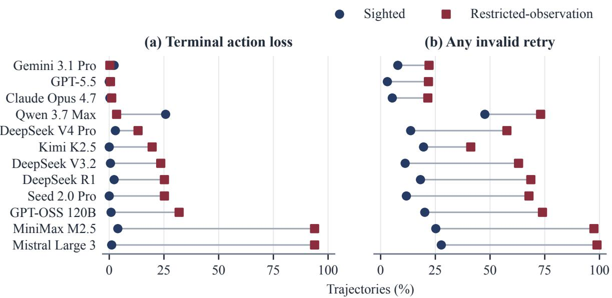  
图 12 动作级失败集中出现在受限观测设置下。左：以动作终止的失败（非法动作、未发命令或超出动作上限）。右：包含任意被拒绝着法的轨迹，这类轨迹之后仍可能恢复。

## F.2 模拟与首着选择

表 7–10 按设置、模型、请求长度和回合模式拆解模拟情况；表 11 则区分终止性动作失败与可恢复的拒绝。GPT-5.5 大多提交单步模拟，而其他几个模型会提交多步着法线。完整着法线合法率随长度下降：单步为 96.3%（2,496/2,592），三至四步为 47.6%（1,110/2,332），五至八步为 37.4%（357/955）；不过，着法线长度、模型和局面同时变化。表 12–15 将首个真实着法与合法着法上的均匀选择基线进行比较；对于在受限观测下经常提前弃权的模型，这些统计仅在首着被接受的轨迹上计算。

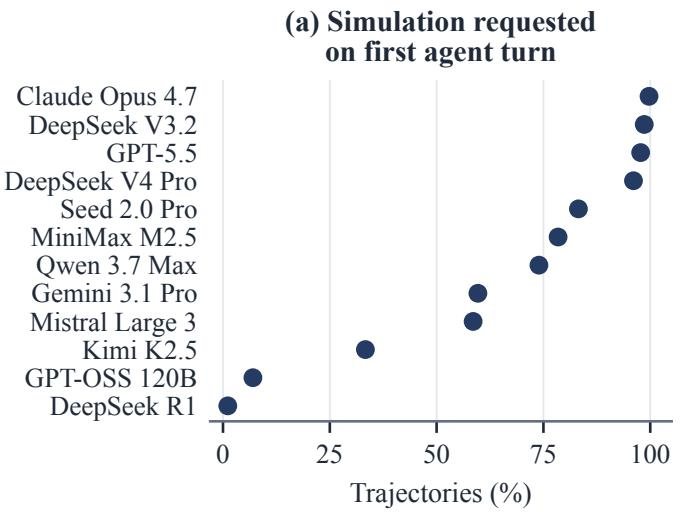

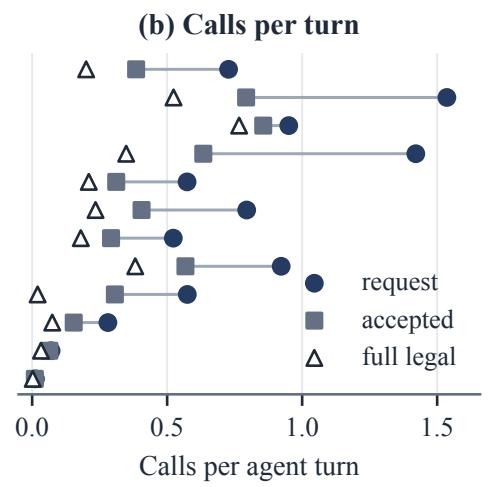  
图 13 各模型的模拟使用情况差异很大。(a) 首回合请求模拟的轨迹数（每个模型 357 条）。(b) 在 15,318 个智能体回合中的每回合模拟请求数、被接受调用数和完整合法着法线数；请求数包括因超预算而被拒绝的调用。

表 7 按协议统计显式模拟的使用情况。所有数值均为轨迹数。行为各行可能重叠；模拟调用被接受不代表整条着法线合法。

<table><tr><td>Trajectory measure</td><td>Sighted</td><td>Restricted-observation</td></tr><tr><td>Trajectory denominator</td><td>4284</td><td>4284</td></tr><tr><td>Requested simulation</td><td>3098</td><td>0</td></tr><tr><td>At least one accepted simulation call</td><td>3098</td><td>0</td></tr><tr><td>At least one full legal requested line</td><td>2155</td><td>0</td></tr><tr><td>At least one mid-line invalid step</td><td>1639</td><td>0</td></tr><tr><td>At least one capped request</td><td>32</td><td>0</td></tr><tr><td>Only budget/protocol rejected</td><td>0</td><td>0</td></tr></table>

表 8 可观测设置下各模型的显式模拟使用情况。Any 和 Full 统计 357 条轨迹中分别至少请求过一次模拟，以及至少有一次原始请求形成完整合法着法线的轨迹数。Accepted 和 Rejected 统计调用数；此处所有拒绝均由预算限制造成。

<table><tr><td>Model</td><td>Any</td><td>Full</td><td>Accepted</td><td>Rejected</td></tr><tr><td>Gemini 3.1 Pro</td><td>332</td><td>299</td><td>1081</td><td>675</td></tr><tr><td>GPT-5.5</td><td>356</td><td>353</td><td>1727</td><td>191</td></tr><tr><td>Qwen 3.7 Max</td><td>290</td><td>188</td><td>360</td><td>284</td></tr><tr><td>Claude Opus 4.7</td><td>357</td><td>241</td><td>595</td><td>529</td></tr><tr><td>DeepSeek V4 Pro</td><td>354</td><td>266</td><td>810</td><td>1006</td></tr><tr><td>Seed 2.0 Pro</td><td>328</td><td>222</td><td>426</td><td>359</td></tr><tr><td>Kimi K2.5</td><td>156</td><td>76</td><td>180</td><td>148</td></tr><tr><td>GPT-OSS 120B</td><td>63</td><td>33</td><td>70</td><td>7</td></tr><tr><td>DeepSeek R1</td><td>8</td><td>2</td><td>9</td><td>2</td></tr><tr><td>DeepSeek V3.2</td><td>352</td><td>292</td><td>890</td><td>835</td></tr><tr><td>Mistral Large 3</td><td>213</td><td>14</td><td>242</td><td>212</td></tr><tr><td>MiniMax M2.5</td><td>289</td><td>169</td><td>359</td><td>345</td></tr></table>

表 9 可观测设置下已接受模拟调用的原始请求长度。长度以半回合计。两个及以上半回合包含模型提供的假设对手应招，而非引擎搜索。由于长度和局面存在差异，不能将合法率解释为规划能力。

<table><tr><td>Model</td><td>Median</td><td>Mean</td><td>1 ply (%)</td><td>≥2 plies (%)</td></tr><tr><td>Gemini 3.1 Pro</td><td>3</td><td>3.57</td><td>12.5</td><td>87.5</td></tr><tr><td>GPT-5.5</td><td>1</td><td>1.52</td><td>71.9</td><td>28.1</td></tr><tr><td>Qwen 3.7 Max</td><td>4</td><td>4.20</td><td>9.2</td><td>90.8</td></tr><tr><td>Claude Opus 4.7</td><td>3</td><td>3.38</td><td>5.5</td><td>94.5</td></tr><tr><td>DeepSeek V4 Pro</td><td>3</td><td>3.12</td><td>27.0</td><td>73.0</td></tr><tr><td>Seed 2.0 Pro</td><td>2</td><td>2.20</td><td>46.7</td><td>53.3</td></tr><tr><td>Kimi K2.5</td><td>3</td><td>3.33</td><td>24.4</td><td>75.6</td></tr><tr><td>GPT-OSS 120B</td><td>1.5</td><td>1.86</td><td>50.0</td><td>50.0</td></tr><tr><td>DeepSeek R1</td><td>3</td><td>3.44</td><td>22.2</td><td>77.8</td></tr><tr><td>DeepSeek V3.2</td><td>2</td><td>1.92</td><td>48.4</td><td>51.6</td></tr><tr><td>Mistral Large 3</td><td>3</td><td>3.93</td><td>3.7</td><td>96.3</td></tr><tr><td>MiniMax M2.5</td><td>1</td><td>1.68</td><td>58.5</td><td>41.5</td></tr></table>

表 10 互斥的智能体回合模式，按显示顺序分配至第一个适用类别。数值为次数（百分比）；可观测和受限观测设置分别包含 15,318 和 12,387 个智能体回合。“恢复”仅表示被拒绝或中止的模拟之后实际走出了一步棋，不代表策略有所改善。“直接执行”表示没有显式调用辅助操作，但不意味着环境没有自动提供状态信息。

<table><tr><td>Turn pattern (priority order)</td><td>Sighted n (%)</td><td>Restricted-observation n (%)</td></tr><tr><td>No executed move</td><td>898 (5.9)</td><td>1,319 (10.6)</td></tr><tr><td>Simulation rejected/aborted, then recovery</td><td>4,386 (28.6)</td><td>0 (0.0)</td></tr><tr><td>Simulate, then adopt tested root</td><td>1,447 (9.4)</td><td>0 (0.0)</td></tr><tr><td>Simulate, then choose different root</td><td>774 (5.1)</td><td>0 (0.0)</td></tr><tr><td>Observe, then move</td><td>234 (1.5)</td><td>15 (0.1)</td></tr><tr><td>Direct execution</td><td>6,988 (45.6)</td><td>10,581 (85.4)</td></tr><tr><td>Other explicit action, then move</td><td>591 (3.9)</td><td>472 (3.8)</td></tr></table>

表 11 互斥的观察到的失败类别。Opponent terminal 汇总其余失败；回放时，这些试验均以攻击方被将死或无子可动结束。类别划分遵循已发布的长将规则（附录 A.5）。

<table><tr><td>Observed failure class</td><td>Sighted</td><td>Restricted-observation</td></tr><tr><td>All observed failures</td><td>4106</td><td>4206</td></tr><tr><td>Invalid-action limit</td><td>12</td><td>1178</td></tr><tr><td>No command/tool call</td><td>105</td><td>6</td></tr><tr><td>Perpetual check by the attacker</td><td>16</td><td>7</td></tr><tr><td>Repetition draw</td><td>39</td><td>56</td></tr><tr><td>Action limit</td><td>25</td><td>0</td></tr><tr><td>Turn cap</td><td>29</td><td>47</td></tr><tr><td>Resignation</td><td>756</td><td>135</td></tr><tr><td>Opponent terminal (attacker cannot move)</td><td>3124</td><td>2777</td></tr></table>

表 12 可观测设置下的根节点动作构成。数值为观察到的百分比（与真实合法根着均匀选择相比的百分点差异）。每个模型的参照集仅包括首着被接受的案例。将军和吃子可以同时发生；quiet 表示两者皆非。这些是动作模式，不是人格标签。

<table><tr><td>Model</td><td>Accepted</td><td>Check</td><td>Capture</td><td>Quiet</td></tr><tr><td>Gemini 3.1 Pro</td><td>353</td><td>95.5 (+84.8)</td><td>25.5 (+18.7)</td><td>4.2 (-80.8)</td></tr><tr><td>GPT-5.5</td><td>357</td><td>95.8 (+85.1)</td><td>25.5 (+18.7)</td><td>3.6 (-81.3)</td></tr><tr><td>Qwen 3.7 Max</td><td>287</td><td>88.9 (+77.9)</td><td>27.2 (+20.3)</td><td>8.7 (-76.0)</td></tr><tr><td>Claude Opus 4.7</td><td>356</td><td>84.6 (+73.8)</td><td>29.8 (+23.0)</td><td>10.7 (-74.3)</td></tr><tr><td>DeepSeek V4 Pro</td><td>350</td><td>81.4 (+70.7)</td><td>27.7 (+21.0)</td><td>14.6 (-70.4)</td></tr><tr><td>Seed 2.0 Pro</td><td>357</td><td>88.0 (+77.2)</td><td>33.3 (+26.6)</td><td>7.3 (-77.7)</td></tr><tr><td>Kimi K2.5</td><td>357</td><td>72.8 (+62.1)</td><td>26.3 (+19.5)</td><td>19.9 (-65.1)</td></tr><tr><td>GPT-OSS 120B</td><td>352</td><td>71.9 (+61.2)</td><td>20.7 (+14.0)</td><td>22.2 (-62.8)</td></tr><tr><td>DeepSeek R1</td><td>352</td><td>51.4 (+40.7)</td><td>34.7 (+27.8)</td><td>34.7 (-50.3)</td></tr><tr><td>DeepSeek V3.2</td><td>355</td><td>70.4 (+59.7)</td><td>41.1 (+34.3)</td><td>15.8 (-69.2)</td></tr><tr><td>Mistral Large 3</td><td>355</td><td>37.5 (+26.7)</td><td>25.6 (+18.8)</td><td>46.5 (-38.5)</td></tr><tr><td>MiniMax M2.5</td><td>344</td><td>34.9 (+24.2)</td><td>27.0 (+20.3)</td><td>52.6 (-32.4)</td></tr></table>

表 13 可观测设置下根节点棋子选择的差异（百分点）。差异相对于相同首着接受案例分布下的合法着法均匀选择计算。Other 包括将帅、士和象。为便于阅读，未显示区间，也未进行多重比较校正。这些探索性对比并非棋子类型专项棋力的证据。

<table><tr><td>Model</td><td>Rook</td><td>Cannon</td><td>Horse</td><td>Pawn</td><td>Other</td></tr><tr><td>Gemini 3.1 Pro</td><td>+10.9</td><td>-22.5</td><td>+3.2</td><td>+10.8</td><td>-2.5</td></tr><tr><td>GPT-5.5</td><td>+16.1</td><td>-17.5</td><td>-5.7</td><td>+8.7</td><td>-1.6</td></tr><tr><td>Qwen 3.7 Max</td><td>+4.7</td><td>-17.8</td><td>+6.2</td><td>+8.8</td><td>-1.9</td></tr><tr><td>Claude Opus 4.7</td><td>+4.7</td><td>-22.2</td><td>+11.2</td><td>+9.3</td><td>-3.0</td></tr><tr><td>DeepSeek V4 Pro</td><td>+11.7</td><td>-21.9</td><td>+7.7</td><td>+4.5</td><td>-1.9</td></tr><tr><td>Seed 2.0 Pro</td><td>+24.2</td><td>-27.3</td><td>-4.0</td><td>+9.9</td><td>-2.7</td></tr><tr><td>Kimi K2.5</td><td>+4.3</td><td>-16.9</td><td>+6.9</td><td>+8.7</td><td>-3.0</td></tr><tr><td>GPT-OSS 120B</td><td>+16.5</td><td>-16.6</td><td>+5.4</td><td>-2.7</td><td>-2.6</td></tr><tr><td>DeepSeek R1</td><td>+17.8</td><td>-22.3</td><td>+2.1</td><td>+3.5</td><td>-1.1</td></tr><tr><td>DeepSeek V3.2</td><td>+11.8</td><td>-21.6</td><td>+2.5</td><td>+9.9</td><td>-2.7</td></tr><tr><td>Mistral Large 3</td><td>+1.7</td><td>-12.0</td><td>+14.7</td><td>-1.6</td><td>-2.8</td></tr><tr><td>MiniMax M2.5</td><td>+12.0</td><td>-25.8</td><td>+11.9</td><td>+3.2</td><td>-1.4</td></tr></table>

表 14 受限观测设置下的根节点动作构成。数值为观察到的百分比（与真实合法根着均匀选择相比的百分点差异）。每个模型的参照集仅包括首着被接受的案例。将军和吃子可以同时发生；quiet 表示两者皆非。这些是动作模式，不是人格标签。

<table><tr><td>Model</td><td>Accepted</td><td>Check</td><td>Capture</td><td>Quiet</td></tr><tr><td>Gemini 3.1 Pro</td><td>356</td><td>82.6 (+71.9)</td><td>26.7 (+19.9)</td><td>10.4 (-74.6)</td></tr><tr><td>GPT-5.5</td><td>357</td><td>72.5 (+61.8)</td><td>37.8 (+31.0)</td><td>13.7 (-71.3)</td></tr><tr><td>Qwen 3.7 Max</td><td>352</td><td>69.9 (+59.1)</td><td>26.7 (+19.9)</td><td>18.8 (-66.2)</td></tr><tr><td>Claude Opus 4.7</td><td>355</td><td>58.9 (+48.1)</td><td>45.1 (+38.3)</td><td>19.7 (-65.2)</td></tr><tr><td>DeepSeek V4 Pro</td><td>341</td><td>43.4 (+32.7)</td><td>36.1 (+29.3)</td><td>34.0 (-50.9)</td></tr><tr><td>Seed 2.0 Pro</td><td>334</td><td>55.7 (+45.0)</td><td>35.3 (+28.7)</td><td>32.0 (-53.0)</td></tr><tr><td>Kimi K2.5</td><td>340</td><td>52.1 (+41.4)</td><td>46.5 (+39.6)</td><td>25.3 (-59.7)</td></tr><tr><td>GPT-OSS 120B</td><td>320</td><td>61.3 (+50.7)</td><td>41.9 (+35.0)</td><td>24.1 (-61.0)</td></tr><tr><td>DeepSeek R1</td><td>325</td><td>51.7 (+40.8)</td><td>42.5 (+35.7)</td><td>28.3 (-56.5)</td></tr><tr><td>DeepSeek V3.2</td><td>303</td><td>36.0 (+25.3)</td><td>29.4 (+22.9)</td><td>50.2 (-35.1)</td></tr><tr><td>Mistral Large 3</td><td>47</td><td>12.8 (+5.1)</td><td>0.0 (-3.7)</td><td>87.2 (-2.7)</td></tr><tr><td>MiniMax M2.5</td><td>44</td><td>27.3 (+18.9)</td><td>4.5 (-0.5)</td><td>72.7 (-15.7)</td></tr></table>

表 15 受限观测设置下根节点棋子选择的差异（百分点）。差异相对于相同首着接受案例分布下的合法着法均匀选择计算。Other 包括将帅、士和象。为便于阅读，未显示区间，也未进行多重比较校正。这些探索性对比并非棋子类型专项棋力的证据。

<table><tr><td>Model</td><td>Rook</td><td>Cannon</td><td>Horse</td><td>Pawn</td><td>Other</td></tr><tr><td>Gemini 3.1 Pro</td><td>+11.4</td><td>-19.4</td><td>+2.5</td><td>+7.6</td><td>-2.2</td></tr><tr><td>GPT-5.5</td><td>+11.6</td><td>-17.5</td><td>-1.2</td><td>+8.2</td><td>-1.1</td></tr><tr><td>Qwen 3.7 Max</td><td>+0.5</td><td>-15.5</td><td>+5.2</td><td>+9.2</td><td>+0.6</td></tr><tr><td>Claude Opus 4.7</td><td>+5.4</td><td>-27.8</td><td>+10.4</td><td>+13.0</td><td>-1.1</td></tr><tr><td>DeepSeek V4 Pro</td><td>+7.7</td><td>-19.5</td><td>+4.4</td><td>+6.3</td><td>+1.1</td></tr><tr><td>Seed 2.0 Pro</td><td>+18.7</td><td>-16.1</td><td>-6.8</td><td>+7.0</td><td>-2.8</td></tr><tr><td>Kimi K2.5</td><td>+4.9</td><td>-21.5</td><td>+4.3</td><td>+13.8</td><td>-1.6</td></tr><tr><td>GPT-OSS 120B</td><td>+18.9</td><td>-24.1</td><td>-0.5</td><td>+7.6</td><td>-1.8</td></tr><tr><td>DeepSeek R1</td><td>+25.2</td><td>-25.6</td><td>-1.3</td><td>+2.8</td><td>-1.1</td></tr><tr><td>DeepSeek V3.2</td><td>+7.0</td><td>-22.6</td><td>+8.4</td><td>+2.4</td><td>+4.8</td></tr><tr><td>Mistral Large 3</td><td>-2.3</td><td>+5.9</td><td>-5.5</td><td>+3.9</td><td>-1.9</td></tr><tr><td>MiniMax M2.5</td><td>+1.2</td><td>-4.4</td><td>-1.0</td><td>+2.2</td><td>+2.0</td></tr></table>

## F.3 按设置、结果和模型划分的 REPL 调用构成

图 14–17 按设置和结果绘制图 6 中的调用构成，并分别展示可观测设置下胜局最多的四个模型，以及每种设置下的所有模型；环境自动生成的弃权记录不纳入其中。

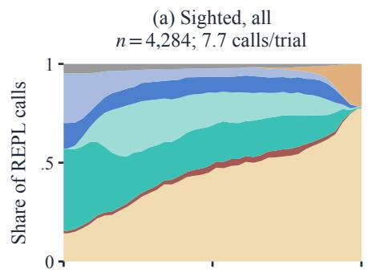  
(d) 受限观测，全部试验 n = 4,284；每次试验 4.2 次调用
(b) 可观测，成功试验 n = 178；每次试验 9.8 次调用

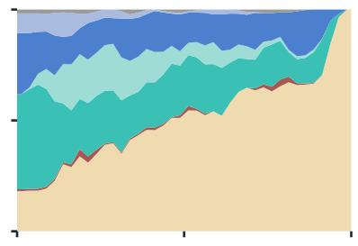  
(c) 可观测，失败试验 n = 4,106；每次试验 7.6 次调用

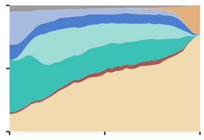

(e) 受限观测，成功试验 n = 78；每次试验 5.6 次调用
(f) 受限观测，失败试验 n = 4,206；每次试验 4.2 次调用
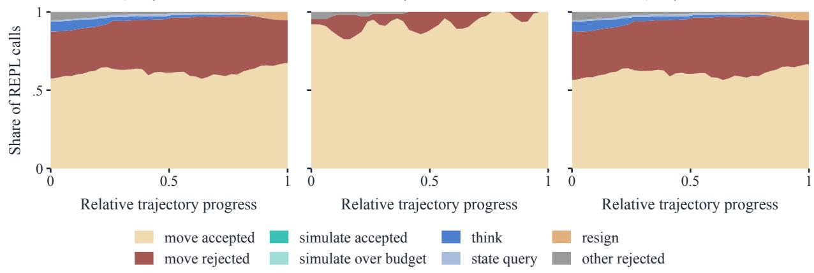  
图 14 汇总全部 12 个模型，按设置和结果划分的 REPL 调用构成。各列依次表示全部、成功和失败试验。

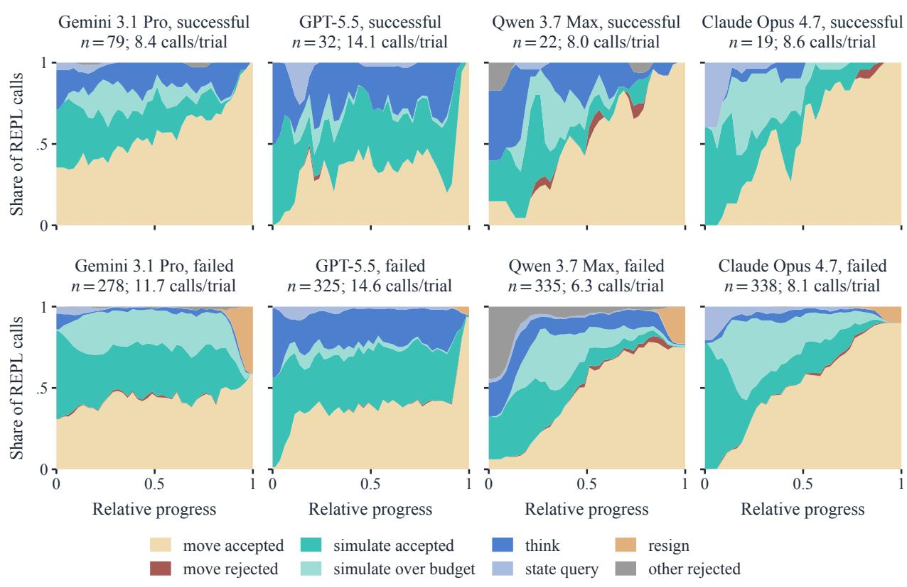  
图 15 胜局最多的四个模型在可观测设置下按结果划分的 REPL 调用构成。成功面板包含 19–79 次试验。

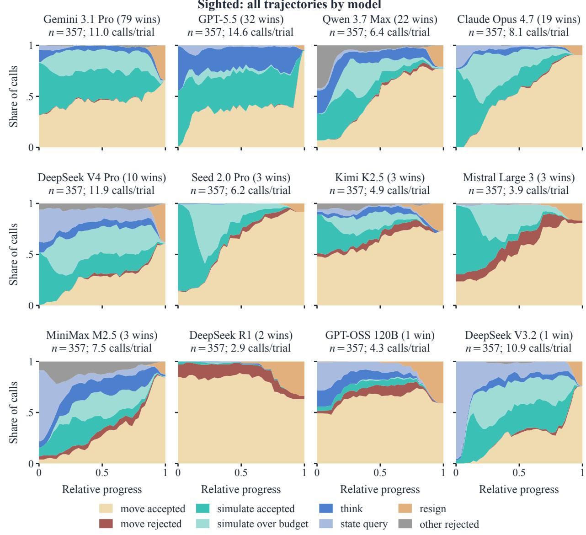  
图 16 每个模型在可观测设置全部 357 次试验中的 REPL 调用构成。

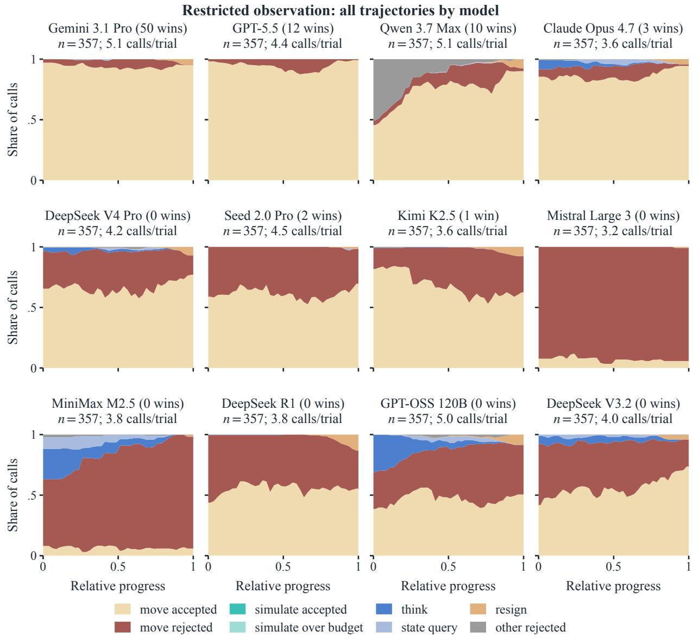  
图 17 每个模型在受限观测设置全部 357 次试验中的 REPL 调用构成。此处的状态查询是 get\_history 调用，也是唯一可用的查询。

## F.4 反馈与错误恢复

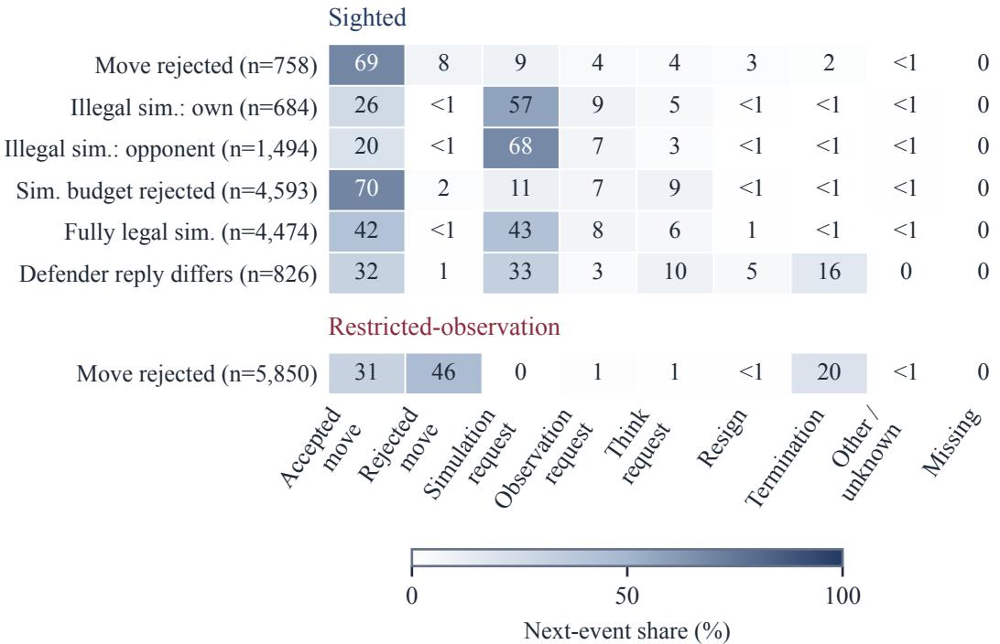  
图 18 遇到指定反馈事件后的下一步动作。每行以一个事件为条件，展示同一回合内的下一次交互；防守方应招不匹配一行展示真实应招后的下一次决策。请求数包含被拒绝的请求，百分比已四舍五入。

图 18 展示智能体如何响应反馈。对于错误恢复（图 19），若规则回放确认同一回合接下来的 1、2 或 3 次动作交互内出现合法真实着法，则将一次被拒绝的真实着法记为已恢复；读取、模拟和 think 调用也占用窗口位置，而认输与弃权会阻止恢复。在可观测设置下，758 次拒绝中有 69.4%、83.1% 和 87.9% 分别在 1、2 和 3 次交互内恢复；在受限观测设置下，5,850 次拒绝中有 31.2%、38.6% 和 38.9% 得到恢复（3 次交互内恢复率区间分别为 [84.6, 90.9]% 和 [36.0, 42.1]%）。受限观测总数主要由 Mistral Large 3 和 MiniMax M2.5 贡献，它们分别造成 1,052 次和 1,049 次拒绝，仅恢复其中的 4.3% 和 4.6%。四个最强模型在两种设置下的恢复率均至少为 88%（Gemini 3.1 Pro：可观测 90.0%、受限 95.8%；GPT-5.5：100% 和 93.3%；Claude Opus 4.7：100% 和 88.1%；Qwen 3.7 Max：96.4% 和 91.0%），不过每个模型在可观测设置下都只有 11–28 次拒绝。

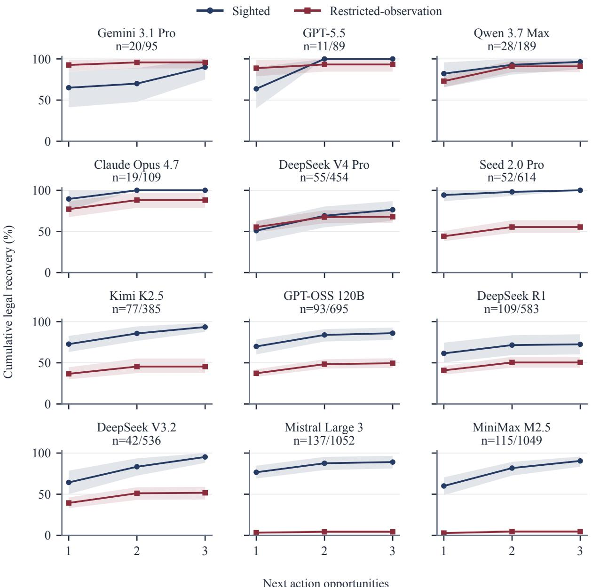  
图 19 按模型统计被拒绝着法后的恢复情况。累计比例表示同一回合内，下一次、两次或三次动作交互之后出现合法真实着法的被拒绝着法；n 表示可观测/受限观测设置下的拒绝次数。阴影表示 95% 案例自助法区间（重采样 1,000 次）。

## F.5 棋子构成

图 20 和表 16–18 按初始进攻方子力对案例分组。棋子存在性分组可以重叠，组合分组则互斥；首着棋子计数反映棋子是否可用以及轨迹长度，而非棋子偏好。

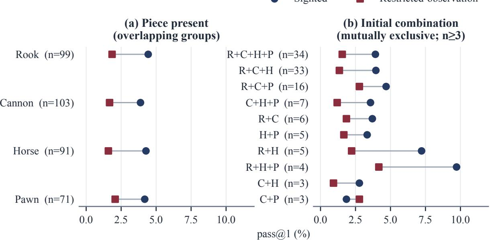  
图 20 按初始进攻方棋子划分的结果。左：按是否存在车、炮、马和兵划分的重叠分组。右：包含至少三个案例的互斥棋子组合。标签表示案例数；散点汇总 12 个模型和每个案例的三次试验。

表 16 按初始红方棋子是否存在统计到达率。各行之间有重叠，不能相加。局面结构和难度会混淆比较结果；这些并非棋子造成的因果效应。

<table><tr><td>Initial red piece</td><td>Cases</td><td>Sighted pass/traj.</td><td>Restricted-observation pass/traj.</td></tr><tr><td>Rook</td><td>99</td><td>158/3564</td><td>66/3564</td></tr><tr><td>Cannon</td><td>103</td><td>144/3708</td><td>62/3708</td></tr><tr><td>Horse</td><td>91</td><td>140/3276</td><td>52/3276</td></tr><tr><td>Pawn</td><td>71</td><td>107/2556</td><td>53/2556</td></tr></table>

表 17 互斥的初始红方棋子组合。保留少于五个案例的分组是为了完整覆盖，而非用于模型排名。

<table><tr><td>Combination</td><td>Cases</td></tr><tr><td>rook+cannon+horse+pawn</td><td>34</td></tr><tr><td>rook+cannon+horse</td><td>33</td></tr><tr><td>rook+cannon+pawn</td><td>16</td></tr><tr><td>cannon+horse+pawn</td><td>7</td></tr><tr><td>rook+cannon</td><td>6</td></tr><tr><td>horse+pawn</td><td>5</td></tr><tr><td>rook+horse</td><td>5</td></tr><tr><td>rook+horse+pawn</td><td>4</td></tr><tr><td>cannon+horse</td><td>3</td></tr><tr><td>cannon+pawn</td><td>3</td></tr><tr><td>cannon</td><td>1</td></tr><tr><td>pawn</td><td>1</td></tr><tr><td>rook+pawn</td><td>1</td></tr></table>

表 18 每种设置下 4,284 条轨迹中，智能体首个被接受的非合成着法所用棋子类型。Other 包括将帅、士和象；Unknown 表示无法解析反馈。这表示动作构成，不代表不受局面影响的偏好。

<table><tr><td>First moved piece</td><td>Sighted</td><td>Restricted-observation</td></tr><tr><td>Rook</td><td>2032</td><td>1665</td></tr><tr><td>Cannon</td><td>705</td><td>588</td></tr><tr><td>Horse</td><td>851</td><td>608</td></tr><tr><td>Pawn</td><td>556</td><td>525</td></tr><tr><td>Other</td><td>31</td><td>88</td></tr><tr><td>Unknown</td><td>0</td><td>0</td></tr><tr><td>No Accepted First Move</td><td>109</td><td>810</td></tr></table>

## G 代表性轨迹

以下示例依据对保留轨迹采用的固定确定性规则选出。它们用于说明对局如何展开，并非对模型倾向的估计。

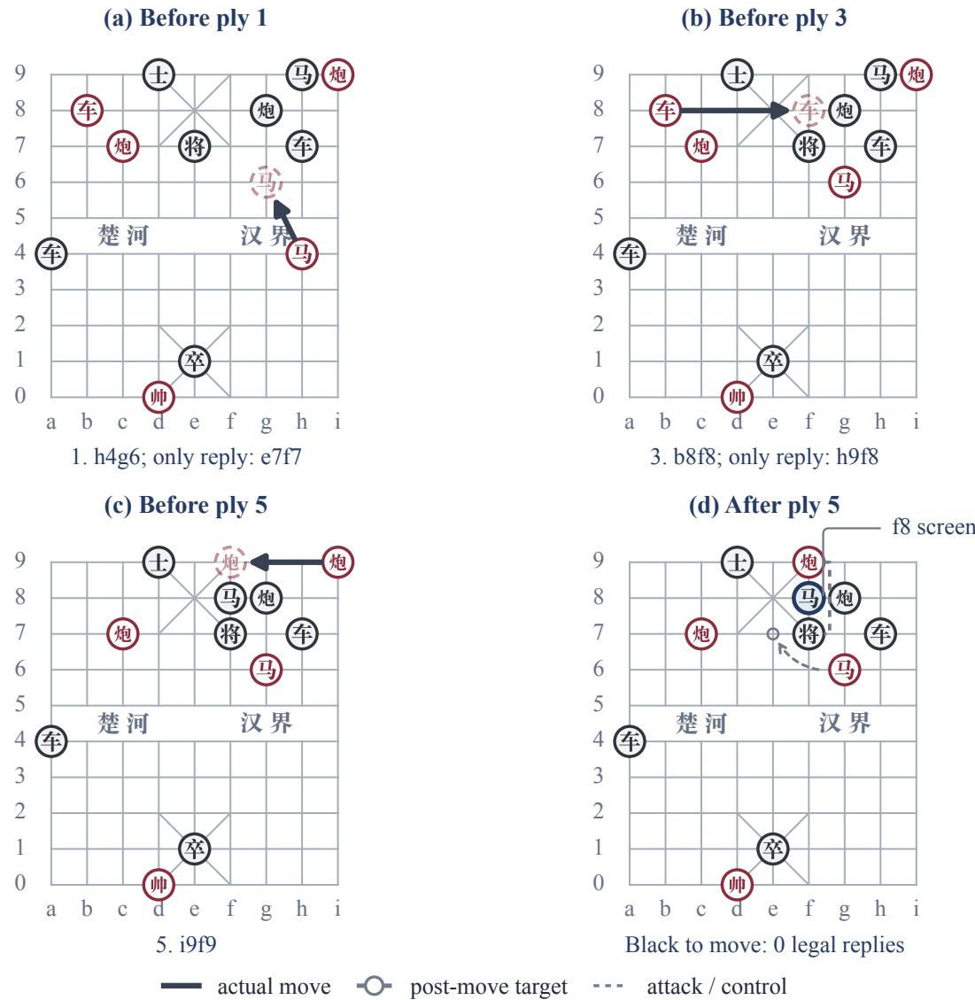  
图 21 SQYQ-251 上的强制杀棋。面板 A–C 展示红方三步棋之前的真实局面（实线箭头表示实际走出的着法；虚线轮廓表示目标位置）。黑方的应招 e7f7 和 h9f8 均为强制着法。面板 D 展示最终局面：f9 上的炮隔着 f8 上的黑马完成将死，g6 上的红马控制 e7。存档反馈将该终局标记为无子可动；规则回放确认实际为将死。

SQYQ-251：两条通往同一杀棋的路线。解法为五个半回合的强制杀棋（图 21）。走出 h4g6 后，红马控制 e7 并保护 f8。弃车 b8f8 迫使黑方走 h9f8；吃子的黑马打开了从 i9 出发的炮路，并成为 i9f9 的炮架。Qwen 3.7 Max（可观测，试验 2）陈述了这一计划，在第一次决策时模拟完整着法线 h4g6 e7f7 b8f8 h9f8 i9f9，真实对局也完全按此展开。Gemini 3.1 Pro（可观测，试验 3；图 1）则在看到防守方第一次应招后才模拟，并在第二次决策时检查 b8f8 h9f8 i9f9，然后实际走出该着法。同一局面中，DeepSeek V4 Pro 走到前缀 h4g6 e7f7 后选择 b8e8，并称该着是将军。事实并非如此；黑方应以 h7h0 并将死红方。根据规则可以验证这一错误判断，但我们并未将 b8e8 确定为

引擎判定的败着。

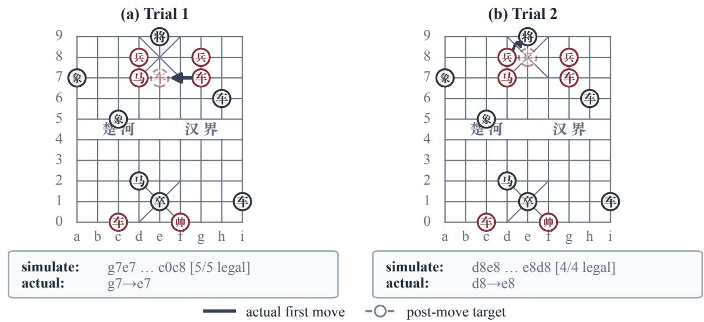  
图 22 相同模型和局面，不同首着。Gemini 3.1 Pro 在 SQYQ-012 上的两次可观测试验。试验 1 模拟了一条合法的五个半回合着法线，走出 g7e7 并获胜；试验 2 模拟了一条合法的四个半回合着法线，走出 d8e8 后认输。实线箭头标示首着，虚线轮廓标示目标位置。

SQYQ-012：着法线都合法，结果却不同。Gemini 3.1 Pro 的两次试验都在走棋前模拟了完全合法的着法线（图 22）。试验 1 检查 g7e7 c5e7 d8e8 e9e8 c0c8，走出 g7e7，之后通过 d8e8 和 d7b8 获胜；试验 2 检查 d8e8 e9e8 g8f8 e8d8，走出 d8e8，最终认输。模拟着法线的合法性无法解释这两种不同结果。

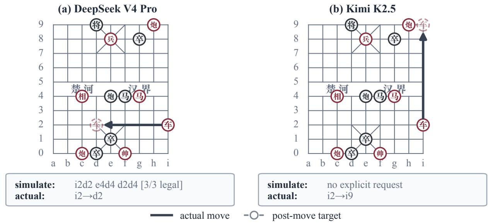  
图 23 JH-327 上从同一局面出发的不同模型。共同走出前缀 h2h9 g9g8 后，DeepSeek V4 Pro（试验 3）模拟了完全合法的三步着法线，并走出 i2d2（获胜）；Kimi K2.5（试验 2）没有模拟，直接走出 i2i9（落败）。箭头和轮廓的含义同图 22；模拟细节见各面板。

JH-327：同一局面，不同模型。从完全相同的第二次决策开始，进行了模拟的模型获胜，而没有模拟的模型落败（图 23）。仅凭这一对案例无法将结果归因于模拟；

表 19 列出了选取的对比案例。

表 19 按固定规则选取的同案例轨迹对比。C1：同一案例中模型间成功率差距最大；C2：相同模型和首着，但结果不同；C3：受限观测下非法动作导致的失败及其同伴对比；C4：首回合显式使用工具与未使用工具；C5：回合内从被拒绝着法中恢复与未发生拒绝；C6：首个移动棋子不同且结果不同。Trial k 表示某个“模型—案例—设置”单元格中的第 $k$ 次（共三次）试验。Root move 是保存的参考首着；Played 最多列出智能体实际走出的四步棋。B/L 统计成功/尝试的显式棋盘和合法着法调用；S 统计被接受/尝试的模拟调用数，而非完全合法的着法线。终局原因依据附录 A.5 的规则回放确定。这些有意选取的示例不用于估计代表性效应或内部推理。

<table><tr><td>Contrast; model; setting</td><td>Root move; agent moves</td><td>Outcome; actions</td></tr><tr><td>C1a JH-084</td><td>Root move: g5g9.</td><td>Pass; checkmate.</td></tr><tr><td>Gemini 3.1 Pro, trial 1 Sighted</td><td>Played: g5g9, h5h9</td><td>Invalid: 0. B/L/S: 0/0, 0/0, 0/0.</td></tr><tr><td>C1b JH-084</td><td>Root move: g5g9.</td><td>Fail; resignation.</td></tr><tr><td>GPT-OSS 120B, trial 1 Sighted</td><td>Played: g5d5, e0d0, d0e0, e0d0, ...</td><td>Invalid: 3. B/L/S: 1/1, 1/1, 0/0.</td></tr><tr><td>C2a SQYQ-066</td><td>Root move: g8g9.</td><td>Pass; checkmate.</td></tr><tr><td>Gemini 3.1 Pro, trial 2 Sighted</td><td>Played: g8g9, d8e8, g9g8, i5g6, ...</td><td>Invalid: 0. B/L/S: 0/0, 0/0, 4/7.</td></tr><tr><td>C2b SQYQ-066</td><td>Root move: g8g9.</td><td>Fail; attacker checkmated.</td></tr><tr><td>Gemini 3.1 Pro, trial 1 Sighted</td><td>Played: g8g9, d8d9, g9g8, i5g6, ...</td><td>Invalid: 0. B/L/S: 0/0, 0/0, 8/18.</td></tr><tr><td>C3a SQYQ-062</td><td>Root move: f8e8.</td><td>Fail; invalid-action limit.</td></tr><tr><td>DeepSeek R1, trial 2 Restricted observation</td><td>Played: a5e5, e5e8, b8c6</td><td>Invalid: 5. B/L/S: 0/0, 0/0, 0/0.</td></tr><tr><td>C3b SQYQ-062</td><td>Root move: f8e8.</td><td>Fail; attacker checkmated.</td></tr><tr><td>Gemini 3.1 Pro, trial 1 Restricted observation</td><td>Played: c8c9, a5e5, e2g0</td><td>Invalid: 1. B/L/S: 0/0, 0/0, 0/0.</td></tr><tr><td>C4a JH-327</td><td>Root move: h2h9.</td><td>Pass; checkmate.</td></tr><tr><td>DeepSeek V4 Pro, trial 3 Sighted</td><td>Played: h2h9, i2d2, d2d4, d4d5</td><td>Invalid: 0. B/L/S: 1/1, 1/1, 2/3.</td></tr><tr><td>C4b JH-327</td><td>Root move: h2h9.</td><td>Fail; attacker checkmated.</td></tr><tr><td>Kimi K2.5, trial 2 Sighted</td><td>Played: h2h9, i2i9</td><td>Invalid: 0. B/L/S: 0/0, 0/0, 0/0.</td></tr><tr><td>C5a SQYQ-098</td><td>Root move: b2b9.</td><td>Pass; defender perpetual check.</td></tr><tr><td>Qwen 3.7 Max, trial 2 Restricted observation</td><td>Played: b2b9, g7g8, d0d1, d1d2, ...</td><td>Invalid: 5. B/L/S: 0/0, 0/0, 0/0.</td></tr><tr><td>C5b SQYQ-098</td><td>Root move: b2b9.</td><td>Pass; checkmate.</td></tr><tr><td>Gemini 3.1 Pro, trial 2 Restricted observation</td><td>Played: b2b9, h6h9, g7g8, h9f9, ...</td><td>Invalid: 0. B/L/S: 0/0, 0/0, 0/0.</td></tr><tr><td>C6a SQYQ-012</td><td>Root move: g7e7.</td><td>Pass; checkmate.</td></tr><tr><td>Gemini 3.1 Pro, trial 1 Sighted</td><td>Played: g7e7, d8e8, d7b8</td><td>Invalid: 0. B/L/S: 0/0, 0/0, 1/1.</td></tr><tr><td>C6b SQYQ-012</td><td>Root move: g7e7.</td><td>Fail; resignation.</td></tr><tr><td>Gemini 3.1 Pro, trial 2 Sighted</td><td>Played: d8e8, d7c9, g8f8, f8e8, ...</td><td>Invalid: 1. B/L/S: 0/0, 0/0, 6/10.</td></tr></table>
